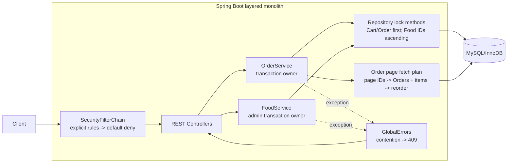
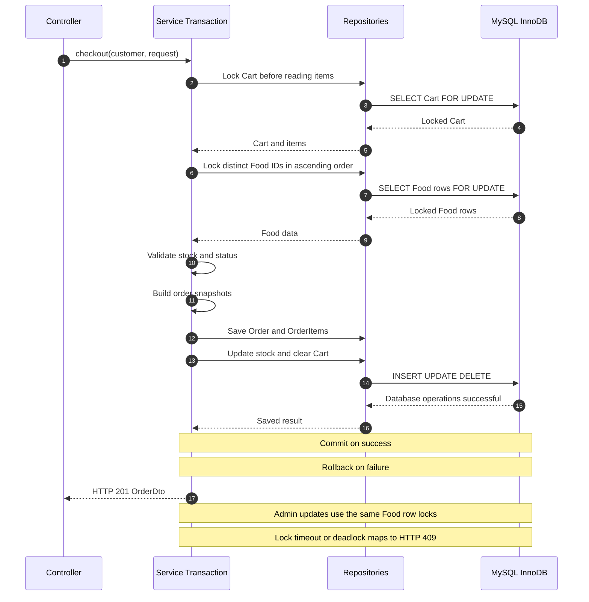
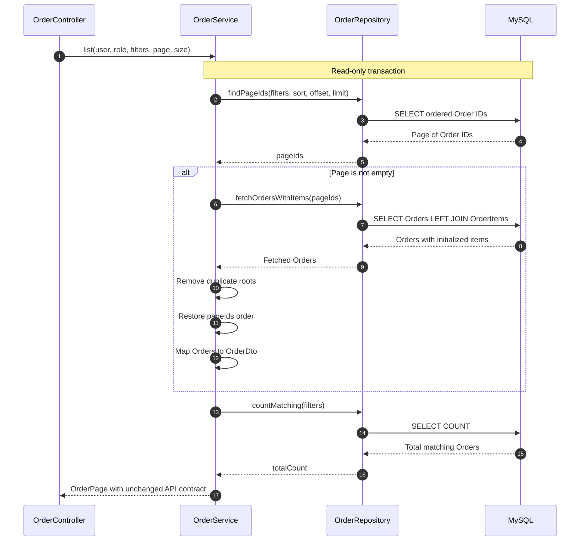
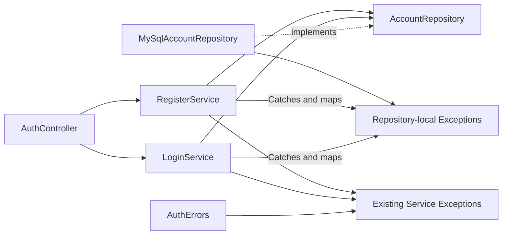
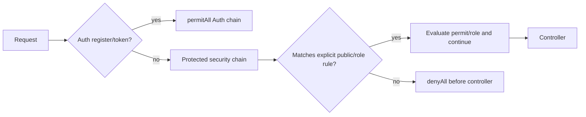

# ByteMe Phase 2 — Architecture Decisions

Ngày lập: 2026-11-22; cập nhật G4-C/G4-D ngày 2026-11-23. Tài liệu gồm **G3.1–G3.5**: tổng hợp bằng chứng G1–G2, ưu tiên vấn đề, xác định phạm vi, so sánh giải pháp, đề xuất kiến trúc To-Be và lập implementation plan để review trước G4. Các lựa chọn kỹ thuật ở G3.3–G3.4 mang trạng thái **PROPOSED**; các plan G3.5 mang trạng thái **PENDING_TEAM_APPROVAL** và chưa cấp quyền sửa application code.

## G3.1 — Tổng hợp và ưu tiên architecture findings

### 1. Cơ sở quyết định

Nguồn chính là [System Assessment](01_SYSTEM_ASSESSMENT.md), [Baseline & Benchmark](02_BASELINE_BENCHMARK.md) và official [BEFORE Intel aggregation](evidence/g2.5/2026-11-21/before-baseline-intel.md)/[JSON](evidence/g2.5/2026-11-21/before-baseline-intel.json). Source chỉ được dùng ở G1–G2 để giải thích transaction/query path; G3 không audit lại source.

Quy ước trong G3:

- **CONFIRMED**: đã có runtime evidence tái hiện issue hoặc có static evidence trực tiếp cho đặc tính kiến trúc được nêu.
- **RISK — UNVERIFIED**: đã thấy plan/behavior hoặc design exposure, nhưng chưa có bằng chứng đủ để kết luận impact đối với quality attribute.
- **DEFERRED**: có thể là issue thật, nhưng không nằm trong các lát cải tiến nhỏ nhất có giá trị đo được cho nhóm hai người.
- Số latency đơn lẻ của G2.3 chỉ là diagnostic; số BEFORE chính thức dùng cho so sánh hiệu năng là median của ba run Intel đã khóa ở G2.5.

Baseline chính thức đã khóa ở application SHA `510f6415b6af535ceec77213f0b0c7d5082123f7`, nhóm `kaggle-intel-xeon`, ba run hợp lệ. AFTER phải qua cùng manifest comparator; không gộp run AMD vào nhóm Intel. Mục tiêu năm run chưa đạt là stretch target, không chặn baseline tối thiểu ba run.

### 2. Findings register đã ưu tiên

| ID | Ưu tiên | Phân loại | Finding và bằng chứng | Quyết định phạm vi |
|---|---|---|---|---|
| AF-01 | **P0** | **CONFIRMED DEFECT** | Admin gán stock tuyệt đối đồng thời checkout làm mất cập nhật dù cả hai request báo thành công: G2.3 sai invariant **12/15** round; official W3 lặp lại **37/45** round trên cả 3 run Intel. | Đưa vào cải tiến G4-A; đây là bằng chứng mạnh và lặp lại nhất về consistency. |
| AF-02 | **P0** | **CONFIRMED DEFECT** | Hai cart khác nhau checkout cùng food gây oversell/lost update **6/15** round trong G2.3: 14 đơn vị được commit từ stock 10, final stock 3. Official W3 không tái hiện ở **0/45**, nên kết quả đó là regression observation chứ không phủ định defect đã tái hiện. | Đưa vào cùng G4-A vì dùng chung inventory transaction boundary; phải giữ rõ khác biệt giữa hai protocol. |
| AF-03 | **P0** | **CONFIRMED DEFECT** | Order list phát sinh N+1: page size 1/5/20/50 tạo **4/8/23/53 SELECT**, tức `N+3`. Official W1 cũng ghi median **18,020** item SELECT cho khoảng **901** order-list request, tương ứng 20 item SELECT/request. | Đưa vào cải tiến G4-B; phạm vi hẹp, đo được và tách tương đối độc lập với G4-A. |
| AF-04 | **P1 guard** | **CONFIRMED symptom / correctness INCONCLUSIVE** | Same-cart checkout giữ đúng final data trong 15/15 round G2.3 nhưng loser có **2 HTTP 500**; official W3 có **1 server-error round/45**. Chưa có double order, nhưng conflict/error semantics chưa ổn định. | Không mở thành cải tiến thứ ba; G4-A phải có regression guard “không 5xx, tối đa một consumption/order”. Exact client-conflict contract cần review trước khi code. |
| AF-05 | **P2** | **RISK — UNVERIFIED** | Food search scan 5,000 rows với `LOWER(...) LIKE '%needle%'`; official W1 cho food search p95 **31.121 ms**, p99 **38.731 ms**, 0 error ở tải khóa 5 RPS. Plan bất lợi đã xác nhận nhưng user-visible severity/SLO violation chưa có. | **DEFERRED**; không tự động thêm index/search engine/cache trong G4. Chỉ nâng scope nếu workload/cardinality đại diện chứng minh impact. |
| AF-06 | **P2** | **RISK — UNVERIFIED** | Order filter/count dùng owner index rồi filter/sort, chưa có composite filter/sort index. G2.3 plan chỉ khoảng 0.459 ms ở 239 order của owner; performance severity được kết luận inconclusive. | **DEFERRED**; không gộp với N+1 để tránh thay nhiều biến cùng lúc. |
| AF-07 | **P1** | **CONFIRMED design issue / impact runtime chưa đo** | Package cycle `service ↔ repository` do `MySqlAccountRepository` import hai service exceptions; ArchitectureTest chưa cấm hướng dependency hoặc package cycle. DTO/entity coupling và `OrderService` hotspot cũng tồn tại nhưng chưa có change-cost evidence. | Đưa phần cycle hẹp vào G4-C với ArchUnit BEFORE/AFTER; tiếp tục **DEFERRED** DTO/entity, `OrderService` và package/module redesign. |
| AF-08 | — | **OBSERVED CORRECT trong protocol đã chạy** | Same-order cancellation không double-release stock 15/15; first-cart race giữ đúng một cart/item 15/15. Đây không phải bằng chứng tuyệt đối về mọi interleaving. | Không coi là defect cần sửa; giữ làm regression scenarios nếu code G4 chạm logic liên quan. |
| AF-09 | — | **NO JUSTIFICATION** | Layered monolith hiện phù hợp một nhà hàng, một deployable, nhóm hai người; G1–G2 không có evidence yêu cầu scale-out hoặc microservices. | **DEFERRED/REJECTED FOR G4**: không phân rã service, không thêm broker/distributed cache. |
| AF-10 | **P1** | **CONFIRMED policy exposure / chưa có production exploit** | G1 `SEC2-03` xác định protected chain kết thúc bằng `.anyRequest().authenticated()`: endpoint mới quên matcher vẫn mở cho mọi role đã đăng nhập. 18 endpoint hiện tại đã có matcher cụ thể; `TEST-06` xác nhận chưa có fail-closed route-registration test. `AuthIntegrationTest` còn có test-only route ngoài matcher đang dựa vào fallback này. | Đưa phạm vi hẹp vào G4-D: terminal `denyAll`, role matrix 18/18 và synthetic-unlisted-route test. Không mở rộng sang key rotation, audit logging hoặc endpoint/business change. |

### 3. Kết luận G3.1

Năm finding đủ bằng chứng cho bốn phạm vi hẹp là AF-01, AF-02, AF-03, phần dependency cycle của AF-07 và authorization exposure AF-10. AF-01/AF-02 cùng thuộc G4-A; AF-03 thành G4-B; AF-07 chỉ mở G4-C cho cycle/gates; AF-10 thành G4-D fail-closed boundary. AF-04 là acceptance guard. AF-05/AF-06 và phần DTO/entity/`OrderService` của AF-07 tiếp tục deferred; AF-08 không cần remediation; AF-09 không có căn cứ mở rộng topology.

## G3.2 — Phạm vi cải tiến và tiêu chí dự kiến cho G4

### 1. Nguyên tắc chia scope cho các workstream

| Workstream | Owner đề xuất | Mục tiêu | Ranh giới chính |
|---|---|---|---|
| **G4-A — Inventory transaction/concurrency consistency** | Nguyễn Văn Huy Hoàng | Làm checkout và admin stock update cho kết quả tương đương một thứ tự tuần tự hợp lệ; không oversell/lost update; conflict không thành 5xx. | Food stock mutation, checkout/admin update transaction path, concurrency tests và W3 AFTER. Không mở rộng sang distributed transaction hay idempotency toàn API. |
| **G4-B — Order-list data access efficiency** | Bùi Công Huy | Loại query amplification phụ thuộc page size trong order list mà không đổi API behavior. | Order-list repository/mapping path, query-count tests và W1 AFTER. Không tối ưu food search, filter index, cache hay detail endpoint nếu không cần. |
| **G4-C — Dependency boundaries** | Bùi Công Huy | Loại cycle `service ↔ repository`, ngăn dependency ngược tái diễn và giữ Auth behavior. | Auth repository/service exception boundary và ArchUnit. Không refactor `OrderService`, DTO/entity, common error policy hay module structure. |
| **G4-D — Fail-closed authorization boundary** | Nguyễn Văn Huy Hoàng | Loại authenticated fallback cho route chưa khai báo, giữ nguyên policy của 18 endpoint hiện hữu. | Terminal authorization rule, role-matrix/synthetic-route tests. Không thêm endpoint production hoặc mở sang security concerns khác. |
| **Shared integration** | Cả hai | Giữ contract, regression suite và BEFORE/AFTER comparability. | Review chéo, merge A → B → C → D, chạy full gate sau khi bốn lát độc lập đạt targeted gate. |

G3.3 so sánh và đề xuất kỹ thuật theo correctness, contention/query behavior, migration risk và testability. Đề xuất chỉ chuyển từ `PROPOSED` sang `ACCEPTED` sau design review đầu G4.

### 2. G4-A — Inventory transaction/concurrency consistency

#### Quality attribute scenarios

| QAS | Source / stimulus / environment | Artifact & response mong đợi | Response measure |
|---|---|---|---|
| **QAS-A1: concurrent checkout cùng food** | Hai customer có cart độc lập cùng checkout số lượng mà tổng demand vượt stock; request overlap trong MySQL thật. | Inventory/order/cart transaction path chỉ commit các order hợp lệ; stock không âm, committed quantity không vượt stock ban đầu, loser không làm mất/clear cart sai. | **0** oversell/lost-update invariant violation; **0** HTTP 5xx; final DB state thỏa invariant ở mọi round. |
| **QAS-A2: admin stock update vs checkout** | Admin gán stock tuyệt đối đồng thời customer checkout cùng food; hai request overlap. | Kết quả tương đương một trong hai thứ tự tuần tự hợp lệ, hoặc một request nhận conflict rõ ràng; không được cả hai success nhưng final stock ngoài tập outcome hợp lệ. | **0** non-serializable invariant violation; **0** HTTP 5xx; mọi success response tương ứng committed state. |
| **QAS-A3: same-cart duplicate checkout guard** | Hai checkout đồng thời trên cùng cart. | Tối đa một order/consumption; loser nhận client-visible non-5xx outcome ổn định; rollback không phá committed order. | **1** order tối đa, stock giảm đúng một lần, cart clear đúng một lần, **0** server-error round. |
| **QAS-A4: performance under locked write workload** | W2 chạy 10 VUs/180 giây trên AFTER Intel-compatible session với dataset/config/workload đã khóa. | Correctness control không tạo latency regression vượt ngưỡng review và không sinh server error. | Median-of-runs checkout p95/p99 trong guard dưới đây; server errors **0**. |

#### BEFORE metrics

| Measure | BEFORE |
|---|---:|
| C1 same-food oversell/lost update, G2.3 targeted protocol | **6/15 round (40%)** |
| Official W3 same-food invariant violations | **0/45**; dùng làm regression observation, không thay thế evidence 6/15 |
| C4 admin-stock vs checkout, G2.3 | **12/15 round (80%)** |
| Official W3 admin-stock vs checkout | **37/45 round (82.22%)**, xảy ra ở 3/3 run |
| Same-cart data invariant violations / server-error rounds, official W3 | **0/45 / 1/45** |
| W2 checkout median request rate | **95.677 RPS** (min 86.658; max 114.842) |
| W2 checkout median p50 / p95 / p99 | **25.485 / 47.810 / 69.858 ms** |
| W2 checkout errors / business rejections / server errors | **0 / 0 / 0** |

#### Acceptance criteria dự kiến

1. Trên tối thiểu **3 AFTER run Intel-compatible × 15 round/scenario**, QAS-A2 đạt **0/45** invariant violation và **0** server-error round.
2. QAS-A1 phải đạt **0** oversell/lost update trong ít nhất **45 overlapping rounds** bằng protocol có thể chứng minh transaction overlap hoặc tái hiện được BEFORE. Nếu official client-barrier protocol tiếp tục không tái hiện baseline C1, chỉ được tuyên bố “đóng regression/invariant”, không tuyên bố định lượng mức cải thiện C1 từ 6/15 xuống 0/45 nếu protocol không tương đương.
3. QAS-A3 đạt **0/45** data violation, **0/45** server-error round và tối đa một committed order/stock consumption mỗi cart. Exact 4xx/conflict response là quyết định API cần chốt ở design review G4, nhưng 5xx không được chấp nhận cho expected contention.
4. Guard hiệu năng đề xuất để review: median-of-runs W2 checkout p95 không quá **52.591 ms** và p99 không quá **76.844 ms** (tối đa +10% so với BEFORE); server error vẫn bằng 0. Ngưỡng +10% là budget đánh đổi dự kiến cho correctness, chưa phải SLO sản phẩm.
5. Existing sequential checkout/cancel/rollback behavior, ownership/RBAC và order snapshot phải giữ nguyên; full regression hiện có cùng targeted concurrency tests mới đều pass trên MySQL thật.

### 3. G4-B — Order-list data access efficiency

#### Quality attribute scenarios

| QAS | Source / stimulus / environment | Artifact & response mong đợi | Response measure |
|---|---|---|---|
| **QAS-B1: bounded order-list query count** | Customer/employee lấy order list ở page size 1, 5, 20, 50 trên dataset có items/order, `open-in-view=false`. | Trả đúng page, order, ownership/filter và item snapshot; số SELECT không tăng tuyến tính theo số order trả về. | Tổng captured SELECT cho một request là hằng số **≤4** ở cả bốn page size; không còn một item SELECT/order. |
| **QAS-B2: locked W1 response time** | Official W1 order list chạy 5 RPS/180 giây trên AFTER Intel-compatible session. | Response contract/checks đúng, không error; giảm DB round trips mà không làm latency xấu đi. | p95/p99 và error guard bên dưới; request rate giữ theo arrival-rate lock. |
| **QAS-B3: pagination/contract correctness** | Gọi list với role, filter, sort và page boundary hiện có. | Không duplicate/missing order do cách tải items; total/count, stable ordering và DTO snapshot không đổi. | Contract/regression tests pass; response cardinality và item set khớp fixture ở mọi page. |

#### BEFORE metrics

| Measure | BEFORE |
|---|---:|
| Captured SELECT với page size 1 / 5 / 20 / 50 | **4 / 8 / 23 / 53** (`N+3`) |
| Official W1 order-list requests | Median **901** (min 900; max 901) |
| Official W1 item SELECT digest count | Median **18,020** (min 18,000; max 18,020), tức **20 item SELECT/request** |
| Item SELECT digest DB time / rows examined | Median **4,415.712 ms / 72,080 rows** trong W1 window |
| Official W1 order-list request rate | Median **5.004 RPS** |
| Official W1 order-list p50 / p95 / p99 | **17.975 / 27.032 / 33.971 ms** |
| Official W1 errors / business rejections / server errors | **0 / 0 / 0** |

#### Acceptance criteria dự kiến

1. Targeted query-count test trên MySQL thật trả **≤4 captured SELECT/request** cho page size 1, 5, 20 và 50; query count không tăng theo số order trong page và không còn pattern một `order_items` SELECT/order.
2. Pagination, total/count, sort, filter, ownership/RBAC và Order DTO/item snapshot không đổi; không duplicate/missing row; existing regression cùng query-count tests mới đều pass.
3. Trên tối thiểu ba AFTER run hợp lệ, W1 order-list giữ **0 error, 0 business rejection, 0 server error** và arrival rate tương đương lock 5 RPS.
4. Guard bắt buộc: median-of-runs p95 không quá **28.384 ms** và p99 không quá **35.670 ms** (tối đa +5% so với BEFORE). Chỉ tuyên bố **response-time improvement** nếu p95 hoặc p99 giảm ít nhất 10% (p95 ≤ **24.329 ms** hoặc p99 ≤ **30.574 ms**); nếu không đạt, chỉ tuyên bố cải thiện data-access efficiency dựa trên query count/DB telemetry.
5. AFTER report phải ghi total order-list SELECT/request và DB query digest/time/rows; không dùng riêng endpoint latency để suy ra nguyên nhân.

### 4. G4-C — Dependency boundaries

#### Quality attribute scenarios

| QAS | Source / stimulus / environment | Artifact & response mong đợi | Response measure |
|---|---|---|---|
| **QAS-C1: repository boundary enforcement** | Developer thay đổi Auth persistence adapter hoặc thêm repository class trong default build. | Architecture gate từ chối mọi dependency `repository → service`; adapter chỉ phát repository exceptions nội bộ. | **0** dependency violation `repository → service`; `MySqlAccountRepository` có **0** service import. |
| **QAS-C2: package-cycle prevention** | Production packages được import vào ArchUnit trên integrated A+B+C source. | Top-level package graph không có cycle; failure nêu rõ dependency path nếu tái diễn. | **0** top-level package cycle. |
| **QAS-C3: Auth behavior preservation** | Registration/login unit, web và MySQL integration regression chạy sau exception remapping. | Duplicate/general persistence failure giữ service/API semantics hiện hữu; không lộ DB detail. | Targeted Auth regression pass; duplicate vẫn `409 ACCOUNT_CONFLICT`; không contract drift. |

#### BEFORE metrics

| Measure | BEFORE |
|---|---:|
| Top-level package cycle | **1** — `service ↔ repository` |
| Reverse imports trong `MySqlAccountRepository` | **2** — `AccountPersistenceException`, `DuplicateAccountException` |
| Automated gates cho `repository → service` / package cycles | **0 / 2** |

#### Acceptance criteria dự kiến

1. Hai ArchUnit rules chạy trong default suite và chứng minh **0** `repository → service` dependency, **0** top-level package cycle.
2. Repository dùng exceptions nội bộ; `RegisterService`/`LoginService` map sang service exceptions hiện hữu và giữ cause cần thiết.
3. Auth unit/web/integration regression pass; duplicate account vẫn là `409 ACCOUNT_CONFLICT`, persistence failure khác không lộ DB/vendor message.
4. Không sửa `OrderService`, `OrderRepository`, Cart/Food paths, DTO/entity, schema, endpoint/payload hoặc method ownership G4-A/G4-B.
5. Không dùng G4-C để tuyên bố toàn hệ thống đã chuyển sang clean/hexagonal architecture; DTO/entity và hotspot refactor vẫn deferred.

### 5. G4-D — Fail-closed authorization boundary

#### Quality attribute scenarios

| QAS | Source / stimulus / environment | Artifact & response mong đợi | Response measure |
|---|---|---|---|
| **QAS-D1: deny unregistered route** | Developer thêm controller route nhưng chưa khai báo authorization matcher; request dùng valid CUSTOMER/EMPLOYEE/ADMIN token. | Security filter chain từ chối trước controller thay vì cho mọi authenticated role đi qua. | Cả **3/3** authenticated roles nhận 403; controller invocation **0**. Anonymous nhận 401. |
| **QAS-D2: preserve current access policy** | 18 endpoint hiện hữu được gọi bởi anonymous, CUSTOMER, EMPLOYEE và ADMIN trong web test environment. | Public routes và role permissions giữ đúng như G1 inventory; valid caller vẫn đi qua security, invalid caller bị chặn. | **18/18** endpoint patterns có matrix row; 0 unintended allow/deny drift. |
| **QAS-D3: preserve security error contract** | Anonymous/wrong-role/unlisted requests đi qua Auth/protected chains. | 401/403 `ApiError`, `WWW-Authenticate` và `Cache-Control: no-store` giữ nguyên; không đổi business/API payload. | Representative header/body regression pass; 0 production endpoint/matcher mới. |

#### BEFORE metrics

| Measure | BEFORE |
|---|---:|
| Protected-chain terminal policy | `.anyRequest().authenticated()` |
| Production endpoints có explicit matcher | **18/18** |
| Automated synthetic-unlisted-route fail-closed gate | **0** |
| Test-only authenticated route ngoài matcher | `/scope-check/echo` source hiện mong 200; source-level evidence, runtime pass chưa được tuyên bố |

#### Acceptance criteria dự kiến

1. Protected chain kết thúc bằng `.anyRequest().denyAll()`; explicit matcher của 18 endpoint giữ nguyên.
2. Role matrix bao phủ **18/18** endpoint và bốn caller classes; public/role behavior không drift.
3. Synthetic test-only unlisted route trả 403 cho valid CUSTOMER/EMPLOYEE/ADMIN, 401 cho anonymous và controller invocation bằng 0.
4. Existing Auth/Food/Cart/Order security regression, C architecture/Auth gates và 401/403/no-store contract pass sau integration.
5. Không thêm endpoint production, wildcard allow-list, JWT key rotation/revocation, observability hoặc business/database change.

### 6. Gate chung cho BEFORE/AFTER và giới hạn quyết định

- Dùng cùng configuration/workload/dataset locks của official BEFORE và chỉ nhận AFTER manifest tương thích nhóm Intel. So sánh median của tối thiểu ba run, kèm min/max/CV; không pool request samples và không chọn một run thuận lợi.
- Chỉ application/JAR SHA được phép thay đổi theo implementation đã review. Mọi thay đổi protocol, dataset, page size, load hoặc telemetry phải version hóa và đo lại BEFORE tương ứng.
- Mỗi cải tiến phải có targeted correctness/query-count/architecture/security evidence trước official load run; official W1/W2/W3 không thay thế test invariant chi tiết.
- Không coi Hikari saturation là criterion vì baseline không expose live Hikari gauges. Missing telemetry giữ `null`, không đổi thành 0.
- G3.1–G3.2 chốt **problem scope, QAS, BEFORE và acceptance proposal**; G3.3–G3.4 đưa ra lựa chọn kỹ thuật `PROPOSED`; G3.5 cụ thể hóa plan `PENDING_TEAM_APPROVAL`. Exact contract và trade-off threshold cuối cùng cần hai thành viên duyệt ở đầu G4 trước khi sửa application code.

### 7. Review decision cần chốt trước G4

1. Phê duyệt bốn workstream G4-A/G4-B/G4-C/G4-D cùng owner/reviewer đã chốt; không thêm AF-05/AF-06 hoặc phần DTO/entity/`OrderService` của AF-07 vào iteration.
2. Chốt expected loser semantics cho same-cart/same-food contention (ít nhất: không 5xx và invariant đúng).
3. Phê duyệt performance budgets dự kiến: +10% cho checkout p95/p99 và +5% guard cho order-list; đây là trade-off threshold, không phải SLO sản phẩm.
4. Chốt protocol chứng minh overlap cho C1 để tránh tuyên bố cải thiện dựa trên official scenario vốn đã 0/45 ở BEFORE.
5. Chốt repository exception/service mapping và hai ArchUnit rules cho G4-C; giữ Auth API/error behavior.
6. Chốt G4-D current-route matrix, synthetic route, C/D method ownership và merge order A → B → C → D.
7. Sau design review, cập nhật trạng thái/reviewer của ADR và giữ nguyên số BEFORE đã khóa; không hồi tố evidence để khớp lựa chọn.

## G3.3 — So sánh giải pháp và lựa chọn đề xuất

**Decision status chung: `PROPOSED` — cần hai thành viên review trước G4.**

Phần này chỉ đọc các path trực tiếp liên quan: `OrderService.create/list/cancel`, `FoodService.updateFood/reserveStock/releaseStock`, `CartService.getItemsForCheckout/clearCart`, repository tương ứng, các entity `Food/Cart/Order`, `OrderDto`, `GlobalErrors`, `AccountRepository`, `MySqlAccountRepository`, `RegisterService`, `LoginService`, `ArchitectureTest`, `SecurityConfiguration` và các Auth/security tests liên quan trực tiếp. Những fact chi phối lựa chọn:

- `OrderService.create` đang là outer `@Transactional`; stock reserve, order save và cart clear cùng unit of work. `FoodService.updateFood` là transaction riêng cho admin update.
- Stock hiện dùng entity read–check–modify; `Food` không có `@Version`. Checkout nhiều món duyệt theo thứ tự cart item, chưa có thứ tự lock theo food ID.
- Same-cart checkout đọc cart rồi clear ở cuối transaction nhưng không khóa cart trước khi đọc.
- `OrderService.list` phân trang root `Order`, sau đó `OrderDto.fromEntity` duyệt collection `Order.items` lazy trong read-only transaction; đây là nguồn N+1.
- `GlobalErrors` đã có response `409 CONCURRENT_UPDATE` cho `PessimisticLockingFailureException`; optimistic conflict chưa có mapping tương ứng.
- Protected security chain đã có explicit matcher cho 18 endpoint nhưng kết thúc bằng `.anyRequest().authenticated()`; test-only `/scope-check/echo` minh họa authenticated route ngoài matcher vẫn đi qua controller.

### 1. G4-A — So sánh chiến lược concurrency control

| Phương án | Correctness đối với C1/C4 | Phù hợp code hiện tại | Chi phí/rủi ro | Kết luận |
|---|---|---|---|---|
| **Pessimistic row locking** | Serialize read–check–write trên từng `Food`; cùng protocol cho admin assignment tạo outcome tương đương một thứ tự tuần tự. Có thể khóa cart trước khi đọc để chặn duplicate checkout. | Cao: giữ entity/JPA mapping và outer service transaction; không cần cột/schema mới. Existing `409 CONCURRENT_UPDATE` là nền tảng conflict response. | Lock wait/deadlock/starvation; phải giữ transaction ngắn và khóa theo thứ tự xác định. Contention có thể tăng p95/p99. | **SELECTED — PROPOSED**. Phù hợp nhất với correctness-first, một MySQL, transaction ngắn và quy mô một nhà hàng. |
| **Optimistic locking (`@Version`)** | Phát hiện lost update lúc flush; rollback toàn checkout nếu một version conflict. | Trung bình: cần cột version/migration, mapping và conflict handler; để chặn same-cart cần version/lock thêm trên Cart hoặc CartItem. | Conflict phát hiện muộn sau khi đã dựng Order; cần retry hoặc trả conflict. Auto-retry POST checkout/absolute PUT phức tạp khi chưa có idempotency contract; nhiều row làm tăng xác suất rollback. | **REJECTED cho G4-A**. Hợp với low-contention/edit-style workload hơn; tăng migration và retry surface nhưng vẫn không giải quyết C2 một mình. |
| **Atomic conditional SQL update** | Checkout có thể decrement bằng điều kiện `stock >= quantity`; admin assignment/increment cũng serialize ở DB statement level. | Trung bình: cần custom modifying queries và row-count interpretation, đi lệch entity read–modify–write hiện tại. | Vẫn cần giải pháp riêng cho same-cart; snapshot name/price/status phải đọc nhất quán; persistence context có thể stale; multi-food workflow và error mapping phức tạp hơn. | **REJECTED làm primary G4-A**. Là fallback nếu lock contention không đạt budget; không chọn hybrid ngay để tránh hai consistency model trong cùng aggregate. |

#### Lựa chọn đề xuất A: pessimistic write locks với outer service transaction

Phạm vi transaction To-Be:

1. **Checkout:** `OrderService.create` tiếp tục là transaction owner duy nhất. Transaction khóa cart của customer **trước khi đọc items**, lấy snapshot cart sau lock, thu toàn bộ food ID, khóa tất cả `Food` liên quan theo ID tăng dần, rồi mới validate availability/stock, dựng và lưu Order, cuối cùng clear cart. Mọi lỗi rollback stock, order/items và cart như một unit.
2. **Admin food update:** `FoodService.updateFood` giữ transaction riêng nhưng đọc `Food` bằng pessimistic write lock trước khi validate/apply request. Khi request gán stock tuyệt đối, nó dùng đúng row lock mà checkout dùng; update metadata/status cũng được serialize với checkout snapshot.
3. **Cancellation/release:** transaction `OrderService.cancel/updateStatus` khóa Order trước khi quyết định transition; nếu release stock, thu food ID và khóa theo ID tăng dần trước khi cộng trả. Đây là áp dụng cùng protocol cho writer hiện hữu, không mở rộng use case.
4. Các helper reserve/release tham gia transaction caller (`REQUIRED` hiện tại); không mở transaction độc lập, không commit từng món và không thực hiện network/external I/O trong vùng giữ lock.

Lock ordering bắt buộc:

- **Aggregate root trước:** checkout khóa `Cart`; cancel/status khóa `Order`. Một transaction không được khóa `Food` rồi quay lại lấy `Cart`/`Order`.
- **Food sau, theo primary key tăng dần:** gom distinct food IDs, sort ascending, acquire write locks theo đúng thứ tự; không dùng thứ tự `cart_items.id` hoặc iteration order làm lock order.
- Admin update chỉ khóa một `Food`. Nếu sau này có admin bulk update, cũng phải dùng thứ tự food ID tăng dần; bulk update không thuộc G4.
- Không giữ lock qua serialization HTTP. DTO cần thiết được dựng trong transaction; commit/rollback xảy ra trước khi controller gửi response.

Conflict handling đề xuất:

- Thiếu stock/food unavailable vẫn là business `409` với code hiện có; không biến thành 500 và không retry.
- Lock timeout/deadlock/acquisition failure được normalize thành **HTTP 409, code `CONCURRENT_UPDATE`**, response `no-store`. Không trả raw DB/Hibernate message.
- Không auto-retry checkout hoặc admin absolute assignment trong G4 vì API chưa có idempotency key và retry có thể che contention/đổi ordering semantics. Client có thể retry bằng request mới sau khi đọc lại trạng thái.
- Lock wait phải có timeout hữu hạn, nhỏ hơn HTTP/request timeout. Exact milliseconds cần chốt trong G4 review và được version hóa như application behavior trong treatment/JAR; không đổi benchmark runtime/pool configuration và mọi AFTER run phải dùng cùng giá trị.
- Same-cart loser phải thành một conflict nghiệp vụ ổn định (đề xuất `409 CONCURRENT_UPDATE` hoặc một code cart-specific được review), không phải stale-row 500; final state vẫn tối đa một order và một stock consumption.

Trade-offs và mitigation:

- **Ưu:** serializable business outcome cho các row được bảo vệ; giữ model/domain mapping và rollback hiện tại; không schema migration; dễ viết integration test final-state.
- **Nhược:** block thay vì fail-fast; hot food có thể tạo queue; deadlock vẫn có thể xảy ra nếu path khác vi phạm ordering; transaction checkout dài hơn atomic statement.
- **Mitigation:** khóa đủ row một lần ở đầu mutation phase, deterministic ordering, không gọi external service, bounded timeout, log conflict theo code/path không chứa PII, và dùng latency guard G3.2 để quyết định có cần xem lại atomic SQL hay không.
- **Rủi ro còn lại:** checkout đồng thời cart add/update không nằm trong scenario G4-A; thiết kế không được tuyên bố bao phủ mọi cart race. Nếu targeted test phát hiện cross-path này do vùng code đã chạm, phải ghi finding mới thay vì mở scope âm thầm.

### 2. G4-B — So sánh chiến lược loại N+1

| Phương án | Pagination & API contract | Query-count predictability | Chi phí/rủi ro | Kết luận |
|---|---|---|---|---|
| **Batch fetching** | Root page query không đổi; DTO/entity contract giữ nguyên. | Có thể giảm collection load thành các `IN` batch, nhưng số query phụ thuộc batch size, Hibernate session và provider behavior; nếu batch nhỏ hơn page thì vẫn tăng theo `ceil(N/batch)`. | Ít code; annotation/global config có thể ảnh hưởng path khác và che N+1 thay vì làm fetch plan explicit. | **REJECTED làm primary G4-B**. Giữ làm fallback nhỏ nếu two-step phát sinh issue không dự kiến. |
| **Two-step fetching** | Bước 1 phân trang đúng trên root Order IDs; bước 2 fetch đúng set Order + items, không paginate collection join. API DTO không đổi. | Xác định: page-ID query + one fetch query + count; không phụ thuộc số order trong page. | Thêm repository method và bước reorder/de-duplicate; `IN` list tối đa 100 IDs; phải xử lý empty page. | **SELECTED — PROPOSED**. Đáp ứng trực tiếp query-count criterion và pagination safety. |
| **DTO projection** | Có thể trả đúng contract, nhưng flat order-item rows làm duplicate parent; paginate trực tiếp trên join sai parent page. Muốn đúng vẫn cần page-ID step hoặc SQL/window logic. | Có thể rất ít query và tránh persistence context. | Projection phải lặp gần toàn bộ `OrderDto`, group rows, tính total, giữ enum/time/null semantics; coupling repository → API DTO và contract drift tăng. | **REJECTED cho G4-B**. Lợi ích không đủ bù complexity ở DTO lớn; two-step vẫn cần nếu muốn pagination đúng. |

#### Lựa chọn đề xuất B: two-step page IDs rồi fetch Orders với items

Fetch plan To-Be trong một `@Transactional(readOnly = true)` tại `OrderService.list`:

1. Giữ nguyên validation, role-to-owner scoping, status/type filter và sort `createdAt DESC, id DESC`.
2. Query **page of Order IDs** với chính filter/sort/offset/limit hiện tại; đây là nơi duy nhất áp dụng pagination.
3. Nếu ID page không rỗng, chạy một query `Order + items` cho `id in (:pageIds)` không có pagination. Fetch phải bao gồm order không có item, de-duplicate root Order và giữ item order theo `OrderItem.id` như contract hiện tại.
4. Vì `IN` query không bảo đảm thứ tự root, reorder kết quả theo thứ tự ID của bước 2 trước khi map `OrderDto`. Missing/duplicate IDs là invariant failure, không được bỏ qua im lặng.
5. Chạy count query với cùng filter để tạo `totalElements`; map DTO trong transaction rồi trả `OrderPage` như hiện tại. Empty page bỏ qua fetch query nhưng vẫn trả count/page metadata đúng.

Query budget dự kiến là ba application SELECT cho non-empty page: page IDs, Orders+items và count. Một environment/driver SELECT đã thấy trong diagnostic có thể làm captured total thành bốn, nên acceptance G3.2 giữ `≤4` thay vì ép đúng ba. Detail endpoint `GET /api/orders/{id}` không đổi.

Trade-offs và mitigation:

- **Ưu:** query count hằng theo page size; pagination parent chính xác; giữ nguyên `OrderDto`, security scope và entity mapping; fetch plan explicit ở use case gây lỗi.
- **Nhược:** hai lượt đọc data page trước khi count; fetch join tạo row multiplication theo số item; cần reorder/de-duplicate trong memory.
- **Mitigation:** cùng read-only transaction/MySQL snapshot, page size đã chặn `≤100`, ID list bounded, deterministic reorder map, fixture có zero/one/many items và page-boundary tests.
- **Rủi ro còn lại:** số item/order cực lớn có thể làm result set phình dù query count thấp; G2 không có evidence để đưa projection/streaming vào scope. DB time/rows và heap/RSS AFTER phải được quan sát, không chỉ count query.

### 3. G4-C — So sánh chiến lược dependency boundary

| Phương án | Cycle/boundary | Change surface | Đánh giá |
|---|---|---|---|
| Chuyển service exceptions sang `common` | Có thể xóa import `repository → service`, nhưng đưa persistence/business signal vào package đang pha trộn concern. | Nhỏ nhưng làm RC-01/SC-07 khó rõ hơn và controller/common coupling tăng. | **REJECTED**; xóa cycle bằng cách mở rộng `common` không tạo boundary rõ. |
| Di chuyển `AccountRepository` và Auth models sang application port package | Có dependency inversion rõ hơn, có thể chuẩn hóa ports/adapters. | Lớn: đổi package/interface/model/wiring/test; vượt evidence và dễ kéo DTO/entity/transaction redesign. | **DEFERRED**; chỉ xem lại khi có module/boundary redesign riêng. |
| Repository exceptions nội bộ, service mapping tại use case | Giữ package-by-layer hiện tại, loại `repository → service`, xóa cycle và giữ controller contract. | Hẹp: adapter, hai service, hai exception mới, ArchUnit/Auth tests. | **PROPOSED cho G4-C**; phù hợp bằng chứng confirmed và không chạm A/B ownership. |

#### Lựa chọn đề xuất C: repository-local exceptions + automated architecture gates

`MySqlAccountRepository` giữ vendor/constraint detection nhưng chỉ phát repository exceptions. `RegisterService`/`LoginService` dịch signal này sang service exceptions hiện hữu. ArchUnit cấm `repository → service` và kiểm tra top-level package cycles. G4-C không di chuyển port/model package, không tách DTO/entity và không refactor hotspot.

### 4. G4-D — So sánh chiến lược authorization fallback

| Phương án | Security boundary | Change surface | Đánh giá |
|---|---|---|---|
| Giữ `.anyRequest().authenticated()` và dựa vào review thủ công | Endpoint mới quên matcher vẫn mở cho mọi authenticated role. | Không đổi code nhưng giữ SEC2-03/TEST-06. | **REJECTED**; không fail-safe và không có executable guard. |
| Thêm deny rules theo từng wildcard/package route | Có thể chặn một số path nhưng dễ tạo gap mới, phụ thuộc naming và vẫn cần fallback. | Nhiều matcher, khó chứng minh complete. | **REJECTED**; policy phức tạp hơn mà không mạnh bằng terminal deny. |
| Giữ explicit current matchers, đổi terminal fallback sang `denyAll`, thêm role matrix + synthetic route | Fail-safe defaults; route mới phải được cấp quyền rõ ràng. | Hẹp: một production rule, file test mới và D-owned Auth test blocks. | **PROPOSED cho G4-D**; giữ 18 endpoint/behavior và đo được trực tiếp. |

#### Lựa chọn đề xuất D: explicit allow/role rules + terminal default deny

Protected chain giữ nguyên thứ tự matcher và error handlers, chỉ đổi terminal rule. Role-matrix test khóa chính sách 18 endpoint; synthetic test-only controller chứng minh route chưa khai báo bị chặn trước controller. Không thêm production endpoint hoặc mở rộng sang JWT key lifecycle.

### 5. Decision summary cho review

| Workstream | Proposed choice | Why now | Reconsider trigger |
|---|---|---|---|
| G4-A | Pessimistic write lock trên Cart/Order aggregate root và Food rows, outer service transaction, deterministic lock order, 409 conflict | Correctness defect đã lặp; hợp entity read–modify–write, không migration, giải quyết C1/C4 và guard C2 trong một protocol | Không đạt latency budget; lock timeout/deadlock cao; targeted tests cho thấy lock plan không bao phủ invariant |
| G4-B | Two-step page Order IDs → fetch Orders+items → reorder, count trong cùng read-only transaction | Query count xác định, pagination safe, giữ API contract | Result-set/heap regression; query count >4; provider không de-duplicate đúng hoặc contract/page tests fail |
| G4-C | Repository exceptions nội bộ → service exception mapping; ArchUnit direction + cycle gates | Cycle/import ngược đã confirmed; phạm vi hẹp, đo được, tách khỏi A/B | Auth/API regression; architecture rules phát hiện thêm cycle ngoài scope; change surface vượt file list đã duyệt |
| G4-D | Explicit current matchers + terminal `.denyAll()`; 18-route matrix và synthetic-unlisted-route gate | SEC2-03/TEST-06 có source evidence trực tiếp; security tactic rõ, change hẹp, không đổi 18 endpoint | Current route bị deny/allow sai; synthetic test dựa vào production allow-list; C/D method-ownership contract bị vi phạm |

## G3.4 — Kiến trúc To-Be và Architecture Decision Records

**Architecture status: `PROPOSED` — chưa triển khai.** Topology vẫn là layered monolith + MySQL; không thêm service, cache, broker hay datastore. Thay đổi nằm trong transaction/fetch policy, Auth dependency boundary hẹp và HTTP authorization fallback.

### 1. To-Be component view

### 2. To-Be checkout/admin concurrency sequence

### 3. To-Be order-list sequence

### 4. To-Be Auth dependency boundary

`MySqlAccountRepository` không phụ thuộc service exceptions. Mũi tên mapping là control/error translation tại `RegisterService`/`LoginService`, không phải dependency từ repository trở lại service. ArchUnit bảo vệ direction và cycle-free top-level packages.

### 5. To-Be fail-closed authorization boundary

Public/role matchers của 18 endpoint giữ nguyên. Terminal default deny chỉ chặn route không được khai báo; test-only synthetic route không được thêm vào production matcher.

### 6. ADR-001 — Serialize inventory mutations with pessimistic row locks

- **Status:** `PROPOSED`
- **Date:** 2026-11-22
- **Owners:** G4-A / Nguyễn Văn Huy Hoàng, review bởi Bùi Công Huy
- **Related evidence:** AF-01, AF-02, AF-04; QAS-A1–A4

**Context.** Checkout và admin stock update đang dùng concurrent entity read–modify–write mà không lock/version. G2.3 tái hiện oversell 6/15 và lost admin update 12/15; official W3 lặp lost admin update 37/45. Same-cart giữ data đúng nhưng có stale-row 500. Hệ thống là một Spring Boot instance + MySQL, transaction ngắn và chưa có idempotency/retry contract.

**Decision proposed.** Dùng pessimistic write row locks trong các transaction service hiện hữu. Checkout khóa Cart trước khi đọc, sau đó khóa toàn bộ Food theo ID tăng dần; admin update khóa Food trước khi sửa; cancel/status khóa Order rồi Food theo cùng thứ tự. Outer service method sở hữu atomic boundary. Expected contention không auto-retry; timeout/deadlock rollback và trả `409 CONCURRENT_UPDATE`. Không thêm `@Version`, không dùng atomic SQL làm consistency model thứ hai trong G4-A.

**Consequences.** Business outcome của các row được bảo vệ trở nên serializable và không cần schema migration; same-cart có một serialization point. Đổi lại, request có thể block, hot food có thể queue và deadlock vẫn cần handling. Lock duration/order/config trở thành phần của architecture contract và AFTER manifest.

**Alternatives rejected.** Optimistic locking đòi migration, late-conflict/retry handling và thêm guard Cart; atomic SQL hiệu quả nhưng tạo custom persistence path, snapshot/stale-context complexity và vẫn cần Cart strategy. Cả hai được giữ làm reconsideration options, không trộn vào lần triển khai đầu.

**Approval/validation gate.** ADR chỉ chuyển `ACCEPTED` khi hai thành viên duyệt lock graph, conflict code và timeout policy. Implementation chỉ đạt khi acceptance G3.2 cho C1/C4/C2, regression và checkout latency đều pass; nếu không, ADR quay lại `PROPOSED` để xem atomic SQL hoặc optimistic alternative.

### 7. ADR-002 — Use a two-step fetch plan for paginated order lists

- **Status:** `PROPOSED`
- **Date:** 2026-11-22
- **Owners:** G4-B / Bùi Công Huy, review bởi Nguyễn Văn Huy Hoàng
- **Related evidence:** AF-03; QAS-B1–B3

**Context.** Root Order đang được phân trang đúng nhưng DTO mapping chạm lazy `items`, tạo `N+3` SELECT: 4/8/23/53 query cho page 1/5/20/50 và 18,020 item SELECT trong median official W1 run. API phải giữ page metadata, filter/sort/ownership và full item snapshot.

**Decision proposed.** Trong cùng read-only transaction, query ordered page of Order IDs, fetch Orders cùng items bằng một non-paginated query giới hạn bởi ID page, de-duplicate/reorder theo page IDs, rồi map DTO; count giữ query riêng với cùng filter. Không đổi endpoint/response DTO và không áp dụng fetch join trực tiếp lên paginated collection query.

**Consequences.** Non-empty page có query count hằng và pagination root an toàn; API contract/entity model giữ nguyên. Đổi lại cần repository methods, deterministic reorder và handling empty/duplicate/missing IDs; result set vẫn nhân theo item count và cần resource telemetry.

**Alternatives rejected.** Batch fetching ít code nhưng query bound phụ thuộc batch/provider/session và có thể tác động path khác. DTO projection tránh entity loading nhưng flat rows làm pagination/grouping phức tạp, lặp API mapping và tăng repository-to-contract coupling; để phân trang đúng thường vẫn cần ID step.

**Approval/validation gate.** ADR chỉ chuyển `ACCEPTED` khi hai thành viên duyệt query shape, ordering và empty-page behavior. Implementation chỉ đạt khi captured SELECT `≤4` ở mọi page size, contract/page regression pass và W1 latency/resource guards G3.2 đạt; nếu không, ADR quay lại `PROPOSED` để đánh giá batch fetching hoặc projection.

### 8. ADR-003 — Remove repository-to-service dependency and enforce package boundaries

- **Status:** `PROPOSED`
- **Date:** 2026-11-23
- **Owners:** G4-C / Bùi Công Huy, review bởi Nguyễn Văn Huy Hoàng
- **Related evidence:** AF-07; QAS-C1–C3; G1 RC-01, SC-01

**Context.** `RegisterService` và `LoginService` phụ thuộc `repository.AccountRepository`, trong khi `MySqlAccountRepository` import hai exception từ `service`. Static assessment xác nhận một package cycle `service ↔ repository`, hai reverse imports và thiếu ArchUnit rules cho hướng dependency/cycle. Không có bằng chứng đủ để mở rộng sang tách DTO/entity, `OrderService` hoặc module redesign.

**Decision proposed.** Tạo repository exceptions nội bộ cho persistence failure và duplicate record. `MySqlAccountRepository` chỉ ném các exception này; `RegisterService`/`LoginService` map sang `AccountPersistenceException`/`DuplicateAccountException` hiện hữu. Bổ sung ArchUnit rule cấm `repository → service` và rule top-level packages không có cycle. Giữ `AccountRepository` ở package hiện tại, giữ Auth controller/API/error contract và transaction behavior.

**Consequences.** Cycle và dependency ngược được loại bằng change surface hẹp; architecture boundary trở thành executable gate. Đổi lại có thêm hai exception types và explicit mapping tại service. Thiết kế vẫn là package-by-layer, service vẫn phụ thuộc repository interface/DTO/entity-backed models; ADR không tuyên bố giải quyết mọi coupling.

**Alternatives rejected/deferred.** Đưa exceptions vào `common` bị từ chối vì làm mixed-concern package rộng hơn. Di chuyển port/models sang application/domain package và refactor DTO/entity được deferred vì change surface lớn, thiếu change-impact evidence và xung đột phạm vi A/B.

**Approval/validation gate.** ADR chỉ chuyển `ACCEPTED` khi hai thành viên chốt repository exception contract, service mapping, hai ArchUnit rules, C/D test ownership và merge order A → B → C → D. Implementation đạt khi AFTER có 0 `repository → service` dependency, 0 top-level cycle, Auth regression pass và API/error behavior không đổi. Nếu rules phát hiện cycle khác ngoài scope hoặc behavior drift, dừng và review ADR; không thêm allow-list hoặc refactor rộng âm thầm.

### 9. ADR-004 — Deny authorization by default for unmatched routes

- **Status:** `PROPOSED`
- **Date:** 2026-11-23
- **Owners:** G4-D / Nguyễn Văn Huy Hoàng, review bởi Bùi Công Huy
- **Related evidence:** AF-10; QAS-D1–D3; G1 SEC2-03, TEST-06

**Context.** Protected security chain đã khai báo matcher cụ thể cho 18 endpoint hiện hữu nhưng kết thúc bằng `.anyRequest().authenticated()`. Vì vậy controller route mới bị quên policy vẫn cho mọi valid authenticated role đi qua. G1 không phát hiện production endpoint hiện tại bị mở sai; đây là fail-safe/default policy exposure. `AuthIntegrationTest` có test-only route ngoài matcher đang dựa vào fallback, còn test suite chưa có synthetic-unlisted-route guard.

**Decision proposed.** Giữ nguyên Auth chain, public documentation/health/Food matchers và role matchers của 18 endpoint; đổi terminal protected-chain rule thành `.anyRequest().denyAll()`. Bổ sung executable 18-endpoint role matrix và test-only unlisted controller route để chứng minh anonymous nhận 401, valid CUSTOMER/EMPLOYEE/ADMIN đều nhận 403 và controller không được gọi. Không thêm synthetic path vào production allow-list.

**Consequences.** Endpoint mới fail closed cho tới khi policy được khai báo/review, áp dụng tactics least privilege và fail-safe defaults mà không đổi business/API hiện hữu. Đổi lại, developer phải cập nhật matcher và tests khi thêm route hợp lệ; test-only controllers dựa vào fallback cần security setup riêng. Security configuration vẫn là explicit matcher list, nên role matrix trở thành architecture regression gate.

**Alternatives rejected/deferred.** Giữ authenticated fallback và review thủ công không ngăn regression. Wildcard deny theo từng prefix phức tạp hơn và vẫn có thể bỏ sót. Sinh policy từ OpenAPI hoặc refactor toàn bộ security DSL vượt scope. JWT rotation/revocation, audit logging và observability là concerns khác, không thuộc ADR này.

**Approval/validation gate.** ADR chỉ chuyển `ACCEPTED` sau khi hai thành viên duyệt current-route matrix, synthetic-route design, 401/403 contract, C/D Auth-test ownership và merge order. Implementation đạt khi 18/18 route behavior giữ nguyên, unlisted route bị chặn trước controller cho mọi authenticated role, existing security/Auth regression và C gates pass, không có endpoint/matcher production mới. Nếu current behavior drift hoặc cần wildcard exception để làm test xanh, dừng và review ADR thay vì nới scope.

### 10. Review checklist trước G4

- [ ] Hai thành viên xác nhận ADR-001 lock graph: `Cart/Order → Food IDs ascending`; không có path trong scope khóa ngược chiều.
- [ ] Chốt lock timeout và `409` error code/message; xác nhận không auto-retry khi chưa có idempotency contract.
- [ ] Xác nhận cancellation dùng cùng Food lock protocol nhưng cart add/update concurrency vẫn ngoài scope G4-A.
- [ ] Hai thành viên xác nhận ADR-002 query shape, root de-duplication, root/item ordering và empty-page/count semantics.
- [ ] Hai thành viên xác nhận ADR-003 repository exceptions, service mapping và ArchUnit direction/cycle rules.
- [ ] Hai thành viên xác nhận ADR-004 terminal deny, 18-endpoint role matrix, synthetic route và 401/403 contract.
- [ ] Xác nhận C sở hữu Auth persistence methods/fixtures; D sở hữu `scope-check`/test-only security blocks và chỉ tích hợp sau C.
- [ ] Xác nhận API/OpenAPI success payload không đổi; nếu conflict response documentation thay đổi thì cập nhật contract trong G4.
- [ ] Chỉ sau review mới đổi từng ADR status sang `ACCEPTED` và bắt đầu sửa application code của workstream tương ứng; tài liệu hiện vẫn `PROPOSED`.

## G3.5 — Implementation planning và coordination gate

**Plan status: `PENDING_TEAM_APPROVAL`.** G3.5 cụ thể hóa ADR-001/002/003/004 thành kế hoạch G4 nhưng không đổi trạng thái bốn ADR, không cấp quyền sửa application code và không thay số BEFORE/acceptance G3.2.

Bốn plan độc lập:

- [G4-A — Pessimistic Locking](implementation/G4-A_CONCURRENCY.md)
- [G4-B — Two-Step Fetching](implementation/G4-B_DATA_ACCESS.md)
- [G4-C — Dependency Boundaries](implementation/G4-C_DEPENDENCY_BOUNDARIES.md)
- [G4-D — Fail-Closed Authorization Boundary](implementation/G4-D_FAIL_CLOSED_AUTHORIZATION.md)

### 1. Các chi tiết implementation đã chốt để review

| Concern | G4-A / G4-B / G4-C / G4-D decision |
|---|---|
| Lock coverage | Checkout: `Cart → Food.id ASC`; admin update/delete: `Food`; cancel: `Order → Food.id ASC`; confirm/status: `Order`. Cart add/update/remove và first-cart race ngoài scope. |
| Isolation | Giữ `Isolation.DEFAULT` / MySQL `REPEATABLE READ`; không dùng `SERIALIZABLE`. Explicit row locks bảo vệ write paths; cùng read-only transaction snapshot bảo vệ page IDs/fetch/count. |
| Lock timeout | Pessimistic **no-wait**, `jakarta.persistence.lock.timeout=0` trên locking queries; phải có MySQL runtime test chứng minh hint có hiệu lực, không fallback 50 giây. |
| Conflict semantics | Lock conflict/deadlock → `409 CONCURRENT_UPDATE`, no-store, không auto-retry. Insufficient stock và unavailable giữ business code hiện tại. Request sau commit thấy cart rỗng vẫn là existing `EMPTY_CART`. |
| Pagination consistency | Chỉ page-ID query dùng offset/limit; fetch Orders+items không paginate, dùng left fetch/de-dup; reorder theo page IDs; count cùng scoped filter và cùng read-only transaction. |
| Query budget | Non-empty page: 3 application SELECT; captured total `≤4`. Empty page bỏ fetch query. |
| Dependency boundary | Repository phát repository exceptions nội bộ; `RegisterService`/`LoginService` map sang service exceptions. Không `repository → service`; top-level package graph không cycle. |
| Architecture measure | BEFORE 1 cycle/2 reverse imports; AFTER target 0 cycle/0 reverse dependency bằng ArchUnit; Auth API/error behavior không đổi. |
| Authorization boundary | Giữ explicit public/role matchers của 18 endpoint; terminal protected-chain fallback đổi từ authenticated sang `denyAll`. |
| Authorization measure | BEFORE 0 synthetic fail-closed gate; AFTER 18/18 matrix giữ behavior, unlisted route bị 403 cho 3/3 authenticated roles, anonymous 401, controller invocation 0. |

Những chi tiết này là **proposed implementation contract**. Nếu team không duyệt no-wait, lock coverage, two-step query shape, G4-C exception/boundary rules hoặc G4-D fail-closed policy/matrix, phải sửa ADR/plan trước khi code; không giải quyết khác biệt trong lúc merge.

### 2. Method ownership trên file dùng chung

| File | Hoàng — G4-A | Huy — G4-B | Huy — G4-C | Hoàng — G4-D |
|---|---|---|---|---|
| `OrderService.java` | `create`, `cancel`, `confirm`, `updateStatus`, `moveTo` và helper mutation | `list` và helper reorder chỉ phục vụ list | Không sửa | Không sửa |
| `OrderRepository.java` | locking lookup cho Order mutation | FILTER, page IDs, fetch Orders+items, count | Không sửa | Không sửa |
| `OrderServiceTest.java` | checkout/cancel/status tests | list tests; sửa sau khi rebase A | Không sửa | Không sửa |
| `OrderIntegrationTest.java` | Không mở rộng nếu dùng concurrency test file mới | Không mở rộng nếu dùng query-count test file mới | Không sửa | Không sửa |
| `MySqlAccountRepository.java` | Không sửa | Không sửa | Repository exception translation | Không sửa |
| `RegisterService.java`, `LoginService.java` | Không sửa | Không sửa | Repository-to-service exception mapping | Không sửa |
| `ArchitectureTest.java` | Không làm yếu rules | Không làm yếu rules | Direction/cycle gates | Không sửa/làm yếu |
| `SecurityConfiguration.java` | Không sửa | Không sửa | Không sửa | Chỉ terminal fallback trong `protectedApi` |
| `AuthWebAndServiceTest.java` | Không sửa | Không sửa | Duplicate/persistence cases | Không sửa |
| `AuthIntegrationTest.java` | Không sửa | Không sửa | Duplicate/persistence/concurrent-insert methods và repository fixture | `OtherModuleController`, `scope-check` method và test-only security setup sau C |
| new security/authorization test | Không sửa | Không sửa | Không sửa | Toàn file `FailClosedAuthorizationTest` |

Hoàng sở hữu riêng Cart/Food locking paths, concurrency tests và D authorization fallback/tests. Huy sở hữu query-count integration và C Auth dependency boundary. Không workstream format/rename toàn file hoặc sửa method của owner khác khi resolve conflict.

### 3. Merge order

1. Ngày 23–24/11: team review G3.5/bốn plan và publish sau phê duyệt; ADR tương ứng chỉ chuyển `ACCEPTED` sau review thực tế.
2. Từ 25/11 đến 02/12: bốn workstream code/test **song song** trên ownership riêng; C/D tuân method-level ownership trong Auth tests.
3. Ngày 02/12: G4-A hoàn tất targeted gate, được Bùi Công Huy review và **merge trước**.
4. Cùng ngày, G4-B rebase lên A, preserve lock methods/imports/tests, rerun targeted A+B, được Nguyễn Văn Huy Hoàng review rồi merge.
5. Sau B, Huy rebase G4-C lên integrated A+B, chạy architecture/Auth regression cùng impacted gates, được Hoàng review rồi merge trước D ngày 02/12.
6. Sau C, Hoàng rebase G4-D lên integrated A+B+C, resolve đúng D-owned Auth-test blocks, chạy role matrix/synthetic route và impacted C gates, được Huy review rồi merge cuối ngày 02/12.
7. G5 combined verification chạy 03–04/12; Code Freeze 04/12 chỉ sau khi mọi gate A+B+C+D đạt. AFTER prep sau freeze 04/12; benchmark 05–07/12; buffer/evaluation 08/12.
8. Không squash/rewrite evidence hoặc đổi BEFORE locks trong conflict resolution. Mọi protocol/config/boundary change phải quay lại architecture review.

### 4. Approval gate

- [ ] Team duyệt [`G4-A_CONCURRENCY.md`](implementation/G4-A_CONCURRENCY.md), gồm no-wait, lock graph, 409 và out-of-scope.
- [ ] Team duyệt [`G4-B_DATA_ACCESS.md`](implementation/G4-B_DATA_ACCESS.md), gồm query shapes, snapshot, reorder và query budget.
- [ ] Team duyệt [`G4-C_DEPENDENCY_BOUNDARIES.md`](implementation/G4-C_DEPENDENCY_BOUNDARIES.md), gồm repository exceptions, service mapping, ArchUnit gates và out-of-scope.
- [ ] Team duyệt [`G4-D_FAIL_CLOSED_AUTHORIZATION.md`](implementation/G4-D_FAIL_CLOSED_AUTHORIZATION.md), gồm default deny, 18-route matrix, synthetic route, C/D ownership và out-of-scope.
- [ ] Bốn ADR chuyển từ `PROPOSED` sang `ACCEPTED` chỉ sau review thực tế, với reviewer/date được ghi nhận.
- [ ] Ownership A/B/C/D và merge order A → B → C → D được xác nhận.
- [ ] Chỉ sau sáu điều kiện trên mới bắt đầu G4; tới thời điểm cập nhật G3.5, cả bốn plan vẫn chờ phê duyệt.
