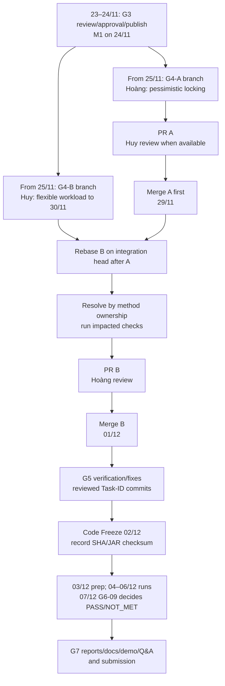

# ByteMe Phase 2 — Git Workflow

Tài liệu này cụ thể hóa Git strategy tại [ROADMAP.md](ROADMAP.md#9-git-workflow-and-reviewmerge-strategy) và method ownership tại [G3.5 / implementation plans](03_ARCHITECTURE_DECISIONS.md). Task ID và trạng thái công việc vẫn theo [TASK_TRACKER.md](TASK_TRACKER.md).

## 1. Branching strategy

- Một workstream dùng một branch xuyên suốt; không tạo branch riêng cho từng task.
- Không commit trực tiếp lên integration branch (`main` hoặc branch tích hợp do nhóm chọn). Bắt đầu từ approved base sau M1.
- G4-A: `feature/g4-a-pessimistic-locking` — Nguyễn Văn Huy Hoàng.
- G4-B: `feature/g4-b-two-step-fetching` — Bùi Công Huy.
- Tài liệu G3 được review/approve/publish 23–24/11; G4 bắt đầu 25/11. Hai nhánh G4 có thể phát triển song song trên method ownership đã định. G4-A phải được review và merge 29/11; sau đó G4-B rebase lên integration head mới nhất, giữ nguyên thay đổi G4-A trong file dùng chung, chạy các kiểm tra bị ảnh hưởng và merge 01/12.
- Do Huy có bài tập lớn môn khác 23–30/11, tiến độ G4-B trong giai đoạn này linh hoạt và workload được giữ nhẹ; G4-A do Hoàng triển khai độc lập. B vẫn hoàn tất rebase/verification/merge vào 01/12.
- Không tạo nhánh task nhỏ cho G5, G6 hoặc G7. Các thay đổi thuộc những giai đoạn này đi qua nhánh tích hợp sau G4; nếu nhóm quyết định tách nhánh phát hành theo quy trình repository hiện hành, nhánh đó đại diện cho cả workstream/release, không phải từng task.

## 2. Method ownership và file dùng chung

- G4-A sở hữu các mutation method của `OrderService` (`create/cancel/confirm/updateStatus/moveTo`), lock-by-ID method của `OrderRepository`, cùng các lock path Cart/Food và test concurrency liên quan.
- G4-B sở hữu `OrderService.list`, helper chỉ phục vụ list, các query FILTER/page-ID/fetch-items/count của `OrderRepository`, và list/query-count tests.
- Với `OrderService.java`, `OrderRepository.java` và `OrderServiceTest.java`, chỉ chỉnh method/test thuộc ownership của nhánh. Thay đổi shared setup/import phải ở mức tối thiểu; ưu tiên test file riêng nếu phù hợp.
- Không format hoặc rewrite toàn file để giải quyết conflict. Thay đổi qua ranh giới ownership cần được cả hai review rõ ràng.

## 3. Quy trình cho mỗi task

1. Chọn task TODO trong `TASK_TRACKER.md`, xác nhận dependency đã hoàn tất và làm việc trên branch của workstream tương ứng.
2. Thực hiện đúng scope, method ownership và acceptance của task. Tạo/cập nhật kiểm tra cần thiết theo task plan; không gộp tối ưu hóa deferred hoặc sửa evidence baseline vào change set.
3. Commit phần thay đổi nhỏ, có thể review độc lập. Mỗi commit message dùng Conventional Commits kèm Task ID.
4. Push branch workstream lên remote và mở/cập nhật PR khi có một lát cắt review được; PR mô tả Task ID, thay đổi, acceptance/evidence và kiểm tra đã chạy.
5. Reviewer chéo kiểm tra scope, ownership, behavior/API contract và evidence. Xử lý comment bằng commit mới trên cùng branch; không force-push/rewrite commit đã được review hoặc branch đã chia sẻ.
6. Chỉ merge sau approval và các gate bắt buộc. Cập nhật `TASK_TRACKER.md` sau khi deliverable của task đã được commit/push và điều kiện DONE của task được chứng minh; ghi link PR/commit/evidence khi tracker có chỗ phù hợp. Không đánh dấu task DONE chỉ vì PR đã mở.

## 4. Commit convention

Dùng dạng:

```text
<type>(<scope>): <imperative summary> [<TASK-ID>]
```

Ví dụ:

```text
feat(concurrency): lock inventory rows during checkout [G4-A-03]
test(data-access): assert bounded order list queries [G4-B-06]
fix(verification): preserve pagination ordering [G5-06]
docs(benchmark): classify official run attempt [G6-04]
```

`type` chọn theo nội dung (`feat`, `fix`, `test`, `docs`, `refactor`, `perf`, `build`, `chore`); `scope` ngắn gọn theo workstream/component. Dùng một Task ID chính cho một commit. Nếu commit phục vụ nhiều task không thể tách hợp lý, nêu tất cả ID trong body và liên kết tracker/PR; tránh gom task độc lập.

## 5. Pull request, review và thứ tự merge G4

1. G4-A mở PR từ `feature/g4-a-pessimistic-locking` vào integration branch sau M1. Bùi Công Huy review khi khả dụng; Hoàng xử lý góp ý. Merge A ngày 29/11 sau khi các gate G4-A đạt.
2. Trong lúc đó G4-B tiếp tục trên nhánh riêng và không sửa method thuộc A. Sau khi A merge, Huy fetch integration branch, rebase nhánh B, giải quyết file chung theo method ownership, chạy targeted G4-B và các kiểm tra G4-A bị ảnh hưởng; Hoàng review PR B.
3. Merge G4-B sau G4-A vào 01/12. PR B phải chỉ ra đã rebase trên commit A mới nhất và các kiểm tra sau rebase đã đạt.
4. Sau hai merge, cả nhóm review combined diff/evidence trước G5. Không dùng conflict resolution để thay đổi ADR, acceptance criteria, lock semantics hoặc API contract.

## 6. Branch strategy cho G5–G7

- G5–G7 không commit trực tiếp vào `main`. Khi có thay đổi cần commit, dùng branch theo workstream hoặc fix (không tạo branch riêng cho từng task), push branch và mở PR để review trước khi merge. G5 verification/hardening diễn ra sau khi cả G4-A và G4-B merge, ngày 02/12; fix blocker có thể làm ngay khi phát hiện theo G5-06.
- Tại Code Freeze 02/12, ghi application SHA và JAR checksum. Giữ nguyên lịch sử của commit đã freeze. Mọi thay đổi sau freeze phải đi qua review/regression, tạo SHA mới và tuân thủ yêu cầu benchmark cùng một application SHA; cập nhật manifest/evidence theo tracker.
- G6 AFTER preparation chạy 03/12; official run attempts chạy 04–06/12, buffer và final minimum decision/evaluation ngày 07/12. Tận dụng các ngày G6 để Hoàng chuẩn bị trước báo cáo kiến trúc, demo/Q&A và Huy chuẩn bị reproduction guide, bảng kết quả/templates; chỉ chốt kết luận và số liệu sau khi evidence được xác nhận. G7 documentation/demo changes cũng đi qua branch workstream/fix và PR, không commit trực tiếp vào `main`. Không sửa application code trong benchmark/evidence commit trừ khi có change được review theo quy trình sau-freeze.
- G6 run attempts được lưu và phân loại `VALID`, `INVALID` hoặc `INCOMPATIBLE`; chỉ G6-09 chốt minimum-run gate `PASS`/`NOT_MET`. Commit evidence không được sửa/xóa kết quả gốc.
- Trước G7 submission, review package và evidence links; submission commit/record phải gắn với task tương ứng trong tracker. Deadline và dependency vẫn theo roadmap/tracker.

## 7. Lệnh Git thường dùng

Lệnh dưới đây dùng `main` làm base/integration target ví dụ; mọi thay đổi gửi PR, không commit trực tiếp vào `main`.

```bash
# Khởi đầu một workstream từ approved base
git switch main
git pull --ff-only origin main
git switch -c feature/g4-a-pessimistic-locking

# Xem thay đổi và commit một task
git status --short
git diff
git add <file>
git commit -m "feat(concurrency): lock inventory rows during checkout [G4-A-03]"

# Push lần đầu hoặc cập nhật nhánh workstream
git push -u origin feature/g4-a-pessimistic-locking
git push

# G4-B: sau merge G4-A, rebase lên integration head
git fetch origin
git switch feature/g4-b-two-step-fetching
git rebase origin/main
# Nếu có conflict: sửa theo method ownership, rồi
git add <resolved-file>
git rebase --continue
# Sau rebase, cập nhật nhánh đã push theo quy tắc an toàn của nhóm
git push --force-with-lease

# Kiểm tra nhánh/commit trước PR hoặc cập nhật tracker
git log --oneline --decorate -n 12
git diff origin/main...HEAD
git status --short
```

Với thay đổi G5–G7, tạo hoặc dùng lại một nhánh workstream/fix thích hợp (ví dụ `fix/g5-concurrency-regression` hoặc `docs/g7-evaluation-package`), commit có Task ID, push rồi mở PR tới `main`. Không tạo nhánh cho từng task; nhóm có thể gom các task liên quan trên cùng nhánh miễn PR nhỏ, review được và mỗi commit truy được về Task ID.

Chỉ dùng `--force-with-lease` cho nhánh cá nhân G4-B sau rebase đã thống nhất; không dùng trên integration branch hoặc nhánh có commit người khác mà chưa phối hợp. Khi merge PR, dùng merge mode đã thống nhất trong repository; không tự thay đổi chính sách lịch sử.

## 8. Sơ đồ luồng


