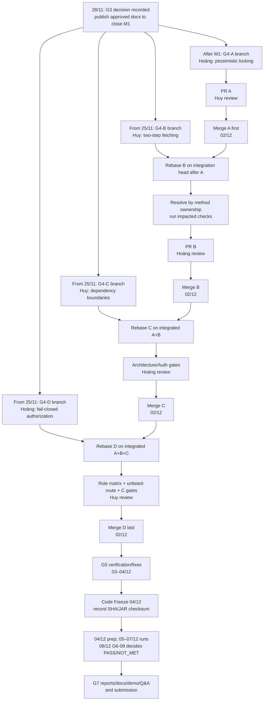

# ByteMe Phase 2 — Git Workflow

Tài liệu này cụ thể hóa Git strategy tại [ROADMAP.md](ROADMAP.md#9-git-workflow-and-reviewmerge-strategy) và method ownership tại [G3.5 / implementation plans](03_ARCHITECTURE_DECISIONS.md). Task ID và trạng thái công việc vẫn theo [TASK_TRACKER.md](TASK_TRACKER.md).

## 1. Branching strategy

- Một workstream dùng một branch xuyên suốt; không tạo branch riêng cho từng task.
- Không commit trực tiếp lên integration branch (`main` hoặc branch tích hợp do nhóm chọn). Bắt đầu từ approved base sau M1.
- G4-A: `feature/g4-a-pessimistic-locking` — Nguyễn Văn Huy Hoàng.
- G4-B: `feature/g4-b-two-step-fetching` — Bùi Công Huy.
- G4-C: `feature/g4-c-dependency-boundaries` — Bùi Công Huy; Nguyễn Văn Huy Hoàng review.
- G4-D: `feature/g4-d-fail-closed-authorization` — Nguyễn Văn Huy Hoàng; Bùi Công Huy review.
- ADR/plans G3 được chốt bằng quyết định dự án ngày 28/11/2026, không yêu cầu approval riêng của từng thành viên. G4 chỉ bắt đầu sau khi bản approved được merge/publish và G3-04/M1 `DONE`. Bốn nhánh G4 phát triển song song trên ownership đã định. Ngày 02/12 merge A trước, B rebase/verify/merge sau A, C rebase/merge sau B, rồi D rebase trên integrated A+B+C và merge cuối sau C/D gates.
- Không tạo nhánh task nhỏ cho G5, G6 hoặc G7. Các thay đổi thuộc những giai đoạn này đi qua nhánh tích hợp sau G4; nếu nhóm quyết định tách nhánh phát hành theo quy trình repository hiện hành, nhánh đó đại diện cho cả workstream/release, không phải từng task.

## 2. Method ownership và file dùng chung

- G4-A sở hữu các mutation method của `OrderService` (`create/cancel/confirm/updateStatus/moveTo`), lock-by-ID method của `OrderRepository`, cùng các lock path Cart/Food và test concurrency liên quan.
- G4-B sở hữu `OrderService.list`, helper chỉ phục vụ list, các query FILTER/page-ID/fetch-items/count của `OrderRepository`, và list/query-count tests.
- G4-C/Huy sở hữu exception boundary trong `MySqlAccountRepository`, mapping tối thiểu tại `RegisterService`/`LoginService`, repository exception files, `ArchitectureTest` và persistence-related Auth regression. C không sửa `OrderService`, `OrderRepository`, Cart/Food paths, DTO/entity hoặc D-owned authorization blocks.
- G4-D/Hoàng sở hữu terminal fallback trong `SecurityConfiguration.protectedApi`, file `FailClosedAuthorizationTest` mới, và chỉ `OtherModuleController`/`scope-check`/test-only security setup liên quan trong `AuthIntegrationTest`. D không sửa duplicate/persistence/concurrent-insert methods, repository fixture hoặc ArchUnit rules thuộc C.
- Với `OrderService.java`, `OrderRepository.java` và `OrderServiceTest.java`, chỉ chỉnh method/test thuộc ownership của nhánh. Thay đổi shared setup/import phải ở mức tối thiểu; ưu tiên test file riêng nếu phù hợp.
- Không format hoặc rewrite toàn file để giải quyết conflict. Thay đổi qua ranh giới ownership cần được cả hai review rõ ràng; không làm yếu ArchUnit direction/cycle rules hoặc thêm production allow-list cho synthetic D route để xử lý merge.

## 3. Quy trình cho mỗi task

1. Chọn task TODO trong `TASK_TRACKER.md`, xác nhận dependency đã hoàn tất và làm việc trên branch của workstream tương ứng. Riêng chuỗi task G4-B trên cùng branch, có thể bắt đầu task kế tiếp khi predecessor đã có local commit gắn Task ID và acceptance kỹ thuật được ghi nhận trong tracker. Đây chỉ là local dependency gate; predecessor vẫn giữ status hiện tại và chưa được tính `DONE`.
2. Thực hiện đúng scope, method ownership và acceptance của task. Tạo/cập nhật kiểm tra cần thiết theo task plan; không gộp tối ưu hóa deferred hoặc sửa evidence baseline vào change set.
3. Commit phần thay đổi nhỏ, có thể review độc lập. Mỗi commit message dùng Conventional Commits kèm Task ID.
4. Push branch workstream lên remote và mở/cập nhật PR khi có một lát cắt review được; PR mô tả Task ID, thay đổi, acceptance/evidence và kiểm tra đã chạy.
5. Reviewer chéo kiểm tra scope, ownership, behavior/API contract và evidence. Xử lý comment bằng commit mới trên cùng branch; không force-push/rewrite commit đã được review hoặc branch đã chia sẻ.
6. Chỉ merge sau approval và các gate bắt buộc. Cập nhật `TASK_TRACKER.md` sau khi deliverable của task đã được commit/push và điều kiện DONE của task được chứng minh; ghi link PR/commit/evidence khi tracker có chỗ phù hợp. Local dependency gate của G4-B không thay thế push, review hoặc các điều kiện này. Không đánh dấu task DONE chỉ vì đã hoàn thành local hoặc PR đã mở.

## 4. Commit convention

Dùng dạng:

```text
<type>(<scope>): <imperative summary> [<TASK-ID>]
```

Ví dụ:

```text
feat(concurrency): lock inventory rows during checkout [G4-A-03]
test(data-access): assert bounded order list queries [G4-B-06]
refactor(boundaries): isolate repository exceptions [G4-C-03]
feat(security): deny unmatched authenticated routes [G4-D-02]
fix(verification): preserve pagination ordering [G5-06]
docs(benchmark): classify official run attempt [G6-04]
```

`type` chọn theo nội dung (`feat`, `fix`, `test`, `docs`, `refactor`, `perf`, `build`, `chore`); `scope` ngắn gọn theo workstream/component. Dùng một Task ID chính cho một commit. Nếu commit phục vụ nhiều task không thể tách hợp lý, nêu tất cả ID trong body và liên kết tracker/PR; tránh gom task độc lập.

## 5. Pull request, review và thứ tự merge G4

1. G4-A mở PR từ `feature/g4-a-pessimistic-locking` vào integration branch sau M1. Bùi Công Huy review; Hoàng xử lý góp ý. Merge A trước trong ngày 02/12 sau khi các gate G4-A đạt.
2. Trong lúc đó G4-B tiếp tục trên nhánh riêng và không sửa method thuộc A. Sau khi A merge, Huy fetch integration branch, rebase nhánh B, giải quyết file chung theo method ownership, chạy targeted G4-B và các kiểm tra G4-A bị ảnh hưởng; Hoàng review PR B.
3. Merge G4-B sau G4-A trong ngày 02/12. PR B phải chỉ ra đã rebase trên commit A mới nhất và các kiểm tra sau rebase đã đạt.
4. G4-C phát triển song song trên Auth boundary files. Sau B merge, C rebase trên integrated A+B, chạy ArchUnit direction/cycle rules, Auth regression và impacted A/B checks; Nguyễn Văn Huy Hoàng duyệt. Merge C trước D ngày 02/12.
5. G4-D phát triển song song trên `SecurityConfiguration` và test file riêng; D chỉ tích hợp D-owned blocks trong `AuthIntegrationTest` sau C-05. Sau C merge, D rebase trên integrated A+B+C, chạy 18-endpoint role matrix, synthetic-unlisted-route proof, existing security regression và impacted C gates; Huy review. Merge D cuối ngày 02/12.
6. Sau bốn merge, cả nhóm review combined diff/evidence trước G5. Không dùng conflict resolution để thay đổi ADR, acceptance criteria, lock semantics, API contract, nới authorization matcher hoặc làm yếu architecture gates.

## 6. Branch strategy cho G5–G7

- G5–G7 không commit trực tiếp vào `main`. Khi có thay đổi cần commit, dùng branch theo workstream hoặc fix (không tạo branch riêng cho từng task), push branch và mở PR để review trước khi merge. G5 verification/hardening diễn ra sau khi G4-A, G4-B, G4-C và G4-D merge, ngày 03–04/12; fix blocker có thể làm ngay khi phát hiện theo G5-06.
- Tại Code Freeze 04/12, ghi application SHA và JAR checksum. Giữ nguyên lịch sử của commit đã freeze. Mọi thay đổi sau freeze phải đi qua review/regression, tạo SHA mới và tuân thủ yêu cầu benchmark cùng một application SHA; cập nhật manifest/evidence theo tracker.
- G6 AFTER preparation chạy sau freeze 04/12; official run attempts chạy 05–07/12, buffer và final minimum decision/evaluation ngày 08/12. Tận dụng các ngày G6 để Hoàng chuẩn bị trước báo cáo kiến trúc, demo/Q&A và Huy chuẩn bị reproduction guide, bảng kết quả/templates; chỉ chốt kết luận và số liệu sau khi evidence được xác nhận. G7 documentation/demo changes cũng đi qua branch workstream/fix và PR, không commit trực tiếp vào `main`. Không sửa application code trong benchmark/evidence commit trừ khi có change được review theo quy trình sau-freeze.
- G6 run attempts được lưu và phân loại `VALID`, `INVALID` hoặc `INCOMPATIBLE`; chỉ G6-09 chốt minimum-run gate `PASS`/`NOT_MET`. Commit evidence không được sửa/xóa kết quả gốc.
- Trước G7 submission, review package và evidence links; submission commit/record phải gắn với task tương ứng trong tracker. Deadline và dependency vẫn theo roadmap/tracker.

## 7. Lệnh Git thường dùng

Lệnh dưới đây dùng `main` làm base/integration target ví dụ; mọi thay đổi gửi PR, không commit trực tiếp vào `main`.

```bash
# Khởi đầu một workstream từ approved base
git switch main
git pull --ff-only origin main
git switch -c feature/g4-a-pessimistic-locking

# Xem thay đổi và commit một task
git status --short
git diff
git add <file>
git commit -m "feat(concurrency): lock inventory rows during checkout [G4-A-03]"

# Push lần đầu hoặc cập nhật nhánh workstream
git push -u origin feature/g4-a-pessimistic-locking
git push

# G4-B: sau merge G4-A, rebase lên integration head
git fetch origin
git switch feature/g4-b-two-step-fetching
git rebase origin/main
# Nếu có conflict: sửa theo method ownership, rồi
git add <resolved-file>
git rebase --continue
# Sau rebase, cập nhật nhánh đã push theo quy tắc an toàn của nhóm
git push --force-with-lease

# G4-C: sau merge B, rebase trên integrated A+B rồi chạy Architecture/Auth gates
git switch feature/g4-c-dependency-boundaries
git rebase origin/main

# G4-D: sau merge C, rebase trên integrated A+B+C rồi chạy role-matrix/C+D gates
git switch feature/g4-d-fail-closed-authorization
git rebase origin/main

# Kiểm tra nhánh/commit trước PR hoặc cập nhật tracker
git log --oneline --decorate -n 12
git diff origin/main...HEAD
git status --short
```

Với thay đổi G5–G7, tạo hoặc dùng lại một nhánh workstream/fix thích hợp (ví dụ `fix/g5-concurrency-regression` hoặc `docs/g7-evaluation-package`), commit có Task ID, push rồi mở PR tới `main`. Không tạo nhánh cho từng task; nhóm có thể gom các task liên quan trên cùng nhánh miễn PR nhỏ, review được và mỗi commit truy được về Task ID.

Chỉ dùng `--force-with-lease` cho nhánh cá nhân G4-B/G4-C/G4-D sau rebase đã thống nhất; không dùng trên integration branch hoặc nhánh có commit người khác mà chưa phối hợp. Khi merge PR, dùng merge mode đã thống nhất trong repository; không tự thay đổi chính sách lịch sử.

## 8. Sơ đồ luồng


