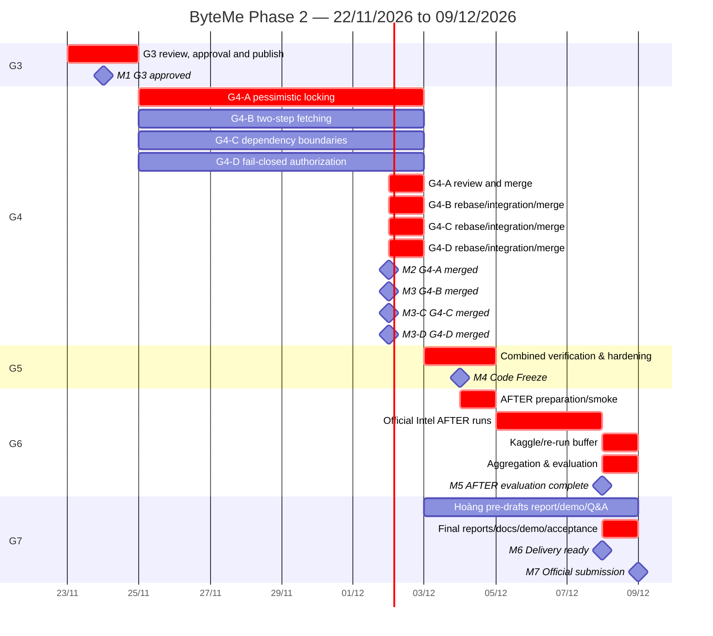

# ByteMe Phase 2 — Project Roadmap

- **Thời gian:** 22/11/2026–09/12/2026
- **Internal delivery deadline:** 08/12/2026
- **Official submission deadline:** 09/12/2026
- **Planning status:** `ACTIVE_PLAN`; không đại diện cho kết quả thực tế
- **Task-level source of truth:** [TASK_TRACKER.md](TASK_TRACKER.md)
- **Detailed Git instructions:** [GIT_WORKFLOW.md](GIT_WORKFLOW.md)

## 1. Project objectives

1. Hoàn tất phê duyệt ADR-001/ADR-002/ADR-003/ADR-004 và bốn implementation plan mà không mở rộng scope ngoài G4-A/G4-B/G4-C/G4-D.
2. Triển khai pessimistic locking để bảo vệ inventory/order consistency, two-step fetching để loại order-list N+1, dependency boundaries để xóa cycle `service ↔ repository` và fail-closed authorization để loại authenticated fallback cho route chưa khai báo.
3. Giữ nguyên 18 endpoint, public/role permissions và API/behavior ngoài conflict semantics đã duyệt; đạt targeted, combined, role-matrix, black-box và Docker verification trước Code Freeze.
4. Thu tối thiểu ba official AFTER run hợp lệ trên Kaggle Intel-compatible, dùng đúng BEFORE locks/protocol và đánh giá trung thực acceptance criteria.
5. Hoàn thiện báo cáo, tài liệu tái hiện, demo, chuẩn bị vấn đáp và submission package trước 08/12; ngày 09/12 chỉ dành cho submission hoặc emergency.

## 2. Current project status

Cập nhật tại 28/11/2026. Chỉ ghi trạng thái đã có; không suy diễn công việc tương lai là hoàn tất.

| Phase | Trạng thái | Kết quả hiện có / gate còn lại |
|---|---|---|
| G0 — Requirements & baseline setup | **COMPLETED** | Requirements/baseline documentation đã hoàn thành. Không lập lại task. |
| G1 — System assessment | **COMPLETED** | Assessment/findings đã hoàn thành. Không audit lại. |
| G2 — Verification & BEFORE benchmark | **COMPLETED** | Official Intel BEFORE baseline đã khóa; phải giữ nguyên locks/evidence. |
| G3 — Architecture design & decisions | **COMPLETED** | ADR-001…004 `ACCEPTED`, bốn plans `APPROVED`; bản approved được publish qua [PR #4](https://github.com/BuiHuy16/ByteMe-phase2/pull/4), merge SHA `db39c50d9a8d9d53d2c41d026729e5e7905249aa`. G3-04/M1 `DONE`. |
| G4 — Architecture implementation | **NOT STARTED** | Chỉ bắt đầu sau khi G3-04/M1 `DONE`. Bốn branch phát triển song song trên scope riêng; merge A → B → C → D. |
| G5 — Verification & hardening | **NOT STARTED** | Phụ thuộc cả bốn PR G4 đã merge. |
| G6 — AFTER benchmark & evaluation | **NOT STARTED** | Phụ thuộc Code Freeze SHA và G5 pass. |
| G7 — Final acceptance & delivery | **NOT STARTED** | Có thể pre-draft trong G6; final content phụ thuộc G6 evaluation. |

## 3. Team members and responsibilities

| Thành viên | Primary responsibilities | Cross-review/support |
|---|---|---|
| **Bùi Công Huy** | Điều phối dự án; owner G4-B/G4-C; query count/pagination, dependency boundaries; toàn bộ Kaggle/AFTER benchmark; aggregation và đánh giá BEFORE/AFTER; experimental report | Review G4-A/G4-D; integration/freeze; final docs, reproduction guide, release/submission |
| **Nguyễn Văn Huy Hoàng** | Owner G4-A/G4-D; locking, fail-closed authorization; lead kiểm thử tích hợp/correctness evidence và architecture/correctness report | Review G4-B/G4-C; cung cấp correctness evidence cho Huy; benchmark incident support; demo/vấn đáp/final acceptance |

Approval G3 được chốt bằng quyết định dự án ngày 28/11/2026 và không yêu cầu xác nhận riêng của từng thành viên. Hai thành viên vẫn giữ nguyên trách nhiệm review chéo G4, combined acceptance, demo/vấn đáp và final submission. Reviewer của từng task là thành viên còn lại; mỗi task có đúng một primary owner và reviewer đã xác định trong tracker.

## 4. Project timeline

### Calendar summary

| Dates | Phase | Outcome |
|---|---|---|
| 23–24/11 | G3 | Review, approve and publish ADRs/plans/Git workflow |
| 25/11–02/12 | G4-A | Hoàng implements, verifies, gets cross-review and merges pessimistic locking |
| 25/11–02/12 | G4-B | Huy implements two-step fetching, then rebases and merges after A |
| 25/11–02/12 | G4-C | Huy implements Auth dependency boundaries and ArchUnit gates, then rebases/merges after B |
| 25/11–02/12 | G4-D | Hoàng implements fail-closed authorization, role matrix và synthetic-unlisted-route proof, then rebases/merges after C |
| 03–04/12 | G5 | Combined verification/hardening; application SHA frozen only if all gates pass |
| 04/12 | G6 prep | AFTER bundle, compatibility and smoke pass after Code Freeze |
| 05–07/12 | G6 runs | Target at least three valid comparable Intel-compatible official AFTER runs |
| 05–08/12 | G6 support/G7 prep | Hoàng supports incidents and pre-drafts report, technical docs, demo/Q&A |
| 08/12 | G6 buffer/evaluation | Reruns, final `PASS`/`NOT_MET` decision, aggregation/evaluation or limited-evidence report |
| 08/12 | G7 | Final reports/docs/demo/Q&A, acceptance and package complete |
| 09/12 | Submission | Submit; emergency handling only |

## 5. Workstreams

| Workstream | Owner | Window | Deliverable | Hard dependency |
|---|---|---|---|---|
| G3 approval | Task-specific owners; project decision authority chốt approval | 23–28/11 | Accepted ADRs, approved plans and published coordination decision | None |
| G4-A concurrency | Nguyễn Văn Huy Hoàng | 25/11–02/12 | Reviewed/merged pessimistic-locking change with tests | M1 |
| G4-B data access | Bùi Công Huy | 25/11–02/12 | Reviewed/merged two-step fetch change with tests | M1; final rebase/merge waits M2 |
| G4-C dependency boundaries | Bùi Công Huy | 25/11–02/12 | 0 `repository → service`, 0 package cycle, Auth behavior preserved | M1; final rebase/merge waits M3 |
| G4-D fail-closed authorization | Nguyễn Văn Huy Hoàng | 25/11–02/12 | Default deny, 18/18 role matrix, unlisted route denied, current behavior preserved | M1; shared Auth-test integration waits C-05; final merge waits M3-C |
| G5 verification | Nguyễn Văn Huy Hoàng (integration-test/correctness lead), Bùi Công Huy (coordination/integration/freeze) | 03–04/12 | Combined evidence and frozen application SHA | M2 + M3 + M3-C + M3-D |
| G6 benchmark | Bùi Công Huy | 04–08/12 | Valid AFTER evidence, aggregation and evaluation | M4 |
| G6 support/G7 pre-draft | Nguyễn Văn Huy Hoàng | 03–08/12 | Incident support plus report/docs/demo/Q&A pre-drafts | G4 evidence; finalization waits G6 |
| G7 delivery | Both; task-specific owners | 08/12 | Final reports/docs/demo/Q&A/release | G6 evaluation package; không phụ thuộc minimum gate phải PASS |

Parallelism rule: G4-A, G4-B, G4-C và G4-D cùng triển khai từ 25/11 đến 02/12 trên ownership riêng. C không chạm A/B hoặc authorization fallback; D không chạm Auth persistence/architecture rules của C. Ngày 02/12 merge A trước, B rebase/verify/merge sau A, C rebase trên integrated A+B, rồi D rebase trên A+B+C và merge cuối. Shared `AuthIntegrationTest` được chia method-level; D chỉ tích hợp phần mình sau C-05/C merge.

## 6. Milestones and exit criteria

| ID | Milestone | Deadline | Exit criteria |
|---|---|---:|---|
| M1 | G3 approved | 24/11/2026 | **DONE** — bốn ADR `ACCEPTED`, bốn plan `APPROVED`, acceptance/method ownership C/D, Git workflow và merge order được chốt; bản approved được merge/publish qua [PR #4](https://github.com/BuiHuy16/ByteMe-phase2/pull/4), SHA `db39c50d9a8d9d53d2c41d026729e5e7905249aa` |
| M2 | G4-A completed and merged | 02/12/2026 | C1/C2/C4 targeted tests pass; NO_WAIT runtime proof pass; rollback/error mapping/regression pass; reviewer approves; A PR merged first |
| M3 | G4-B completed and merged | 02/12/2026 | Query count constant and captured SELECT `≤4`; pagination/filter/order/ownership/API tests pass; B rebased on A; impacted tests pass; PR merged |
| M3-C | G4-C completed and merged | 02/12/2026 | 0 `repository → service`, 0 package cycle; Auth regression/API behavior pass; C rebased on integrated A+B; PR merged |
| M3-D | G4-D completed and merged | 02/12/2026 | Terminal fallback deny-all; 18/18 role matrix và synthetic unlisted-route gates pass; D rebased on A+B+C; C gates pass lại; PR merged |
| M4 | G5 passed — Code Freeze | 04/12/2026 | Full regression, black-box/role matrix, Docker, concurrency, query/pagination, C architecture/Auth và D fail-closed checks pass; no unresolved P0; application full SHA/JAR frozen for AFTER |
| M5 | G6 AFTER evaluation package completed | 08/12/2026 | Final minimum-run outcome được ghi sau buffer. `PASS` chỉ khi có ≥3 valid comparable Intel runs và evaluation đầy đủ; nếu thiếu, ghi `NOT_MET`, hoàn thành limited-evidence/limitation report và vẫn chuyển G7, không tuyên bố acceptance |
| M6 | G7 final delivery ready | 08/12/2026 | Reports, README/docs, evidence links, reproduction guide, demo/vấn đáp rehearsal và release/submission package pass final review |
| M7 | Official submission | 09/12/2026 | Approved package submitted before deadline; receipt/link recorded; emergency log closed |

Không milestone nào được đánh dấu đạt chỉ vì đến deadline.

## 7. Phase exit criteria and dependencies

| Phase | Entry dependency | Exit criteria | Blocks |
|---|---|---|---|
| G3 | Existing G3.1–G3.5 docs | M1 | G4-A, G4-B, G4-C và G4-D |
| G4-A | M1 | M2 | G4-B final rebase/merge; G5 |
| G4-B | M1; development parallel, integration after M2 | M3 | G5 |
| G4-C | M1; development parallel, integration after M3 | M3-C | G4-D final rebase/merge; G5 |
| G4-D | M1; development parallel; shared Auth-test integration after C-05; final integration after M3-C | M3-D | G5 |
| G5 | M2 + M3 + M3-C + M3-D | M4 | AFTER bundle/runs |
| G6 prep | M4 | Bundle/smoke/comparator pass | Official runs |
| G6 runs | Prep pass | Buffer 08/12 hoàn tất; final minimum-run outcome là `PASS` hoặc `NOT_MET` có evidence | Aggregation hoặc limited-evidence evaluation |
| G6 evaluation | Final outcome sau buffer | M5 evaluation package; minimum gate status giữ riêng | G7 final content |
| G7 | Pre-draft sau khi bốn G4 merge; finalization phụ thuộc G6 report package, minimum gate có thể `PASS` hoặc `NOT_MET` | M6 | Submission |
| Submission | M6 | M7 | — |

## 8. Critical path

Critical path trực tiếp đến 09/12:

`G3 decision recorded 28/11 → publish approved docs and close G3-04/M1 → G4-A/G4-B/G4-C/G4-D parallel implementation and review, with merge order A → B → C → D → G5 combined pass & Code Freeze → AFTER bundle/comparator/smoke after freeze → official attempts → buffer/final minimum-group decision, four-ADR evaluation and final reports/package → submission 09/12`.

Các điểm nhạy:

1. **G4-A merge 02/12** là dependency cứng của B final integration; B phải rebase, verify và merge sau A trong cùng ngày.
2. **G4-C/D integration 02/12**: C phải rebase trên A+B và merge trước; D chỉ sửa D-owned Auth-test blocks sau C, rebase trên A+B+C rồi rerun C architecture/Auth và D authorization gates. C không phụ thuộc D, nên không có vòng dependency.
3. **Code Freeze 04/12** và AFTER bundle/smoke diễn ra nối tiếp trong ngày; mọi code change sau freeze đe dọa toàn bộ evidence và buộc freeze SHA/run lại.
4. **Ba valid Intel runs** là minimum evidence gate. CPU mismatch/invalid run được chạy bù trong buffer 08/12; chỉ sau buffer mới xác nhận `PASS`/`NOT_MET`. `NOT_MET` không dừng nghĩa vụ report/G7/submission.
5. **G6 evaluation và G7** cùng kết thúc 08/12; Hoàng pre-draft architecture/correctness/demo, Huy chuẩn bị experimental report/reproduction artifacts trong G5/G6 để giữ lịch.
6. **Schedule risk cao:** bốn merge tuần tự ngày 02/12 rồi G5, AFTER prep, ba ngày benchmark, evaluation và final delivery 03–08/12 hầu như không có slack. Scope và per-method ownership không được nới.
7. Stretch run 4–5, polishing và non-critical enhancements không được làm chậm minimum-run evaluation hoặc M6.

Critical task IDs được liệt kê riêng trong [TASK_TRACKER.md](TASK_TRACKER.md#critical-path-tasks).

## 9. Git workflow and review/merge strategy

1. Sau M1, tạo bốn feature branches từ cùng approved base:
   - `feature/g4-a-pessimistic-locking` — Nguyễn Văn Huy Hoàng.
   - `feature/g4-b-two-step-fetching` — Bùi Công Huy.
   - `feature/g4-c-dependency-boundaries` — Bùi Công Huy.
   - `feature/g4-d-fail-closed-authorization` — Nguyễn Văn Huy Hoàng.
2. Không commit trực tiếp vào integration/main branch. Không gộp unrelated formatting, deferred optimizations hoặc evidence rewrite.
3. Tuân method ownership G3.5:
   - Hoàng: mutation methods trong `OrderService`, Order locking lookup, Cart/Food lock paths.
   - Huy: `OrderService.list`, Order page/fetch/count methods.
   - Huy/G4-C: `MySqlAccountRepository`, repository exceptions, mapping tối thiểu trong `RegisterService`/`LoginService`, `ArchitectureTest` và persistence-related Auth regression; không sửa A/B/D-owned blocks.
   - Hoàng/G4-D: terminal fallback trong `SecurityConfiguration.protectedApi`, file authorization test mới và `OtherModuleController`/`scope-check` blocks trong `AuthIntegrationTest`; không sửa persistence methods/fixtures của C.
   - Shared tests chỉ sửa đúng method owner; ưu tiên test file mới độc lập.
4. Sau M1, bốn workstream code/test song song từ 25/11 đến 02/12. Hoàng mở PR A; Huy review. A phải merge trước B trong ngày 02/12.
5. Sau A merge, Huy rebase B lên integration head, preserve lock methods/imports/tests, chạy targeted A+B và impacted regression; Hoàng review PR B. B merge ngày 02/12.
6. Sau B merge, Huy rebase C lên integrated A+B, chạy ArchUnit/Auth regression và impacted A/B gates; Hoàng duyệt. C merge trước D ngày 02/12.
7. Sau C merge, Hoàng rebase D lên integrated A+B+C, áp dụng/resolve đúng D-owned Auth-test blocks, chạy 18-route matrix, synthetic-unlisted-route, existing security regression và impacted C gates; Huy duyệt. D merge cuối ngày 02/12.
8. Conflict resolution không được đổi method của owner kia nếu chưa có explicit review. Không dùng merge conflict để thay ADR/acceptance, nới matcher hoặc làm yếu architecture/authorization gates.
9. G5–G7: không commit trực tiếp vào `main`; nếu cần commit thì dùng branch theo workstream hoặc fix (không branch riêng cho từng task), tạo PR và review trước merge. G5 fixes có thể bắt đầu ngay khi blocker phát hiện và đi qua PR. Tại M4 ghi full application SHA/JAR checksum; không rewrite history của frozen SHA.
10. Code change sau M4 yêu cầu regression lại, SHA mới và toàn bộ official AFTER run dùng cùng SHA; không pool run khác application version.

## 10. Risk management and contingency plan

| Risk | Probability / impact | Early trigger | Prevention/mitigation | Contingency | Owner |
|---|---|---|---|---|---|
| G3 publication trễ — **CLOSED** | Resolved | PR #4 merge ngày 28/11/2026 | Bản approved đã được kiểm tra link/status/count trước publish | G3-04/M1 `DONE` tại SHA `db39c50d9a8d9d53d2c41d026729e5e7905249aa`; publication gate đã đóng | Nguyễn Văn Huy Hoàng |
| G4-A chậm | Medium / **Critical** | A2/A3 chưa xong 27/11 hoặc targeted suite đỏ 01/12 | Hoàng triển khai theo dependency từ 25/11; lock methods trước, scope freeze, Huy review theo lịch | Ưu tiên A blockers và cross-review để giữ A-first merge 02/12; không làm giảm verification | Nguyễn Văn Huy Hoàng |
| G4-B integration bị nén | High / **High** | G4-B-01/02 nền tảng chưa sẵn cuối 27/11 hoặc query gate chưa đạt 01/12 | Chia lát cắt nhỏ theo dependency; ưu tiên critical methods/query gates; chuẩn bị rebase và impacted-test checklist trước 02/12 | Ưu tiên rebase/verification ngay sau A merge 02/12; không cắt contract/query verification hoặc scope | Bùi Công Huy |
| G4-C boundary gate fail | Medium / **High** | ArchUnit còn cycle/reverse dependency ngày 01/12 hoặc Auth persistence behavior drift | Huy giữ scope Auth persistence hẹp; test-first hai architecture rules; không chạm D-owned security blocks | Mở lại ADR-003, ghi blocker và không làm yếu rule hoặc đổi A/B/D scope | Bùi Công Huy |
| G4-D role regression hoặc shared Auth-test conflict | Medium / **High** | Một current route bị 401/403 sai; unlisted route vẫn tới controller; C/D sửa cùng Auth test block | New D-owned test file; method-level ownership; C hoàn tất persistence methods trước, D rebase sau C và rerun C+D gates | Mở lại ADR-004, revert/sửa đúng fallback hoặc test setup; không thêm production allow-list cho synthetic route và không đổi deadline/scope âm thầm | Nguyễn Văn Huy Hoàng |
| NO_WAIT không hoạt động | Medium / **Critical** | Contender chờ DB default hoặc không map 409 trong test 26/11 | Runtime proof ngay A3; không đợi end-to-end | Dừng implementation và review ADR cùng ngày; không silent native fallback; đánh giá ảnh hưởng tới mốc M2/M3/G5 mà không giảm gate | Nguyễn Văn Huy Hoàng |
| Merge conflict shared files | High / High | Hai branch sửa cùng method/import/setup, đặc biệt `Order*` hoặc `AuthIntegrationTest` | Method ownership, small commits, no whole-file format, merge A→B→C→D | Rebase tuần tự; owner và reviewer cùng resolve; rerun impacted prior-workstream gates trước merge | Bùi Công Huy điều phối |
| Regression failure | Medium / **Critical** | Targeted/full suite fail hoặc behavior/API drift | Tests-first, isolated scope, frequent targeted runs | Classify root cause; fix/retest affected + full suite; không Code Freeze khi còn P0 | Nguyễn Văn Huy Hoàng |
| Kaggle CPU không tương thích | Medium / **Critical** | Manifest comparator báo AMD/mismatch | Validate manifest trước measured run; retain Intel-only group | Exclude mismatched evidence, mở session khác; dùng 08/12/2026 buffer; không pool AMD | Bùi Công Huy |
| Official AFTER run invalid | Medium / **Critical** | Reset/checksum/telemetry/cleanup/secret scan fail | Validate từng run ngay sau session; preserve raw evidence | Re-run fresh session; 08/12/2026 buffer; không sửa acceptance để hợp thức hóa | Bùi Công Huy |
| Cải tiến không đạt acceptance | Medium / High | Correctness violation, query >4 hoặc latency guard fail | Targeted gates trước official; telemetry đầy đủ | Báo fail/trade-off trung thực; chỉ code change nếu còn đủ time để re-freeze và rerun toàn bộ; không đổi threshold hồi tố | Cả hai; primary theo ADR |
| Thiếu thời gian report/demo | High / High | G6 evaluation trễ hoặc pre-draft chưa có khung trước 05/12 | Hoàng pre-draft 03–07/12; templates/evidence refs sớm; Huy hoàn thiện phần experiment sau khi G6 chốt 08/12 | Ưu tiên required report/evidence/demo; bỏ polish/stretch; giữ acceptance; 09/12 chỉ submission/emergency | Nguyễn Văn Huy Hoàng |

### Priority of contingencies

1. Bảo vệ M4/Code Freeze và AFTER prep 04/12, cùng toàn bộ three-run + buffer window 05–08/12.
2. Bảo vệ evidence validity/comparability; không đánh đổi integrity lấy lịch.
3. Bảo vệ required reports/demo/submission; bỏ target 5 runs hoặc visual polish trước khi bỏ acceptance work.
4. Nếu không đủ ba comparable runs, báo cáo limitation và phần evidence hợp lệ; không đổi tiêu chí hoặc pool CPU/SHA khác nhau.

## 11. Definition of Done — ByteMe Phase 2

Phase 2 chỉ `DONE` khi toàn bộ điều kiện sau đạt:

- ADR-001/ADR-002/ADR-003/ADR-004 và implementation decisions có decision basis/date/status cuối dựa trên quyết định thực tế; không tạo review cá nhân giả và không mở rộng scope ngoài bốn ADR.
- G4-A/G4-B/G4-C/G4-D code được review/merge theo A → B → C → D, đúng ownership và không có unrelated change; C đạt 0 `repository → service`/0 package cycle; D đạt default deny, 18/18 role matrix và unlisted-route denial.
- Targeted, full regression, role-matrix, black-box, Docker, concurrency invariant, query-count/pagination/API compatibility gates pass; no unresolved P0.
- Frozen application SHA/JAR và benchmark locks được ghi; mọi official AFTER run dùng cùng compatible Intel group và application version.
- Minimum-run gate được ghi `PASS` khi có tối thiểu ba valid official AFTER runs; nếu `NOT_MET`, limitation/evidence shortfall vẫn được báo cáo trung thực và raw artifacts hợp lệ được giữ.
- BEFORE/AFTER evaluation bao gồm correctness, query count, latency, throughput/successful throughput, conflict/error rate, resources, trade-offs và acceptance status.
- README, architecture docs/ADRs/diagrams, reproduction/deployment guide, evidence references, reports, demo và chuẩn bị vấn đáp hoàn chỉnh.
- Final acceptance review đối chiếu yêu cầu bài tập; release/submission package tái tạo được và không chứa secret.
- Submission hoàn tất trước 09/12/2026 và có receipt/link xác nhận.

Planning dates, TODO status hoặc milestone deadline tự thân không chứng minh Definition of Done.
