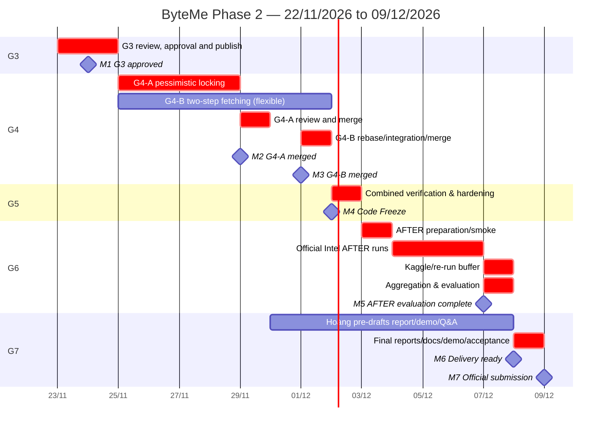

# ByteMe Phase 2 — Project Roadmap

- **Thời gian:** 22/11/2026–09/12/2026
- **Internal delivery deadline:** 08/12/2026
- **Official submission deadline:** 09/12/2026
- **Planning status:** `ACTIVE_PLAN`; không đại diện cho kết quả thực tế
- **Task-level source of truth:** [TASK_TRACKER.md](TASK_TRACKER.md)
- **Detailed Git instructions:** [GIT_WORKFLOW.md](GIT_WORKFLOW.md)

## 1. Project objectives

1. Hoàn tất phê duyệt ADR-001/ADR-002 và hai implementation plan mà không mở rộng scope ngoài G4-A/G4-B.
2. Triển khai pessimistic locking để bảo vệ inventory/order consistency và two-step fetching để loại order-list N+1.
3. Giữ nguyên API/behavior ngoài conflict semantics đã duyệt; đạt targeted, combined, black-box và Docker verification trước Code Freeze.
4. Thu tối thiểu ba official AFTER run hợp lệ trên Kaggle Intel-compatible, dùng đúng BEFORE locks/protocol và đánh giá trung thực acceptance criteria.
5. Hoàn thiện báo cáo, tài liệu tái hiện, demo, chuẩn bị vấn đáp và submission package trước 08/12; ngày 09/12 chỉ dành cho submission hoặc emergency.

## 2. Current project status

Cập nhật tại 22/11/2026. Chỉ ghi trạng thái đã có; không suy diễn công việc tương lai là hoàn tất.

| Phase | Trạng thái | Kết quả hiện có / gate còn lại |
|---|---|---|
| G0 — Requirements & baseline setup | **COMPLETED** | Requirements/baseline documentation đã hoàn thành. Không lập lại task. |
| G1 — System assessment | **COMPLETED** | Assessment/findings đã hoàn thành. Không audit lại. |
| G2 — Verification & BEFORE benchmark | **COMPLETED** | Official Intel BEFORE baseline đã khóa; phải giữ nguyên locks/evidence. |
| G3 — Architecture design & decisions | **DOCUMENTATION COMPLETE / APPROVAL PENDING** | G3.1–G3.5, ADR-001/002 và implementation plans đã có; cần team review, đổi ADR sang `ACCEPTED` và publish tài liệu. |
| G4 — Architecture implementation | **NOT STARTED** | Chỉ bắt đầu sau M1. Hai branch được code song song; A merge trước B. |
| G5 — Verification & hardening | **NOT STARTED** | Phụ thuộc cả hai PR G4 đã merge. |
| G6 — AFTER benchmark & evaluation | **NOT STARTED** | Phụ thuộc Code Freeze SHA và G5 pass. |
| G7 — Final acceptance & delivery | **NOT STARTED** | Có thể pre-draft trong G6; final content phụ thuộc G6 evaluation. |

## 3. Team members and responsibilities

| Thành viên | Primary responsibilities | Cross-review/support |
|---|---|---|
| **Bùi Công Huy** | Owner G4-B; query count/pagination/API compatibility; integration; AFTER environment/Kaggle runs; aggregation, BEFORE/AFTER analysis/visualization; experimental report | Review G4-A; combined verification; final docs, reproduction guide, release/submission |
| **Nguyễn Văn Huy Hoàng** | Owner G4-A; transaction boundaries, lock ordering/conflict handling; concurrency/rollback/data integrity; architecture/correctness report | Review G4-B; benchmark incident support; pre-draft G7 during G6; demo/vấn đáp/final acceptance support |

Cả hai cùng phê duyệt ADR/plans, review chéo, combined acceptance, demo/vấn đáp và final submission. Mỗi task vẫn có đúng một primary owner trong tracker.

## 4. Project timeline

### Calendar summary

| Dates | Phase | Outcome |
|---|---|---|
| 23–24/11 | G3 | Review, approve and publish ADRs/plans/Git workflow |
| 25–29/11 | G4-A | Hoàng implements, verifies, gets cross-review and merges pessimistic locking |
| 25/11–01/12 | G4-B | Huy implements two-step fetching with flexible/reduced workload through 30/11; rebases and merges after A |
| 02/12 | G5 | Combined verification/hardening; application SHA frozen only if all gates pass |
| 03/12 | G6 prep | AFTER bundle, compatibility and smoke pass |
| 04–06/12 | G6 runs | Target at least three valid comparable Intel-compatible official AFTER runs |
| 04–06/12 | G6 support/G7 prep | Hoàng supports incidents and pre-drafts report, technical docs, demo/Q&A |
| 07/12 | G6 buffer/evaluation | Reruns, final `PASS`/`NOT_MET` decision, aggregation/evaluation or limited-evidence report |
| 08/12 | G7 | Final reports/docs/demo/Q&A, acceptance and package complete |
| 09/12 | Submission | Submit; emergency handling only |

## 5. Workstreams

| Workstream | Owner | Window | Deliverable | Hard dependency |
|---|---|---|---|---|
| G3 approval | Both (task-specific owners) | 23–24/11 | Accepted ADRs, approved plans and published coordination decisions | None |
| G4-A concurrency | Nguyễn Văn Huy Hoàng | 25–29/11 | Reviewed/merged pessimistic-locking change with tests | M1 |
| G4-B data access | Bùi Công Huy | 25/11–01/12 | Reviewed/merged two-step fetch change with tests; flexible/light workload through 30/11 | M1; final rebase/merge waits M2 |
| G5 verification | Nguyễn Văn Huy Hoàng (test lead), Bùi Công Huy (integration/freeze) | 02/12 | Combined evidence and frozen application SHA | M2 + M3 |
| G6 benchmark | Bùi Công Huy | 03–07/12 | Valid AFTER evidence, aggregation and evaluation | M4 |
| G6 support/G7 pre-draft | Nguyễn Văn Huy Hoàng | 30/11–07/12 | Incident support plus report/docs/demo/Q&A pre-drafts | G4 evidence; finalization waits G6 |
| G7 delivery | Both; task-specific owners | 08/12 | Final reports/docs/demo/Q&A/release | G6 evaluation package; không phụ thuộc minimum gate phải PASS |

Parallelism rule: G4-A và G4-B bắt đầu 25/11, code/test song song trên vùng method ownership riêng. Huy giữ workload G4-B linh hoạt/nhẹ từ 25–30/11 vì lịch học phần khác; Hoàng có thể triển khai G4-A độc lập. G4-B không được merge trước A; sau A merge 29/11, B bắt buộc rebase, rerun impacted/combined targeted tests và merge 01/12.

## 6. Milestones and exit criteria

| ID | Milestone | Deadline | Exit criteria |
|---|---|---:|---|
| M1 | G3 approved | 24/11/2026 | Hai ADR `ACCEPTED`; hai plan approved; acceptance/owners/method ownership/Git workflow/merge order được cả hai xác nhận; tài liệu approved được commit/push bởi task tương ứng |
| M2 | G4-A completed and merged | 29/11/2026 | C1/C2/C4 targeted tests pass; NO_WAIT runtime proof pass; rollback/error mapping/regression pass; reviewer approves; A PR merged first |
| M3 | G4-B completed and merged | 01/12/2026 | Query count constant and captured SELECT `≤4`; pagination/filter/order/ownership/API tests pass; B rebased on A; impacted tests pass; PR merged |
| M4 | G5 passed — Code Freeze | 02/12/2026 | Full regression, black-box, Docker, concurrency invariants and query/pagination checks pass; no unresolved P0; application full SHA/JAR frozen for AFTER |
| M5 | G6 AFTER evaluation package completed | 07/12/2026 | Final minimum-run outcome được ghi sau buffer. `PASS` chỉ khi có ≥3 valid comparable Intel runs và evaluation đầy đủ; nếu thiếu, ghi `NOT_MET`, hoàn thành limited-evidence/limitation report và vẫn chuyển G7, không tuyên bố acceptance |
| M6 | G7 final delivery ready | 08/12/2026 | Reports, README/docs, evidence links, reproduction guide, demo/vấn đáp rehearsal và release/submission package pass final review |
| M7 | Official submission | 09/12/2026 | Approved package submitted before deadline; receipt/link recorded; emergency log closed |

Không milestone nào được đánh dấu đạt chỉ vì đến deadline.

## 7. Phase exit criteria and dependencies

| Phase | Entry dependency | Exit criteria | Blocks |
|---|---|---|---|
| G3 | Existing G3.1–G3.5 docs | M1 | Cả G4-A và G4-B |
| G4-A | M1 | M2 | G4-B final rebase/merge; G5 |
| G4-B | M1; development parallel, integration after M2 | M3 | G5 |
| G5 | M2 + M3 | M4 | AFTER bundle/runs |
| G6 prep | M4 | Bundle/smoke/comparator pass | Official runs |
| G6 runs | Prep pass | Buffer 07/12 hoàn tất; final minimum-run outcome là `PASS` hoặc `NOT_MET` có evidence | Aggregation hoặc limited-evidence evaluation |
| G6 evaluation | Final outcome sau buffer | M5 evaluation package; minimum gate status giữ riêng | G7 final content |
| G7 | G6 report package; minimum gate có thể `PASS` hoặc `NOT_MET` | M6 | Submission |
| Submission | M6 | M7 | — |

## 8. Critical path

Critical path trực tiếp đến 09/12:

`G3 approval 23–24/11 → G4-A implementation/review/merge 25–29/11 → G4-B completion/rebase/verification/merge 01/12 → G5 combined pass & Code Freeze 02/12 → AFTER bundle/comparator/smoke 03/12 → official attempts 04–06/12 → buffer/final minimum-group decision and evaluation 07/12 → final reports/package 08/12 → submission 09/12`.

Các điểm nhạy:

1. **G4-A merge 29/11** là dependency cứng của B final integration. G4-B có workload linh hoạt đến 30/11 nhưng phải đạt rebase, verification và merge ngày 01/12.
2. **Code Freeze 02/12** để lại một ngày cho AFTER bundle/smoke trước khi benchmark bắt đầu 04/12; mọi code change sau freeze đe dọa toàn bộ evidence và buộc freeze SHA/run lại.
3. **Ba valid Intel runs** là minimum evidence gate. CPU mismatch/invalid run được chạy bù trong buffer 07/12; chỉ sau buffer mới xác nhận `PASS`/`NOT_MET`. `NOT_MET` không dừng nghĩa vụ report/G7/submission.
4. **G6 evaluation** kết thúc 07/12 và G7 cuối 08/12; Hoàng phải pre-draft architecture, technical docs, demo/Q&A từ 30/11 đến lúc benchmark chạy để giữ lịch.
5. **Schedule risk cao:** G5, AFTER prep, ba ngày benchmark và evaluation lần lượt chiếm các ngày liền nhau 02–08/12, hầu như không có slack nếu một gate fail hoặc Kaggle gián đoạn.
6. Stretch run 4–5, polishing và non-critical enhancements không được làm chậm minimum-run evaluation hoặc M6.

Critical task IDs được liệt kê riêng trong [TASK_TRACKER.md](TASK_TRACKER.md#critical-path-tasks).

## 9. Git workflow and review/merge strategy

1. Sau M1, tạo hai feature branches từ cùng approved base:
   - `feature/g4-a-pessimistic-locking` — Nguyễn Văn Huy Hoàng.
   - `feature/g4-b-two-step-fetching` — Bùi Công Huy.
2. Không commit trực tiếp vào integration/main branch. Không gộp unrelated formatting, deferred optimizations hoặc evidence rewrite.
3. Tuân method ownership G3.5:
   - Hoàng: mutation methods trong `OrderService`, Order locking lookup, Cart/Food lock paths.
   - Huy: `OrderService.list`, Order page/fetch/count methods.
   - Shared tests chỉ sửa đúng method owner; ưu tiên test file mới độc lập.
4. Sau M1, code song song từ 25/11. Hoàng mở PR A; Huy review khi khả dụng. A phải merge ngày 29/11.
5. Sau A merge, Huy rebase B lên integration head, preserve lock methods/imports/tests, chạy targeted A+B và impacted regression; Hoàng review PR B. B merge ngày 01/12.
6. Conflict resolution không được đổi method của owner kia nếu chưa có explicit review. Không dùng merge conflict để thay ADR/acceptance.
7. G5–G7: không commit trực tiếp vào `main`; nếu cần commit thì dùng branch theo workstream hoặc fix (không branch riêng cho từng task), tạo PR và review trước merge. G5 fixes có thể bắt đầu ngay khi blocker phát hiện và đi qua PR. Tại M4 ghi full application SHA/JAR checksum; không rewrite history của frozen SHA.
8. Code change sau M4 yêu cầu regression lại, SHA mới và toàn bộ official AFTER run dùng cùng SHA; không pool run khác application version.

## 10. Risk management and contingency plan

| Risk | Probability / impact | Early trigger | Prevention/mitigation | Contingency | Owner |
|---|---|---|---|---|---|
| G3 approval trễ | Medium / **Critical** | ADR/plan review chưa xong 24/11 | Dành trọn 23–24/11 cho review và xử lý comment theo thứ tự ưu tiên | G4 không bắt đầu trước approval; dùng contingency trong lịch G4, không bỏ acceptance gate | Cả hai |
| G4-A chậm | Medium / **Critical** | A2/A3 chưa xong 26/11 hoặc targeted suite đỏ 28/11 | Hoàng triển khai độc lập từ 25/11; lock methods trước, scope freeze, Huy review khi khả dụng | Ưu tiên A blockers, Hoàng tập trung A; Huy hỗ trợ review khi có thời gian nhưng không làm giảm verification | Nguyễn Văn Huy Hoàng |
| Huy availability G4-B | High / **High** | G4-B-01/02 nền tảng chưa sẵn cuối 27/11 | Workload linh hoạt 25–30/11; chia lát cắt nhỏ theo dependency; ưu tiên critical methods/query gates; Hoàng pre-draft G7 song song | Dùng buffer trong cửa sổ 25/11–01/12 và ưu tiên merge 01/12; không cắt contract/query verification hoặc scope | Bùi Công Huy |
| NO_WAIT không hoạt động | Medium / **Critical** | Contender chờ DB default hoặc không map 409 trong test 26/11 | Runtime proof ngay A3; không đợi end-to-end | Dừng implementation và review ADR cùng ngày; không silent native fallback; đánh giá ảnh hưởng tới mốc M2/M3/G5 mà không giảm gate | Nguyễn Văn Huy Hoàng |
| Merge conflict shared files | High / High | Cả hai sửa cùng method/import/setup | Method ownership, small commits, no whole-file format, A-first merge | A merge; B rebase có cả hai cùng resolve; rerun targeted A+B trước PR B | Bùi Công Huy |
| Regression failure | Medium / **Critical** | Targeted/full suite fail hoặc behavior/API drift | Tests-first, isolated scope, frequent targeted runs | Classify root cause; fix/retest affected + full suite; không Code Freeze khi còn P0 | Nguyễn Văn Huy Hoàng |
| Kaggle CPU không tương thích | Medium / **Critical** | Manifest comparator báo AMD/mismatch | Validate manifest trước measured run; retain Intel-only group | Exclude mismatched evidence, mở session khác; dùng 07/12 buffer; không pool AMD | Bùi Công Huy |
| Official AFTER run invalid | Medium / **Critical** | Reset/checksum/telemetry/cleanup/secret scan fail | Validate từng run ngay sau session; preserve raw evidence | Re-run fresh session; 07/12 buffer; không sửa acceptance để hợp thức hóa | Bùi Công Huy |
| Cải tiến không đạt acceptance | Medium / High | Correctness violation, query >4 hoặc latency guard fail | Targeted gates trước official; telemetry đầy đủ | Báo fail/trade-off trung thực; chỉ code change nếu còn đủ time để re-freeze và rerun toàn bộ; không đổi threshold hồi tố | Cả hai; primary theo ADR |
| Thiếu thời gian report/demo | High / High | G6 evaluation trễ hoặc pre-draft chưa có khung trước 04/12 | Hoàng pre-draft 30/11–06/12; templates/evidence refs sớm; Huy hoàn thiện phần experiment sau khi G6 chốt 07/12 | Ưu tiên required report/evidence/demo; bỏ polish/stretch; giữ acceptance; 09/12 chỉ submission/emergency | Nguyễn Văn Huy Hoàng |

### Priority of contingencies

1. Bảo vệ M4/Code Freeze 02/12, AFTER prep 03/12 và toàn bộ three-run + buffer window 04–07/12.
2. Bảo vệ evidence validity/comparability; không đánh đổi integrity lấy lịch.
3. Bảo vệ required reports/demo/submission; bỏ target 5 runs hoặc visual polish trước khi bỏ acceptance work.
4. Nếu không đủ ba comparable runs, báo cáo limitation và phần evidence hợp lệ; không đổi tiêu chí hoặc pool CPU/SHA khác nhau.

## 11. Definition of Done — ByteMe Phase 2

Phase 2 chỉ `DONE` khi toàn bộ điều kiện sau đạt:

- ADR-001/ADR-002 và implementation decisions có reviewer/date/status cuối; scope không mở rộng ngoài hai ADR.
- G4-A/G4-B code được review/merge đúng order, method ownership và không có unrelated change.
- Targeted, full regression, black-box, Docker, concurrency invariant, query-count/pagination/API compatibility gates pass; no unresolved P0.
- Frozen application SHA/JAR và benchmark locks được ghi; mọi official AFTER run dùng cùng compatible Intel group và application version.
- Minimum-run gate được ghi `PASS` khi có tối thiểu ba valid official AFTER runs; nếu `NOT_MET`, limitation/evidence shortfall vẫn được báo cáo trung thực và raw artifacts hợp lệ được giữ.
- BEFORE/AFTER evaluation bao gồm correctness, query count, latency, throughput/successful throughput, conflict/error rate, resources, trade-offs và acceptance status.
- README, architecture docs/ADRs/diagrams, reproduction/deployment guide, evidence references, reports, demo và chuẩn bị vấn đáp hoàn chỉnh.
- Final acceptance review đối chiếu yêu cầu bài tập; release/submission package tái tạo được và không chứa secret.
- Submission hoàn tất trước 09/12/2026 và có receipt/link xác nhận.

Planning dates, TODO status hoặc milestone deadline tự thân không chứng minh Definition of Done.
