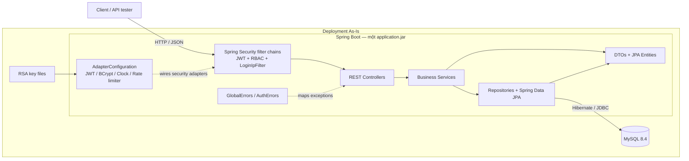
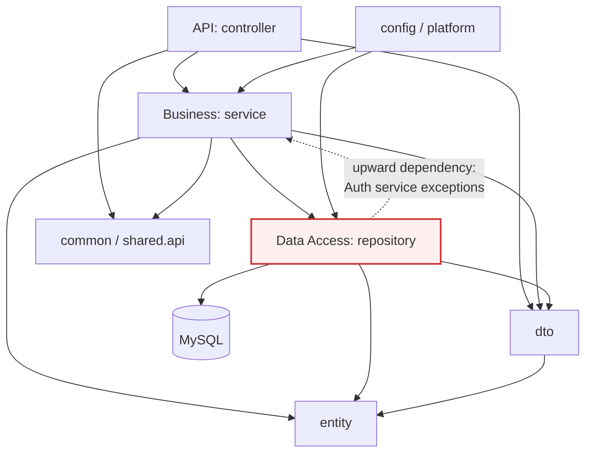

## 2. Architecture Assessment

Phần này khảo sát kiến trúc **As-Is** từ source hiện tại. Không lựa chọn kiến trúc cải tiến và không suy diễn các thành phần chưa tồn tại.

Quy ước đường dẫn source tiếp tục theo Phần 1; riêng `ArchitectureTest.java` trong phần này là `src/test/java/org/example/ArchitectureTest.java`.

### 2.1. Architectural Overview

| Khía cạnh | Nhận định | Trạng thái và bằng chứng |
|---|---|---|
| Architectural style của code | **Layered monolith**, tổ chức **package-by-layer** theo tầng kỹ thuật. | **CONFIRMED** — một Spring Boot entry point (`src/main/java/org/example/Application.java:3-9`), một Maven artifact `byteme` và không có khai báo multi-module (`pom.xml:4-21,99-128`); package `controller`, `service`, `repository`, `entity`, `dto`, `common`, `config`, `platform`, `shared`. |
| Interaction style | REST/JSON đồng bộ; request thread đi xuyên filter → controller → service → repository/JPA → MySQL rồi trả response đồng bộ. | **CONFIRMED** — Spring Web/JPA/Security trong `pom.xml:21-44`; các controller tại `src/main/java/org/example/controller/`; repository kế thừa `JpaRepository`. |
| Deployment model | Một backend deployable (`application.jar`) và một MySQL; Docker Compose tạo hai service `backend`/`mysql`. | **CONFIRMED** — `Dockerfile:1-14`; `compose.yaml:1-38`. Đây là mô hình triển khai, không phải hai application service nghiệp vụ. |
| Persistence model | JPA entities ánh xạ trực tiếp MySQL; schema được quản lý ngoài Hibernate, `open-in-view=false`. | **CONFIRMED** — `src/main/java/org/example/entity/`; `src/main/resources/application.yml:18-23`; `ddl-auto: none`. |
| Security model | Hai Spring Security filter chain, JWT RS256 stateless, RBAC theo role; login có filter rate limit IP và limiter email. | **CONFIRMED** — `SecurityConfiguration.java:19-49`; `AdapterConfiguration.java:22-52`; `LoginIpFilter.java:8-20`. |
| External/runtime dependencies | MySQL, filesystem RSA key pair và Maven/runtime libraries; không có Redis, broker, service discovery hoặc external payment service trong source. | **CONFIRMED** trong phạm vi repository — `compose.yaml:1-38`; `AdapterConfiguration.java:22-33`; dependency list `pom.xml:21-99`. |

Luồng request tổng quát:

1. Embedded servlet container nhận HTTP request; Spring Security chọn filter chain và tạo `AuthenticatedUser` từ JWT nếu endpoint được bảo vệ (`SecurityConfiguration.java:19-49`).
2. Controller bind/validate HTTP payload, lấy principal và gọi service; controller không truy cập repository (`CartController.java:22-50`; `OrderController.java:29-65`; rule tại `ArchitectureTest.java:36-40`).
3. Service thi hành business rule, điều phối service khác và xác định transaction boundary (`FoodService.java:28-130`; `CartService.java:28-115`; `OrderService.java:33-148`).
4. Repository dùng Spring Data JPA để đọc/ghi entity; Hibernate/JDBC giao tiếp MySQL (`FoodRepository.java:9-25`; `OrderRepository.java:14-31`).
5. Entity được đổi sang DTO trong transaction; exception được filter/advice chuyển thành HTTP error (`FoodDto.java:10-12`; `OrderDto.java:18-26`; `GlobalErrors.java:20-85`).

### 2.2. Layered Architecture

#### API layer

- `controller` chịu trách nhiệm route, HTTP status/header, request binding/validation và principal extraction; business logic chính được chuyển xuống service. **CONFIRMED** tại `FoodController.java:14-51`, `CartController.java:15-50`, `OrderController.java:22-69`.
- `AuthController` còn trực tiếp gọi email/password validation và email rate limiter trước `LoginService` (`AuthController.java:27-34`), nên API layer của Auth dày hơn ba controller còn lại. Đây là khác biệt tổ chức, chưa phải lỗi.
- Không có import `org.example.repository` trong package controller. Rule ArchUnit bảo vệ điều này (`ArchitectureTest.java:36-40`).

#### Business layer

- `service` chứa validation/quy tắc nghiệp vụ, ownership, state machine, orchestration và phần lớn transaction boundary (`RegisterService`, `LoginService`, `FoodService`, `CartService`, `OrderService`).
- **CONFIRMED** — không có direct import Spring Web/HTTP, Servlet, Spring Data/JDBC/ORM, JPA/Hibernate hoặc `java.sql` trong `service`. Rule tương ứng nằm tại `ArchitectureTest.java:17-24`; rule cấm gọi method khai báo trực tiếp bởi `JpaRepository` nằm tại `ArchitectureTest.java:27-33`.
- `service` vẫn dùng Spring `@Service` và `@Transactional` (`FoodService.java:10-11,19`; `OrderService.java:12-13,21,34`). Vì vậy tầng này độc lập với **web/DB framework theo yêu cầu đề bài**, nhưng không phải domain/application layer hoàn toàn framework-agnostic.
- Service signatures dùng DTO chung với API (`FoodRequest`, `CreateOrderRequest`, `OrderDto`...), trong khi các DTO request mang Jakarta Validation và DTO response biết JPA entity. Đây là coupling gián tiếp cần đánh giá, không vi phạm direct-import rule hiện tại.

#### Data Access layer

- `repository` cung cấp Spring Data repository cho Food/Cart/Order/User/Category và một adapter `MySqlAccountRepository` cho port `AccountRepository` (`FoodRepository.java:9-25`; `CartRepository.java:7-12`; `OrderRepository.java:14-31`; `MySqlAccountRepository.java:14-68`).
- Repository/query không chứa HTTP concern; không có dependency tới controller. Rule hiện có chỉ kiểm tra hướng này (`ArchitectureTest.java:43-47`).
- **CONFIRMED — vi phạm hướng phụ thuộc layered:** `MySqlAccountRepository` import `AccountPersistenceException` và `DuplicateAccountException` từ `service` (`MySqlAccountRepository.java:10-11,27-50`). Do business service đồng thời phụ thuộc `AccountRepository` (`RegisterService.java:7,14-18`; `LoginService.java:6,12-18`), package graph có cycle `service ↔ repository`.

#### Kết quả kiểm tra ranh giới

| Quy tắc | Kết quả tĩnh | Phạm vi bằng chứng |
|---|---|---|
| Controller không gọi repository | **CONFIRMED** đạt. | Không có import controller → repository; `ArchitectureTest.java:36-40`. |
| Service không phụ thuộc controller | **CONFIRMED** đạt. | Không có import service → controller; `ArchitectureTest.java:50-53`. |
| Service không trực tiếp phụ thuộc web/DB framework | **CONFIRMED** đạt theo direct imports. | `ArchitectureTest.java:17-33`; source imports của `service`. |
| Repository không phụ thuộc controller | **CONFIRMED** đạt. | `ArchitectureTest.java:43-47`. |
| Data Access không phụ thuộc ngược Business | **CONFIRMED** không đạt. | `MySqlAccountRepository.java:10-11`; rule này chưa tồn tại trong `ArchitectureTest`. |
| Không có package cycle | **CONFIRMED** không đạt ở package level do `service ↔ repository`. | Static import graph nêu trên; ArchUnit hiện chưa có cycle/slices rule. |
| Architecture tests đang pass | **PENDING**. | Test có trong source nhưng không chạy trong hạng mục này. |

### 2.3. Component Responsibilities

| Component/package | Trách nhiệm thực tế | Đánh giá phân tách |
|---|---|---|
| `Application` | Bootstrap Spring Boot. | **CONFIRMED** đơn trách nhiệm (`Application.java:3-9`). |
| `controller` | REST adapter, validation trigger, HTTP response, principal extraction; Auth-specific error/advice. | Nhìn chung tách khỏi persistence. `AuthController`/`AuthErrors`/`AuthJsonAdvice` tạo một cụm Auth API riêng (`AuthController.java`; `AuthErrors.java`; `AuthJsonAdvice.java`). |
| `service` | Use-case/business services; ports `PasswordHasher`, `TokenIssuer`; business exceptions/validation Auth. | Cohesion theo nghiệp vụ ở cấp class khá rõ. `OrderService` là orchestrator phụ thuộc `CartService` và `FoodService` (`OrderService.java:28-31`); `CartService` phụ thuộc `FoodService` (`CartService.java:25-26`). |
| `repository` | Repository/DAL và JPQL; adapter account chuyển JPA entity ↔ account DTO. | Phần lớn cohesive với data access, nhưng adapter Auth biết exception của business package và DTO API/application (`MySqlAccountRepository.java:7-12,64-66`). |
| `entity` | JPA mapping và enum dùng chung cho order type/status/payment/account status. | Persistence model và business vocabulary đang cùng package; entity enums đi thẳng lên API/service (`OrderController.java:10-11`; `CreateOrderRequest.java:5-6`). |
| `dto` | Request/response/application command models, validation annotations và entity-to-DTO mapping. | **POTENTIAL ISSUE** — gộp nhiều vai trò: transport validation, application data và persistence mapping (`FoodRequest.java:3-37`; `FoodDto.java:3,10-12`; `OrderDto.java:3-6,18-26`). |
| `config` | Cấu hình Spring Security và endpoint authorization. | Cross-cutting security được tập trung (`SecurityConfiguration.java:19-49`). |
| `platform.config` | Wiring adapters, Clock, RSA keys, JWT decoder, login limiter. | Thực hiện composition root một phần; phụ thuộc framework/hạ tầng được giữ ngoài service (`AdapterConfiguration.java:18-52`). |
| `platform.security` | BCrypt adapter, JWT issuer, IP/email limiter/filter. | `BCryptPasswordHasher`/`LocalRsaTokenIssuer` implement service ports, là điểm phân tách tốt (`BCryptPasswordHasher.java:5-15`; `LocalRsaTokenIssuer.java:12-37`). Rate limiter là state in-memory (`LoginRateLimiter.java:10-27`). |
| `common` | `BusinessException`, `ApiError`, principal helper và global HTTP/data exception mapping. | **POTENTIAL ISSUE** — tên `common` che nhiều concern; `GlobalErrors` đồng thời biết Servlet, Spring Web và Spring DAO (`GlobalErrors.java:3-18,24-80`). |
| `shared.api` | `AuthenticatedUser`, `Role` dùng giữa security, API và service. | Nhỏ và cohesive (`AuthenticatedUser.java:5-9`; `Role.java:3`). |

Kiểu tổ chức theo tầng giúp nhận biết kỹ thuật nhanh, nhưng một thay đổi feature thường phải chạm nhiều package: controller + dto + service + repository + entity. Đây là trade-off của package-by-layer, không tự thân là defect.

### 2.4. Dependency & Coupling Analysis

#### Hướng dependency quan trọng

| Nguồn → đích | Ý nghĩa | Đánh giá |
|---|---|---|
| `controller → service` | API gọi use case. | **CONFIRMED**, đúng hướng chính. |
| `service → repository/entity/dto/common/shared` | Business orchestration dùng persistence ports/models và response/request models. | **CONFIRMED**; coupling tới DTO/entity lớn hơn một layered core tách biệt. |
| `repository → entity` | Spring Data quản lý JPA model. | **CONFIRMED**, đúng trách nhiệm. |
| `repository → service` | Adapter Auth ném exception định nghĩa trong business package. | **CONFIRMED** dependency ngược, tạo package cycle. |
| `dto → entity` | DTO dùng entity enums và static mapper nhận JPA entity. | **CONFIRMED**; thay đổi persistence/domain enum có thể lan tới API contract. |
| `platform → service` | Adapter security implement `PasswordHasher`/`TokenIssuer`. | **CONFIRMED**, đây là dependency vào abstraction hợp lý. |
| `OrderService → CartService → FoodService` và `OrderService → FoodService` | Service-to-service orchestration cho checkout/cancel. | **CONFIRMED**; hợp lý cho use case hiện tại nhưng tạo hotspot coupling tại Order/Cart. |

Phân tích import tĩnh toàn bộ `src/main/java` phát hiện đúng một cặp dependency hai chiều giữa các package cấp một: `repository ↔ service`. Không thấy cặp cycle cấp package khác qua direct imports; dynamic/runtime dependency và kết quả build vẫn **PENDING**.

#### Coupling và cohesion đáng chú ý

- **CONFIRMED** — `OrderService` có fan-out nghiệp vụ lớn nhất: repository, hai service khác, DTO/entity/role/clock; class đồng thời xử lý checkout, query, ownership, cancel và state machine (`OrderService.java:23-31,33-195`). Cohesion vẫn xoay quanh aggregate/use case Order, nhưng đây là điểm thay đổi có ảnh hưởng rộng.
- **CONFIRMED** — `CartService` vừa quản lý cart vừa enrich DTO bằng `FoodService`, tạo dependency Cart → Food (`CartService.java:25-26,109-115`).
- **CONFIRMED** — Auth có abstraction tốt hơn các component còn lại qua `AccountRepository`, `PasswordHasher`, `TokenIssuer`, nhưng đặt `AccountRepository` trong package data và exception adapter trong package service làm mờ hướng ports/adapters (`AccountRepository.java:8-12`; `PasswordHasher.java:3-5`; `TokenIssuer.java:6-7`).
- **POTENTIAL ISSUE** — request/response DTO được dùng trực tiếp làm service API; thay đổi HTTP contract có thể buộc sửa business service, và entity mapping trong DTO làm API phụ thuộc persistence representation.
- **PENDING** — chưa có module boundary ở build level; mọi package được compile/deploy chung, nên enforcement hiện dựa vào convention và ArchUnit chứ không phải module visibility.

### 2.5. Data Flow & Transaction Boundaries

#### Transaction ownership

| Luồng | Boundary thực tế | Trạng thái và hệ quả kiến trúc |
|---|---|---|
| Food read/write | `FoodService` đặt `readOnly=true` cho read và transaction cho create/update/delete/reserve/release. | **CONFIRMED** — `FoodService.java:28-34,43-54,75,95,101,108,116,127`. |
| Cart read/write | `CartService` sở hữu transaction cho view/mutate/checkout helpers. | **CONFIRMED** — `CartService.java:28,35,65,79,93,101`. `CartRepository.saveChanges` bọc `saveAndFlush` để service không gọi JPA-specific method (`CartRepository.java:10-11`; `ArchitectureTest.java:27-33`). |
| Checkout | Outer transaction tại `OrderService.create`; các call Cart/Food tham gia cùng transaction mặc định; save order, stock mutation và clear cart cùng unit of work. | **CONFIRMED** ở thiết kế tĩnh — `OrderService.java:33-68`; `FoodService.java:116-124`; `CartService.java:93-106`. Rollback runtime là **PENDING** trong lượt này. |
| Order query | `OrderService.list/get` dùng read-only transaction, cần thiết vì `open-in-view=false` và DTO truy cập lazy items. | **CONFIRMED** — `OrderService.java:71-93`; `Order.java:70-74`; `application.yml:18-21`. |
| Cancel/status | Transaction ở `OrderService`; state và stock được sửa trong cùng unit of work. | **CONFIRMED** ở thiết kế tĩnh — `OrderService.java:96-148`. Concurrency correctness chưa được chứng minh. |
| Register/login | `RegisterService`/`LoginService` không đặt transaction; `MySqlAccountRepository` mở transaction cho từng repository operation. | **CONFIRMED** — `RegisterService.java:22-34`; `LoginService.java:24-39`; `MySqlAccountRepository.java:23,33,55`. Đây là convention khác với Food/Cart/Order. |

#### Cross-cutting concerns

- Authentication/authorization tập trung ở filter chain; controller không lặp role check (`SecurityConfiguration.java:19-49`).
- Jakarta Bean Validation xử lý phần shape/range của Food/Cart/Order DTO; service xử lý validation phụ thuộc nghiệp vụ. Auth dùng custom strict JSON advice và `AuthValidation` (`FoodRequest.java:13-37`; `CreateOrderRequest.java:9-29`; `AuthJsonAdvice.java:17-46`; `AuthValidation.java:9-31`).
- `GlobalErrors` ánh xạ business, validation, HTTP, data-integrity, lock và unexpected exception; Auth có advice riêng (`GlobalErrors.java:24-85`; `AuthErrors.java:15-36`).
- Clock được inject và dùng UTC, hỗ trợ deterministic tests cho token/order time (`AdapterConfiguration.java:20`; `OrderService.java:31,185-186`; `LocalRsaTokenIssuer.java:20-31`).

#### Consistency/concurrency observations

- **CONFIRMED** — transaction bảo đảm nhóm thao tác ở cấp thiết kế cho execution tuần tự; database unique/FK bổ sung guard (`schema.sql:56-57,66-67,78-80,100-116`).
- **POTENTIAL ISSUE** — `findById`/read-modify-write không dùng pessimistic lock hay optimistic version; checkout, cancel và Admin stock update có các race đã ghi ở Phần 1. Đây là rủi ro consistency, chưa phải defect đã tái hiện.
- **POTENTIAL ISSUE** — query danh sách Order không fetch join/entity graph, trong khi `Order.items` là lazy và `OrderDto.fromEntity` duyệt items cho từng order (`OrderRepository.java:14-30`; `Order.java:70-74`; `OrderService.java:84-85`; `OrderDto.java:18-21`). Có khả năng N+1 query, cần xác nhận bằng SQL metrics/profiling.

### 2.6. Architecture Quality Assessment

| Thuộc tính | Nhận xét sơ bộ | Phân loại / bằng chứng cần thêm |
|---|---|---|
| Maintainability | Tên tầng/trách nhiệm rõ, constructor injection, error/security tập trung và có ArchUnit. Package cycle, DTO đa vai trò và `common` pha trộn concern làm tăng chi phí hiểu/sửa. | **CONFIRMED** ở thiết kế tĩnh; `ArchitectureTest.java:17-53`, các issue tại Mục 2.8. Chưa có maintainability metric. |
| Modifiability | Một deployable đơn giản phù hợp quy mô nhỏ; ports Auth cho phép thay hasher/token issuer. Ngược lại, feature bị trải qua nhiều package và API DTO gắn entity/enum persistence. | **POTENTIAL ISSUE** — cần change-impact exercise ở Source Code Assessment; `PasswordHasher.java`, `TokenIssuer.java`, `dto/*`, `entity/*`. |
| Testability | Clock và adapter interfaces hỗ trợ unit test; service/controller có thể inject dependency; repository/JPA và transaction cần integration test. | **CONFIRMED** về seams tĩnh (`AdapterConfiguration.java:20-33`; constructor/final fields trong services). Trạng thái test pass/coverage là **PENDING** vì không chạy test. |
| Performance | Synchronous path ngắn và Cart bulk-load Food IDs; nhưng Order list có khả năng N+1, food search dùng `lower(...) like '%...%'` và endpoint menu/search không phân trang. | **PENDING** cho hiệu năng thực; cần benchmark/query profile. Bằng chứng tĩnh: `CartService.java:109-115`; `OrderRepository.java:14-30`; `FoodRepository.java:16-22`. Baseline cũ chưa đủ provenance (Phần 0). |
| Reliability | Transaction/constraints/error mapping cung cấp nền tảng rollback và lỗi ổn định; concurrency race, deadlock/retry behavior và recovery chưa được chạy xác minh. | **PENDING** — static support tại `OrderService.java:33-68,96-148`; `GlobalErrors.java:59-80`; runtime evidence còn thiếu. |
| Security | JWT stateless, RBAC/filter tập trung, BCrypt, RSA validation và login rate limit hiện hữu. TLS, token revocation/account-state-after-issue, multi-instance rate limit và các finding security không được kết luận trong hạng mục này. | **CONFIRMED** về mechanism; security quality tổng thể **PENDING**. `SecurityConfiguration.java:19-49`; `AdapterConfiguration.java:22-52`; `BCryptPasswordHasher.java:7-19`. |
| Scalability | Stateless JWT và app không giữ session hỗ trợ replicate ở mức nguyên tắc; toàn bộ request dùng chung MySQL đồng bộ, deployment hiện chỉ mô tả một backend, rate limiter giữ state trong một JVM. | **PENDING** — chưa load/capacity test có provenance; `compose.yaml:1-38`; `LoginRateLimiter.java:10-27`. Multi-instance behavior là **POTENTIAL ISSUE**. |

Không quality attribute nào ngoài các đặc tính cấu trúc tĩnh được coi là “đạt” chỉ từ source. Performance, reliability, security và scalability cần test/benchmark thích hợp trên baseline đã đóng băng.

### 2.7. As-Is Architecture Diagrams

#### A. Kiến trúc tổng thể và mô hình triển khai



#### B. Các tầng và hướng dependency



Đường nét đứt đỏ là dependency ngược đã xác minh, không phải đề xuất kiến trúc mới.

#### C. Luồng kiến trúc checkout

```mermaid
sequenceDiagram
    actor Client
    participant Sec as SecurityFilterChain
    participant API as OrderController
    participant Order as OrderService
    participant Cart as CartService
    participant CartRepo as CartRepository
    participant Food as FoodService
    participant FoodRepo as FoodRepository
    participant OrderRepo as OrderRepository
    participant DB as MySQL

    Client->>Sec: POST /api/orders + Bearer JWT
    Sec->>API: AuthenticatedUser(CUSTOMER)
    API->>Order: create(userId, request)
    activate Order
    Note over Order,DB: Outer @Transactional boundary
    Order->>Order: validate order type / payment / fields
    Order->>Cart: getItemsForCheckout(userId)
    Cart->>CartRepo: findByUserId(userId)
    CartRepo->>DB: SELECT cart + lazy items
    DB-->>Order: cart foodId → quantity
    loop each cart item
        Order->>Food: reserveStock(foodId, quantity)
        Food->>FoodRepo: findById(foodId)
        FoodRepo->>DB: SELECT food
        Food->>Food: validate ACTIVE and stock; decrement
        Food-->>Order: FoodDto snapshot source
    end
    Order->>OrderRepo: save(order + orderItems)
    OrderRepo->>DB: INSERT order/items
    Order->>Cart: clearCart(userId)
    Cart->>CartRepo: saveChanges(cart)
    CartRepo->>DB: DELETE cart_items / flush
    Note over Order,DB: Success → commit; exception → rollback whole transaction
    Order-->>API: OrderDto
    deactivate Order
    API-->>Client: 201 Created + Location
```

### 2.8. Potential Architecture Issues

| Trạng thái | Vấn đề/quan sát kiến trúc | Bằng chứng và điều cần kiểm chứng |
|---|---|---|
| **CONFIRMED** | Dependency ngược `repository → service` và package cycle `service ↔ repository`. | `MySqlAccountRepository.java:10-11`; service phụ thuộc `AccountRepository`. Đây là vi phạm hướng layered, chưa chứng minh lỗi chức năng. |
| **POTENTIAL ISSUE** | ArchUnit rule chưa bao phủ dependency ngược, cycle, DTO/entity coupling hoặc service-to-service rule. | `ArchitectureTest.java:17-53` chỉ cấm một số dependency cụ thể; test chưa chạy trong lượt này. |
| **POTENTIAL ISSUE** | Business service bị gắn với API/persistence model qua DTO và entity enums. | `FoodService.java:5-7`; `OrderService.java:5-11`; DTO imports tại `FoodDto.java:3`, `OrderDto.java:3-6`, `CreateOrderRequest.java:3-6`. Cần đánh giá change impact, chưa chọn cách tách. |
| **POTENTIAL ISSUE** | `common` và Auth error handling phân tán/mix web + DAO + business concerns. | `GlobalErrors.java:3-18,24-80`; `AuthErrors.java:15-36`. Có nguy cơ drift error policy, cần khảo sát code/test chi tiết ở hạng mục sau. |
| **POTENTIAL ISSUE** | Transaction convention không thống nhất: Food/Cart/Order đặt boundary ở service, Auth đặt ở repository. | `RegisterService.java:22-34`; `MySqlAccountRepository.java:23,33,55`; so với `OrderService.java:34`. Không kết luận sai transaction nếu chưa có failure scenario. |
| **POTENTIAL ISSUE** | `OrderService`/`CartService` tạo chuỗi service-to-service coupling và một checkout orchestration hotspot. | `OrderService.java:28-68`; `CartService.java:25-26,93-115`. Có thể hợp lý với quy mô hiện tại; cần đánh giá thay đổi/kiểm thử, không mặc định phải tách. |
| **POTENTIAL ISSUE** | Order list có khả năng N+1 query do lazy `items`. | `OrderRepository.java:23-30`; `Order.java:70-74`; `OrderService.java:84-85`; `OrderDto.java:18-21`. Cần SQL trace/query count trước khi kết luận performance defect. |
| **POTENTIAL ISSUE** | In-memory login limiter không chia sẻ state giữa nhiều backend instance và tăng state theo key tới giới hạn. | `LoginRateLimiter.java:10-27`; deployment hiện một backend (`compose.yaml:21-36`). Chỉ trở thành scalability/security concern khi scale-out hoặc traffic pattern tương ứng. |
| **POTENTIAL ISSUE** | Concurrency consistency chưa được kiến trúc hiện tại bảo vệ bằng lock/version. | `FoodService.java:116-130`; `OrderService.java:96-148`; entity không có `@Version`; đã ghi chi tiết tại Phần 1. Cần test concurrent để xác nhận impact. |
| **PENDING** | OpenAPI viết tay có thể drift so với controller. | Swagger đọc static `/openapi.yaml` (`application.yml:34-38`); chưa xác minh contract-sync test hoặc diff toàn bộ spec trong hạng mục này. |
| **PENDING** | Capacity/scale/recovery thực tế. | Source chỉ chứng minh topology và mechanism; baseline benchmark chưa đủ provenance, chưa có runtime failure/scale test đáng tin cậy. |

### 2.9. Conclusions & Pending Questions

#### Kết luận

- **CONFIRMED** — kiến trúc hiện tại là layered monolith/package-by-layer, đóng gói thành một Spring Boot deployable và dùng MySQL; không phải microservices.
- **CONFIRMED** — đường chính API → Service → Repository/JPA → MySQL được tuân thủ ở controller và phần lớn business/data code; service không direct-import web/DB framework.
- **CONFIRMED** — có một vi phạm hướng dependency ở Auth data adapter, tạo cycle package `service ↔ repository`; ArchitectureTest chưa bảo vệ quy tắc này.
- **CONFIRMED** — transaction, security, validation và error mapping đều có điểm tập trung, nhưng convention chưa hoàn toàn đồng nhất giữa Auth và Food/Cart/Order.
- **PENDING** — không kết luận performance/reliability/security/scalability đạt hay không đạt nếu chưa có test/benchmark/profiling phù hợp.

#### Câu hỏi còn mở

1. `repository → service` là chủ ý theo ports/adapters chưa hoàn thiện hay debt cần loại khỏi layered model?
2. Nhóm có chấp nhận service API dùng trực tiếp transport DTO/JPA-backed enums, hay yêu cầu ranh giới application/domain độc lập hơn?
3. Quy ước transaction chuẩn của hệ thống nên nằm ở service/use-case hay repository adapter đối với Auth?
4. Order list có phát sinh N+1 bao nhiêu query trên dataset thực tế?
5. Các race checkout/cancel/stock update biểu hiện ra sao dưới concurrent integration test?
6. In-memory rate limiter và một MySQL dùng chung có đáp ứng topology triển khai dự kiến hay không?
7. Static OpenAPI có test nào bảo đảm đồng bộ với controller/error contract?

**Readiness:** đủ thông tin để chuyển sang **Hạng mục 3 – Source Code Assessment**. Sơ đồ component, hướng dependency, transaction boundary và hotspot đã rõ; các câu hỏi trên cần được mang sang khảo sát code/test hoặc hạng mục chất lượng tương ứng, chưa phải căn cứ chọn kiến trúc cải tiến.

