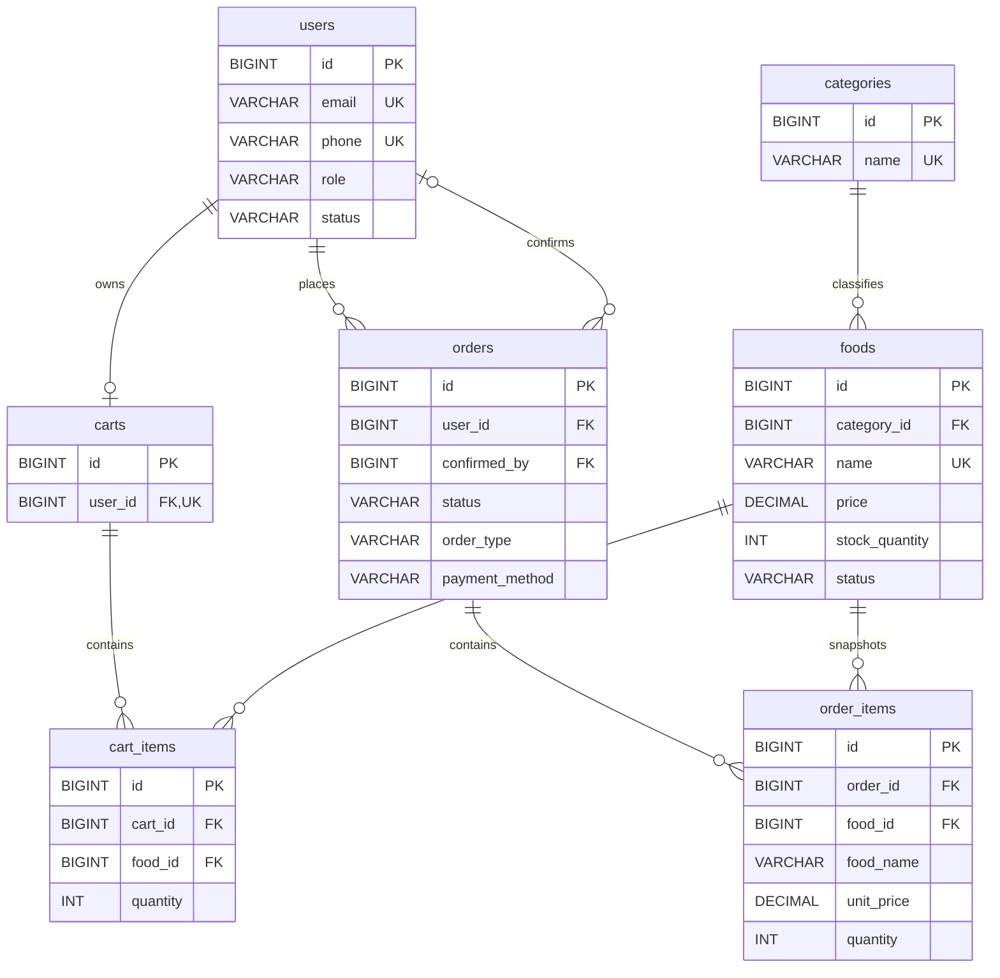

## 4. Database Assessment

Phạm vi mục này là phân tích tĩnh DDL, seed, JPA mapping, repository, transaction annotation, cấu hình và test source. Không kết nối database, không chạy `EXPLAIN`, migration, test hay benchmark. Vì vậy, cấu trúc khai báo trong repository được đánh dấu **CONFIRMED**; trạng thái schema/index/kế hoạch thực thi ở một database đang chạy là **PENDING**; rủi ro cạnh tranh chưa được tái hiện là **POTENTIAL ISSUE**.

### 4.1. Database Overview

| Thuộc tính | Kết quả khảo sát |
|---|---|
| DBMS/storage | **CONFIRMED** — MySQL 8.4/InnoDB trong Docker và Testcontainers (`compose.yaml:2-3`; `DatabaseDesignTests.java:27-32`). |
| Kiểu quản lý schema | **CONFIRMED** — SQL-first bằng `schema.sql`; Hibernate không tạo/cập nhật DDL vì `ddl-auto: none` (`application.yml:18-23`). Không tìm thấy Flyway/Liquibase hay thư mục migration trong repository. |
| Quy mô schema | **CONFIRMED** — 7 bảng nghiệp vụ: `users`, `categories`, `foods`, `carts`, `cart_items`, `orders`, `order_items` (`schema.sql:6-117`). |
| Charset/collation | **CONFIRMED** — mặc định `utf8mb4_0900_as_ci`; các cột enum-like dùng `utf8mb4_0900_as_cs`, còn hash dùng `ascii_bin` (`schema.sql:3,11-13,32,52,86-92`). |
| Tiền và thời gian | **CONFIRMED** — tiền dùng `DECIMAL(15,2)`; timestamp dùng `DATETIME(6)`. Script, Hikari và Hibernate đều khai báo UTC (`schema.sql:4,49,98-99,110`; `application.yml:10-11,22-23`). |
| Runtime hiện tại | **PENDING** — chưa xác minh MySQL version thực tế, storage engine, collation, timezone, isolation, schema drift hoặc index vật lý bằng kết nối DB. |

Database lưu dữ liệu cho một nhà hàng. Tổng đơn không được lưu ở `orders`; ứng dụng tính từ snapshot `order_items.unit_price * quantity` (`OrderDto.java:18-26`; `schema.sql:105-116`). Thiết kế này tránh đồng bộ một cột tổng, nhưng tính đúng vẫn phụ thuộc tính bất biến của chi tiết đơn sau checkout.

### 4.2. Schema & ERD

#### Inventory và quan hệ

| Bảng | Vai trò | PK/unique/FK quan trọng | Quy tắc xóa |
|---|---|---|---|
| `users` | Tài khoản, vai trò, trạng thái | PK `id`; unique `email`, `phone`; CHECK cho dữ liệu tài khoản | Bị `carts`/`orders` tham chiếu bằng `RESTRICT` (`schema.sql:6-32,67,101-102`). |
| `categories` | Danh mục món | PK `id`; unique `name` | `foods.category_id` dùng `RESTRICT` (`schema.sql:34-42,57`). |
| `foods` | Menu, giá, tồn kho, trạng thái bán | PK `id`; unique `name`; FK `category_id` | Bị cart/order item tham chiếu bằng `RESTRICT`; ứng dụng xóa mềm (`schema.sql:44-58,80,116`; `FoodService.java:95-98`). |
| `carts` | Header giỏ, tối đa một giỏ/tài khoản | PK `id`; unique/FK `user_id` | Xóa cart cascade xuống `cart_items` (`schema.sql:60-81`). |
| `cart_items` | Món và số lượng trong giỏ | PK `id`; unique `(cart_id, food_id)`; hai FK | Cascade khi xóa cart; food dùng `RESTRICT` (`schema.sql:70-81`). |
| `orders` | Header đơn, hình thức phục vụ, trạng thái và mốc thời gian | PK `id`; FK `user_id`, `confirmed_by` | Cả hai FK dùng `RESTRICT` (`schema.sql:83-103`). |
| `order_items` | Snapshot tên/giá/số lượng lúc checkout | PK `id`; unique `(order_id, food_id)`; hai FK | Cả order và food dùng `RESTRICT` (`schema.sql:105-117`). |

**CONFIRMED** — ERD trong `docs/database-design.md:13-23` khớp các FK/unique hiện hành. Tuy nhiên, database cho phép một `orders` không có `order_items`; yêu cầu “đơn có ít nhất một dòng” chỉ được bảo đảm bởi luồng checkout (`schema.sql:83-117`; `OrderService.java:37-68`).

### 4.3. JPA Mapping Assessment

| Entity | Mapping đã xác minh | Đánh giá |
|---|---|---|
| `User` | Map 7 cột nghiệp vụ; bỏ `created_at`, `updated_at` do DB quản lý (`User.java:7-34`; `schema.sql:14-15`). | **CONFIRMED compatible** với các thao tác Auth hiện tại. Unique/CHECK chỉ tồn tại trong DDL, không khai báo ở `@Table`. |
| `Category` | Chỉ map `id`, trong khi bảng còn name/description/timestamps (`Category.java:5-10`; `schema.sql:34-42`). | **CONFIRMED partial mapping**; hiện chỉ phục vụ `existsById` trong `FoodService.java:137-140`. Chưa có bằng chứng lỗi, nhưng entity không đại diện đầy đủ bảng. |
| `Food` | Scalar `categoryId`; độ dài/precision của name, price, image, stock, status khớp DDL; bỏ timestamps (`Food.java:8-40`). | **CONFIRMED** — không có `@ManyToOne Category`; integrity dựa vào FK và lookup service. |
| `Cart`/`CartItem` | `Cart.items` là inverse `@OneToMany`, cascade ALL + orphan removal; `CartItem.cart` sở hữu FK LAZY; `foodId` là scalar (`Cart.java:8-26`; `CartItem.java:7-27`). | **CONFIRMED** — phù hợp xóa dòng khi clear/remove và `ON DELETE CASCADE`; timestamps do DB quản lý. |
| `Order`/`OrderItem` | Enum lưu STRING; `Order.items` cascade ALL, không orphan removal; child sở hữu FK LAZY; user/food/confirmedBy là scalar IDs (`Order.java:10-74`; `OrderItem.java:8-35`). | **CONFIRMED** — snapshot name/price có mapping phù hợp. Cascade ALL bao gồm REMOVE, nhưng không có luồng xóa order hiện tại; tác động nếu thêm delete là **PENDING**. |

- **CONFIRMED** — không có `@Version`, `@Lock`, lock mode hoặc native `FOR UPDATE` trong `src/main/java`; vì vậy không có optimistic/pessimistic concurrency control ở mapping/repository hiện tại.
- **CONFIRMED** — `open-in-view: false`; mapping lazy sang DTO được thực hiện bên trong service transaction (`application.yml:18-21`; `OrderService.java:71-93`; `CartService.java:28-32,109-115`).
- **PENDING** — chưa bật schema validation hoặc chạy integration test trong khảo sát này, nên chưa xác nhận runtime mapping của mọi cột/enum/timestamp trên database hiện hữu.

### 4.4. Constraints & Data Integrity

| Bất biến | Lớp bảo vệ hiện tại | Trạng thái đánh giá |
|---|---|---|
| Email và phone duy nhất; role/status/hash user hợp lệ | UNIQUE và CHECK ở DB (`schema.sql:17-31`); validation/service bổ sung | **CONFIRMED** defense in depth cho `users`. |
| Một giỏ/user; một food/cart; một food/order | UNIQUE ở DB (`schema.sql:66,78,114`) | **CONFIRMED**. |
| Tham chiếu user/category/food/cart/order tồn tại | FK + `RESTRICT`, riêng cart → item cascade (`schema.sql:57,67,79-80,101-102,115-116`) | **CONFIRMED**. |
| Giá > 0, stock ≥ 0, quantity > 0, food status hợp lệ | Bean Validation/service (`FoodRequest.java:25-37`; `AddToCartRequest.java:7-14`; `UpdateCartItemRequest.java:6-9`); không có CHECK tương ứng | **CONFIRMED service-enforced**, **POTENTIAL ISSUE** nếu ghi trực tiếp/đường ghi mới bỏ qua API. |
| Order type/status/payment thuộc enum | Java enum/Jackson/service (`Order.java:25-47`; `OrderType.java:3`; `OrderStatus.java:3`; `PaymentMethod.java:3`); DDL chỉ là VARCHAR | **CONFIRMED** không có DB CHECK cho các enum của order. |
| DINE_IN/DELIVERY có đúng trường và payment | `OrderService.applyOrderTypeRules` (`OrderService.java:151-165`) | **CONFIRMED service-enforced**; DB có thể nhận tổ hợp không hợp lệ. |
| Chuyển trạng thái và timestamps nhất quán | `canMove`/`moveTo` (`OrderService.java:119-148`) | **CONFIRMED service-enforced**; DDL không cấm trạng thái/mốc thời gian sai. |
| Đơn có ít nhất một item; snapshot không đổi | Checkout tạo item trước save (`OrderService.java:37-68`) | **POTENTIAL ISSUE** ở ranh giới DB: direct SQL có thể tạo order rỗng và sửa/xóa snapshot. Không có bằng chứng luồng ứng dụng hiện tại làm vậy. |
| Tồn kho không âm khi checkout | Service đọc, kiểm tra rồi ghi giá trị mới (`FoodService.java:116-124`) | **CONFIRMED** cho một execution tuần tự; **POTENTIAL ISSUE** dưới cạnh tranh vì không có lock/version/CHECK. |

Các FK `RESTRICT` cộng với xóa mềm food giúp giữ lịch sử order, nhưng `order_items.food_id` vẫn buộc bản ghi food phải tồn tại (`schema.sql:115-116`; `FoodService.java:95-98`). `confirmed_by` chỉ bảo đảm user tồn tại, không bảo đảm user có role EMPLOYEE (`schema.sql:94,102`); role được bảo vệ ở API/security, không phải constraint quan hệ.

### 4.5. Index Assessment

DDL chỉ khai báo PK và UNIQUE; không có explicit non-unique/composite index tối ưu truy vấn (`schema.sql:16-18,40-41,55-57,65-67,77-80,100-102,113-116`). InnoDB cần index cho FK và có thể tự tạo index hỗ trợ, nhưng danh sách index vật lý chỉ được xác nhận bằng `SHOW INDEX` trên runtime DB — hiện **PENDING**.

| Access pattern | Index hiện thấy trong DDL | Nhận xét tĩnh / candidate cần `EXPLAIN` |
|---|---|---|
| Auth theo email; pre-check email/phone | Unique `email`, unique `phone` (`UserRepository.java:9-11`; `schema.sql:17-18`) | **CONFIRMED** access key được bảo vệ. Query OR của pre-check vẫn cần kế hoạch thực tế. |
| Active foods, tùy chọn category, sort id | PK, unique name; FK category index kỳ vọng nhưng chưa kiểm tra (`FoodRepository.java:10-14`) | **POTENTIAL ISSUE** khi dữ liệu lớn: thiếu explicit composite cho status/category/order. Candidate shape `(status, category_id, id)` chỉ là giả thuyết cần `EXPLAIN` với cả category null/non-null. |
| Tìm `lower(name/description) LIKE '%keyword%'` | Unique B-tree trên name; không có FULLTEXT/function index (`FoodRepository.java:16-22`) | **POTENTIAL ISSUE** table scan: leading wildcard và `lower()` thường không tận dụng B-tree name; cần `EXPLAIN ANALYZE` và dataset đủ lớn. |
| Tìm cart theo user, load item theo cart | Unique `carts(user_id)` và unique `(cart_id, food_id)` (`CartRepository.java:7-11`; `schema.sql:66,78`) | **CONFIRMED** các prefix phù hợp access pattern chính. Index vật lý cho `cart_items.food_id` là **PENDING**. |
| List/count order theo owner tùy chọn, type, status; sort `created_at DESC, id DESC` | Chỉ PK và FK trong DDL (`OrderRepository.java:16-30`; `schema.sql:100-102`) | **POTENTIAL ISSUE** scan/filesort/offset cost. Candidate phải tách workload customer và employee, ví dụ bắt đầu từ `user_id` hoặc `status/type`, rồi `created_at,id`; không quyết định index trước cardinality và `EXPLAIN`. |
| Load order items theo order | Unique `(order_id, food_id)` (`schema.sql:114`) | **CONFIRMED** left-prefix hỗ trợ lookup theo `order_id`; index vật lý cho `food_id` là **PENDING**. |

Không có số liệu row count production, selectivity, buffer pool, query latency hay execution plan. Vì vậy mục này chỉ xác định candidate/rủi ro, không kết luận index nào phải được thêm hoặc query nào đang chậm.

### 4.6. Repository & Query Analysis

- **CONFIRMED** — repository dùng Spring Data JPA/JPQL và derived query; không tìm thấy native SQL trong `src/main/java` (`UserRepository.java:8-11`; `FoodRepository.java:9-25`; `OrderRepository.java:14-31`).
- **CONFIRMED** — Food list/search không phân trang và trả toàn bộ kết quả phù hợp (`FoodRepository.java:10-22`; `FoodService.java:28-51`). Ảnh hưởng thực tế phụ thuộc kích thước menu.
- **POTENTIAL ISSUE** — các điều kiện optional dạng `:param is null or ...` có thể làm kế hoạch kém ổn định; cần `EXPLAIN` cho từng tổ hợp (`FoodRepository.java:12,18`; `OrderRepository.java:16-24`).
- **CONFIRMED** — order pagination dùng offset `PageRequest.of(page,size)` và chạy riêng query content/count (`OrderRepository.java:23-30`; `OrderService.java:71-86`). Offset lớn và count lặp lại là scalability risk, chưa phải defect đã đo.
- **POTENTIAL ISSUE** — list order load `Order.items` LAZY khi `OrderDto.fromEntity` map từng order, có khả năng 1 query list + N query item; không có fetch join/entity graph/batch mapping trong repository (`Order.java:70-74`; `OrderRepository.java:23-24`; `OrderService.java:84-85`; `OrderDto.java:18-21`). Cần SQL/query-count instrumentation để xác minh.
- **CONFIRMED** — cart mutation gọi `saveAndFlush`, ép flush sớm (`CartRepository.java:10-12`). Điều này hỗ trợ phát hiện constraint trong transaction nhưng có thể thay đổi thời điểm lấy lock; tác động contention là **PENDING**.
- **POTENTIAL ISSUE** — duplicate account translation phụ thuộc MySQL code `1062` và tên constraint (`MySqlAccountRepository.java:45-50`), nên schema/driver drift có thể thay đổi error mapping.

### 4.7. Transaction Analysis

| Luồng | Boundary tĩnh | Nhận xét |
|---|---|---|
| Auth read/create | `MySqlAccountRepository` đặt transaction read-only/write quanh từng adapter method (`MySqlAccountRepository.java:22-61`) | `RegisterService` pre-check rồi create qua hai lời gọi riêng (`RegisterService.java:22-31`); unique DB là lớp quyết định khi có race. |
| Food CRUD/stock | Mỗi public method service có read-only hoặc write transaction (`FoodService.java:28-128`) | Reserve/release là read-modify-write trên entity, không lock/version. |
| Cart CRUD | Mỗi public method có transaction; write kết thúc bằng `saveAndFlush` (`CartService.java:28-106`) | Aggregate mutation và orphan removal nằm trong cùng transaction. |
| Checkout | `OrderService.create` là outer transaction; đọc cart, reserve từng food, cascade save order/items và clear cart (`OrderService.java:33-68`) | Với propagation mặc định, các lời gọi sang bean `CartService`/`FoodService` tham gia outer transaction. Không có propagation/isolation tùy chỉnh trong source. |
| Cancel/status | `cancel`, `confirm`, `updateStatus` là write transaction; cancel cập nhật order và hoàn kho (`OrderService.java:96-148`) | `confirm` tự gọi `updateStatus`, nhưng bản thân `confirm` đã mở transaction; chưa thấy mất boundary trong luồng hiện tại. |
| List/get | Transaction read-only bao quanh query và DTO mapping (`OrderService.java:71-93`) | Cho phép khởi tạo collection LAZY dù open-in-view tắt. |

**CONFIRMED design intent** — source test có case rollback checkout khi clear cart lỗi, rollback reservation khi một food lỗi, và rollback cancel/status (`OrderIntegrationTest.java:104-129,164-178,269-278`). Tuy nhiên, các test này không được chạy trong khảo sát nên trạng thái pass là **PENDING**.

**PENDING** — isolation level không được cấu hình trong application; giá trị runtime kế thừa datasource/server. Cần đọc `@@transaction_isolation`, autocommit và timeout trên đúng môi trường benchmark. Không có bằng chứng để kết luận deadlock/rollback behavior cụ thể dù `GlobalErrors` đã map `PessimisticLockingFailureException` thành 409 (`GlobalErrors.java:65-69`).

### 4.8. Concurrency & Consistency Risks

Các interleaving dưới đây suy ra từ read-modify-write không lock/version. Chúng là **POTENTIAL ISSUE**, chưa phải lỗi đã tái hiện.

| Kịch bản | Interleaving/rủi ro tĩnh | Kiểm thử cần có để xác minh |
|---|---|---|
| Hai checkout cùng food | T1/T2 cùng đọc stock `S`, cùng pass check, tạo hai order và ghi stock dựa trên snapshot cũ; có thể lost update hoặc bán vượt mức logic (`FoodService.java:116-124`; `OrderService.java:54-67`). | Hai transaction thật, barrier sau read; tổng quantity sát/vượt stock; assert số order commit, final stock và error/rollback. Ghi nhận isolation, SQL và lock wait. |
| Hai checkout cùng cart | Cả hai có thể đọc cùng item trước khi một bên clear, rồi cùng tạo order/reserve; unique chỉ giới hạn food trong từng order, không giới hạn một checkout/cart (`CartService.java:93-106`; `OrderService.java:35-68`). | Hai request cùng user/cart với latch; assert tối đa một order hợp lệ, một lần trừ stock và trạng thái cart cuối. |
| Hai lần cancel cùng order | Cả hai có thể đọc PENDING trước cập nhật, cùng gọi `releaseStock`, gây hoàn kho hai lần (`OrderService.java:96-102,132-148`). | Hai transaction cancel đồng thời; assert một transition thành công, final stock chỉ tăng một lần và loser nhận conflict phù hợp. |
| Admin sửa stock đồng thời checkout | Admin ghi stock tuyệt đối trong `updateFood`, checkout ghi `oldStock - qty`; commit sau có thể ghi đè thay đổi trước (`FoodService.java:75-92,116-124`). | Barrier quanh hai transaction; chạy cả hai commit order; định nghĩa trước expected business semantics rồi assert final stock. |
| Hai request cùng tạo cart đầu tiên | Cả hai có thể `findByUserId` rỗng rồi INSERT; unique `carts.user_id` giữ integrity, một request có thể nhận conflict (`CartService.java:35-39`; `schema.sql:60-67`; `GlobalErrors.java:59-63`). | User chưa có cart, hai add đồng thời; assert chỉ một cart, item/quantity đúng và error contract của request thua. |

Không tìm thấy concurrency integration test dùng barrier/latch cho các luồng Order/Cart; `AuthIntegrationTest` có utility concurrency nhưng không chứng minh năm kịch bản trên. Các kết quả cần đo trên cùng MySQL/config phần baseline, không suy ra từ unit test tuần tự.

### 4.9. Database Lifecycle

| Môi trường | Cách khởi tạo/reset hiện có | Đánh giá tái lập |
|---|---|---|
| Docker Compose / Local JVM | MySQL mount `schema.sql` vào `/docker-entrypoint-initdb.d`; seed chỉ mount ở `/opt` và chạy thủ công (`compose.yaml:11-14`; `README.md:72-94`). | **CONFIRMED** schema chỉ auto-init khi volume mới. `CREATE TABLE IF NOT EXISTS` không nâng cấp bảng cũ (`schema.sql:1-2`). Reset sạch hiện phụ thuộc tạo lại DB/volume; không có migration/version table. |
| Testcontainers | Pin `mysql:8.4`, init schema; test tự nạp seed (`DatabaseDesignTests.java:27-47`; `OrderIntegrationTest.java:42-65`). | **CONFIRMED** test source có môi trường DB tách biệt. `OrderIntegrationTest` xóa theo thứ tự FK rồi seed lại; pass/runtime vẫn **PENDING** vì không chạy. |
| Kaggle | Dataset chứa jar + bản sao schema/seed; notebook cài `mysql-server`, tạo DB, chạy hai script rồi start jar (`kaggle/script/README.md:21-33`; `byteme_kaggle_benchmark.ipynb:33-46,59-74`). | **POTENTIAL ISSUE** — package `mysql-server` không pin 8.4 như Compose/Testcontainers; version/cấu hình có thể khác giữa session. Đồng bộ jar/schema/seed là bước upload thủ công. |

`seed.sql` là dataset nhỏ, cố định: 8 users, 6 categories, 18 foods, 5 carts, 6 cart items, 8 orders, 16 order items (`seed.sql:7-100`; `DatabaseDesignTests.java:34-36`). Script bọc một transaction nhưng dùng ID/INSERT cố định nên chỉ chạy một lần trên DB rỗng; test source kỳ vọng lần hai thất bại (`seed.sql:1-5,102`; `DatabaseDesignTests.java:187-193`). Đây là **CONFIRMED** cho tính deterministic của sample, nhưng không đủ quy mô để đánh giá index/performance và không phải reset script idempotent.

Để tái lập baseline cần ghi cùng commit/hash của jar, `schema.sql`, `seed.sql`, MySQL image/version, biến kết nối, timezone/isolation, trạng thái database sạch và lệnh seed. Hiện repository chưa có migration history để chứng minh một volume cũ đã tiến tới đúng schema hiện hành.

### 4.10. Database Findings

Mức ảnh hưởng là sơ bộ đối với integrity/reliability/performance/reproducibility; không phải production incident severity và không chọn giải pháp Phase 2.

| ID | Trạng thái | Ảnh hưởng | Phát hiện | Bằng chứng | Xác minh còn thiếu |
|---|---|---|---|---|---|
| DB-01 | **CONFIRMED** | Informational | Schema SQL-first gồm 7 bảng InnoDB; JPA không quản lý DDL. | `schema.sql:1-117`; `application.yml:18-23`. | Runtime schema/version/drift. |
| DB-02 | **CONFIRMED** lifecycle risk | Medium | Không có migration tool/version table; `CREATE TABLE IF NOT EXISTS` không upgrade bảng có sẵn. | `schema.sql:1-2`; `compose.yaml:11-14`; không có Flyway/Liquibase trong `pom.xml`. | Quy trình nâng cấp/reset nhóm sẽ dùng. |
| DB-03 | **CONFIRMED** mapping characteristic | Low–Medium | Mapping cột chính khớp DDL; `Category` chỉ map ID, nhiều FK map scalar và timestamp do DB quản lý. | `Category.java:5-10`; `Food.java:20-39`; `CartItem.java:19-27`; `OrderItem.java:20-35`. | Schema validation/integration runtime. |
| DB-04 | **CONFIRMED** integrity gap at DB boundary | Medium | Food/cart/order invariants chủ yếu ở validation/service; DB không CHECK price/stock/quantity/order enums/shape/timeline. | `schema.sql:44-117`; `FoodRequest.java:25-37`; `OrderService.java:119-165`. | Nhóm có yêu cầu bảo vệ direct SQL/import hay không. |
| DB-05 | **POTENTIAL ISSUE** | High nếu tái hiện | Checkout/cancel/admin update có nguy cơ lost update, oversell hoặc double release do không lock/version. | `FoodService.java:75-92,116-130`; `OrderService.java:35-68,96-148`; không có `@Version/@Lock`. | Năm concurrency tests ở Mục 4.8 trên MySQL thật. |
| DB-06 | **POTENTIAL ISSUE** | Medium–High khi dữ liệu lớn | Food search và order filter/sort/count thiếu explicit index phù hợp; wildcard/OR/offset có thể scan/filesort. | `FoodRepository.java:10-22`; `OrderRepository.java:16-30`; `schema.sql:44-117`. | `SHOW INDEX`, cardinality, `EXPLAIN ANALYZE`, latency/load. |
| DB-07 | **POTENTIAL ISSUE** | Medium | Order list có khả năng N+1 khi map LAZY items. | `Order.java:70-74`; `OrderRepository.java:23-24`; `OrderService.java:84-85`. | SQL query count ở page size đại diện. |
| DB-08 | **CONFIRMED** reproducibility limit | Medium | Seed deterministic nhưng nhỏ và không idempotent; không tự reset database. | `seed.sql:1-5,7-102`; `DatabaseDesignTests.java:187-193`. | Dataset baseline có quy mô/shape nào sẽ dùng benchmark. |
| DB-09 | **PENDING** | Unknown | Chưa xác minh runtime MySQL/config, index vật lý, schema drift, execution plan hoặc test pass. | Giới hạn khảo sát; `application.yml:6-23`. | Kết nối môi trường sạch ở hạng mục test/performance phù hợp. |
| DB-10 | **POTENTIAL ISSUE** reproducibility | Medium | Kaggle cài MySQL từ package không pin 8.4, khác Compose/Testcontainers; artifact/schema/seed upload thủ công. | `compose.yaml:3`; `DatabaseDesignTests.java:30`; `kaggle/script/README.md:21-33`; notebook `33-46`. | Ghi version/config thực tế mỗi run và checksum dataset. |
| DB-11 | **CONFIRMED design intent / PENDING runtime** | Medium | Checkout/cancel được bao bởi outer transaction và có test source về rollback tuần tự. | `OrderService.java:33-68,96-148`; `OrderIntegrationTest.java:104-129,164-178`. | Chạy test trên baseline; bổ sung concurrency/failure modes. |
| DB-12 | **POTENTIAL ISSUE** | Low–Medium | Account pre-check và insert là hai transaction; race được unique bảo vệ nhưng loser phụ thuộc MySQL-specific error translation. | `RegisterService.java:22-31`; `MySqlAccountRepository.java:22-50`; `schema.sql:17-18`; test source cho hai concurrent adapter inserts ở `AuthIntegrationTest.java:100-108`. | Chạy test hiện có; bổ sung race qua toàn bộ HTTP register/pre-check và xác minh error contract. |

Không có database defect mới được **chứng minh bằng runtime** trong khảo sát này. DB-05 đến DB-07, DB-10 và DB-12 là rủi ro/candidate cần đo hoặc test; DB-04 là khoảng trống bảo vệ ở DB boundary nhưng có thể là chủ đích Phase 1.

### 4.11. Conclusions & Pending Questions

#### Kết luận

- **CONFIRMED** — schema hiện hành nhỏ, quan hệ/FK/unique rõ và phù hợp mô hình một nhà hàng; snapshot order và xóa mềm food hỗ trợ giữ lịch sử.
- **CONFIRMED** — JPA mapping nhìn chung khớp DDL, nhưng cố ý tối giản: scalar FK, partial `Category`, nhiều timestamp do DB quản lý và không có version field.
- **CONFIRMED** — checkout/cancel có transaction boundary ở service; rollback tuần tự có test source, nhưng không được tuyên bố pass trong khảo sát này.
- **CONFIRMED** — index explicit chỉ gồm PK/unique; schema lifecycle dựa vào init script/volume và không có migration history.
- **POTENTIAL ISSUE** — concurrency là rủi ro integrity nổi bật nhất; query search/order list là rủi ro performance cần execution plan/query count, không thể kết luận từ source.
- **PENDING** — runtime schema/index/isolation/version, test pass, execution plan, cardinality và behavior cạnh tranh.

#### Câu hỏi/điểm cần nhóm xác nhận

1. Database boundary có phải tự bảo vệ mọi invariant trước import/direct SQL, hay Phase 2 tiếp tục coi service là đường ghi duy nhất?
2. Quy trình chuẩn để reset/upgrade schema cho local, Testcontainers và Kaggle là gì; có yêu cầu giữ data cũ không?
3. Dataset và cardinality nào đại diện cho benchmark trước/sau; sample seed hiện tại có được dùng chỉ để smoke test không?
4. Expected semantics khi admin cập nhật stock đồng thời checkout là absolute overwrite hay delta/serialization?
5. Với hai checkout cùng cart hoặc hai cancel cùng order, request thua phải trả conflict, idempotent success hay hành vi khác?
6. Có chấp nhận phụ thuộc MySQL 8.4 tuyệt đối không, và Kaggle sẽ pin/ghi nhận phiên bản bằng cách nào?
7. Query workload ưu tiên để lấy `EXPLAIN ANALYZE` là food search, customer order history hay employee queue; page size/cardinality chuẩn là bao nhiêu?

**Readiness:** đủ thông tin tĩnh để chuyển sang **Hạng mục 5 – API Assessment**: schema, mapping, query, transaction và các điểm giao tiếp dữ liệu đã được định vị. Chưa đủ bằng chứng để lựa chọn cải tiến database hoặc tuyên bố reliability/performance; các mục runtime/concurrency/index vẫn giữ **PENDING/POTENTIAL ISSUE** cho hạng mục Testing/Performance và quyết định Phase 2 sau này.

