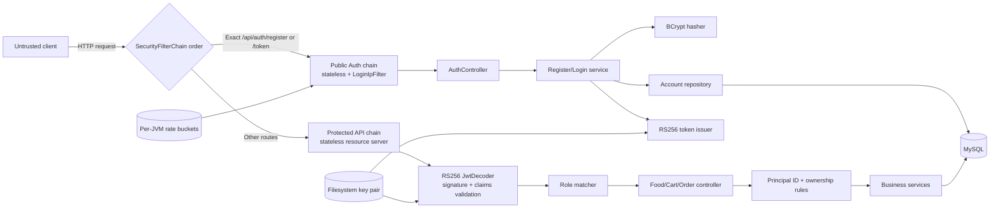

## 6. Security Assessment

Phạm vi mục này là review tĩnh source/config/test và đối chiếu báo cáo bảo mật cũ. Không chạy ứng dụng, test, scanner, dependency resolution hay tấn công. Nhãn **CONFIRMED** chỉ dùng cho cơ chế/khoảng trống thấy trực tiếp trong repository; chỉ gọi là vulnerability đã xác nhận khi có đường khai thác và ảnh hưởng đủ bằng chứng — khảo sát này không xác nhận vulnerability mới nào như vậy.

### 6.1. Security Architecture Overview

ByteMe dùng hai Spring Security filter chain stateless. Auth register/token đi qua chain riêng và login IP filter; API còn lại đi qua OAuth2 Resource Server, JWT decoder, RBAC matcher rồi controller/service. Authentication state nằm trong token; account, ownership và dữ liệu nghiệp vụ nằm ở MySQL. RSA private/public key được đọc từ filesystem lúc khởi động; rate-limit state chỉ nằm trong memory của một JVM.

#### Trust boundaries và trách nhiệm

| Boundary/component | Trách nhiệm đã xác minh | Residual assumption |
|---|---|---|
| Client/network → filter chains | Parse Bearer token, chặn thiếu/sai token và role trước controller (`SecurityConfiguration.java:19-49`). | TLS/reverse proxy không có trong repository; network confidentiality phụ thuộc deployment. |
| Auth input → account service | Strict JSON riêng cho Auth, normalize/validate, hash/verify password, check status (`AuthJsonAdvice.java:17-46`; `AuthValidation.java:9-31`; `LoginService.java:24-39`). | Register vẫn công khai và trả duplicate conflict. |
| Token → principal | RS256 signature và claim validation, chuyển thành đúng một `ROLE_*` (`AdapterConfiguration.java:35-48`; `SecurityConfiguration.java:39-42`). | Không tra lại DB cho mỗi request; token có quyền đến khi hết hạn. |
| Principal → business object | Cart không nhận owner ID từ client; Order customer list/get/cancel kiểm tra owner (`CartController.java:22-50`; `OrderService.java:81-99,180-182`). | EMPLOYEE được đọc mọi order theo policy hiện tại. |
| Filesystem → signing/validation | Đọc cặp key, kiểm tra modulus; issuer yêu cầu RSA private key ≥2048 bit (`AdapterConfiguration.java:22-33`; `LocalRsaTokenIssuer.java:22-27`). | Permission/rotation/backup/revocation là trách nhiệm vận hành. |
| JVM memory → abuse control | Fixed-window quota email/IP, synchronized và cleanup (`LoginRateLimiter.java:10-28`). | Không chia sẻ giữa instance, reset khi restart. |

### 6.2. Authentication Assessment

#### Registration

- `RegisterService` chuẩn hóa full name/email/phone, yêu cầu password và confirmation 8–72 code point, đồng thời giới hạn 72 byte UTF-8; bắt buộc khớp chính xác (`RegisterService.java:22-31`; `AuthValidation.java:20-31`).
- Role/status không nhận từ client: repository luôn ghi `CUSTOMER`/`ACTIVE`, và service kiểm tra kết quả (`MySqlAccountRepository.java:33-50`; `RegisterService.java:31-33`). Điều này giảm mass-assignment/privilege escalation.
- Email/phone unique ở DB và duplicate được map 409 (`schema.sql:17-18`; `MySqlAccountRepository.java:45-50`). **POTENTIAL ISSUE:** response duplicate có thể dùng để dò contact đã đăng ký, trong khi register chưa có rate limit; mức chấp nhận phụ thuộc yêu cầu product/privacy.

#### Login và password

- **CONFIRMED** — password lưu bằng `BCryptPasswordEncoder`; constructor mặc định của Spring dùng strength 10, salt do encoder tạo; verify bằng `matches` (`BCryptPasswordHasher.java:7-19`). Test source có round-trip và UTF-8 limit (`AdaptersTest.java:19-27`).
- Login normalize email, dùng một dummy BCrypt hash khi account không tồn tại rồi trả cùng `INVALID_CREDENTIALS` cho email thiếu/sai password (`LoginService.java:24-31`). Đây là mitigation tốt cho direct username enumeration/timing ở nhánh credentials; chưa có timing measurement.
- Account status chỉ được kiểm tra sau khi password đúng; INACTIVE/LOCKED trả 403 `ACCOUNT_NOT_ACTIVE` (`LoginService.java:28-31`; `AuthErrors.java:17-25`). Sai password của account không active vẫn nhận generic 401.
- Sensitive DTO/command/result override `toString` thành REDACTED; source không log password/token đầy đủ (`RegisterRequest.java:3-4`; `LoginRequest.java:3-4`; `AccessToken.java:11`; `TokenResponse.java:3-4`). Runtime logging configuration/interceptor chưa được kiểm chứng.
- **POTENTIAL ISSUE:** policy chỉ yêu cầu độ dài tối thiểu 8, không thấy breached-password check hoặc composition/strength rule; cost BCrypt không cấu hình theo môi trường. Đây là authentication-hardening decision, chưa có evidence credential compromise.

### 6.3. JWT Security Assessment

| Thuộc tính | Cơ chế hiện tại | Đánh giá |
|---|---|---|
| Algorithm/signature | Issuer đặt RS256; decoder chỉ chấp nhận RS256 với RSA public key (`LocalRsaTokenIssuer.java:32-36`; `AdapterConfiguration.java:35-36`). | **CONFIRMED** chống sửa payload/role nếu private key không lộ; không có `none`/algorithm confusion trong cấu hình thấy được. |
| Key strength/pair | Issuer từ chối private key <2048 bit; loader so modulus public/private (`LocalRsaTokenIssuer.java:22-24`; `AdapterConfiguration.java:22-27`). | **CONFIRMED** startup guard. |
| iss/aud | Issuer cố định hai giá trị; validator yêu cầu exact issuer và audience chứa giá trị mong đợi (`LocalRsaTokenIssuer.java:17-18,32-34`; `AdapterConfiguration.java:42-43`). | **CONFIRMED**. |
| iat/exp/nbf | Issuer ghi iat/exp; validator yêu cầu iat/exp, iat không ở tương lai, exp > iat, now < exp; kiểm tra nbf nếu có (`LocalRsaTokenIssuer.java:29-37`; `AdapterConfiguration.java:39-44`). | **CONFIRMED**; issuer không tạo nbf nhưng decoder hỗ trợ. Không có explicit clock-skew allowance. |
| sub/role | Issuer lấy ID/role server-side; validator yêu cầu sub không blank và role thuộc enum; controller Cart/Order còn yêu cầu sub parse thành long dương (`LocalRsaTokenIssuer.java:32-34`; `AdapterConfiguration.java:41,45`; `CurrentUser.java:8-13`). | **CONFIRMED**. Food ADMIN write không cần numeric sub sau role check, nhưng client không thể tự ký token. |
| TTL | Default cấu hình 5.400 giây, bắt buộc TTL dương (`application.yml:24-31`; `LocalRsaTokenIssuer.java:22-27`). | **CONFIRMED configuration**; suitability cần product/deployment decision. |
| Rotation/revocation | Một cặp key, không `kid`, JTI/denylist/introspection/logout/refresh; không thấy rotation procedure (`LocalRsaTokenIssuer.java:29-36`; `AdapterConfiguration.java:22-36`). | **CONFIRMED lifecycle gap**, không bắt buộc bởi Pha 1 nhưng ảnh hưởng response khi key/token bị lộ. |
| Account change after issue | Protected request tin role/status trong signed token, không query account (`SecurityConfiguration.java:39-42`). | **POTENTIAL ISSUE:** khóa account hoặc đổi role không vô hiệu token đã cấp; quyền cũ tồn tại đến exp hoặc thay key. |

Test source tạo key tạm 2048-bit, kiểm tra claim/expiry và invalid JWT/role access (`TestAuthKeys.java:20-40`; `AdaptersTest.java:28-44`; `OrderWebTest.java:57-76`). Test không được chạy; chưa có test key rotation, revoked/disabled-after-issue, tampered claim bằng decoder production hoặc clock boundary đầy đủ.

### 6.4. Authorization & Access Control

Không lặp inventory Mục 5.1; coverage security của 18 endpoint được nhóm như sau:

| Policy group | Số endpoint | Enforcement |
|---|---:|---|
| Auth public exact paths | 2 | Chain `@Order(1)` permit all (`SecurityConfiguration.java:19-23`). |
| Food public reads | 3 | GET `/api/foods`, `/api/foods/**` permit all (`SecurityConfiguration.java:27-28`). |
| Food ADMIN writes | 3 | POST/PUT/DELETE matchers (`SecurityConfiguration.java:29-31`). |
| Cart CUSTOMER-only | 4 | `/api/cart`, `/api/cart/**` (`SecurityConfiguration.java:32`). |
| Order CUSTOMER create/cancel | 2 | POST collection, DELETE item (`SecurityConfiguration.java:33-34`). |
| Order EMPLOYEE confirm/status | 2 | POST confirm, PUT status (`SecurityConfiguration.java:35-36`). |
| Order CUSTOMER/EMPLOYEE reads | 2 | GET collection/item (`SecurityConfiguration.java:37`). |
| **Tổng** | **18** | **18/18 endpoint có matcher policy cụ thể.** |

#### Ownership, BOLA/IDOR và privilege escalation

- **CONFIRMED** — Cart API không nhận userId; mọi handler dùng subject từ JWT. Update/delete tìm item chỉ trong cart hiện tại, nên item của user khác trả not-found (`CartController.java:22-50`; `CartService.java:65-89`).
- **CONFIRMED** — Order create dùng customer ID từ principal; customer list ép `ownerId=userId`; detail/cancel gọi `requireOwner`. EMPLOYEE list/detail có policy đọc mọi order; confirm/status lấy actor từ principal (`OrderController.java:29-65`; `OrderService.java:81-99,132-148,180-182`).
- **CONFIRMED** — request DTO không có role, owner, server price hoặc order items; unknown field không trở thành entity property. Register luôn tạo CUSTOMER (`RegisterService.java:22-33`; `CreateOrderRequest.java:8-29`).
- Current web/service test source kiểm tra sai role không tới service, spoofed owner header bị bỏ qua và customer khác bị cấm (`FoodCartSecurityTest.java:51-96`; `OrderWebTest.java:57-76`; `OrderServiceTest.java:178-181`). Báo cáo cũ cũng không ghi nhận BOLA trong phạm vi 72 tổ hợp, nhưng áp dụng cho commit khác (`security-report.md:46-54,166-170`).
- **POTENTIAL ISSUE — deny-by-default maintainability:** sau các matcher cụ thể, fallback là `.anyRequest().authenticated()`, không phải `denyAll` (`SecurityConfiguration.java:27-38`). 18 endpoint hiện tại đều được cover, nhưng endpoint mới quên policy sẽ mở cho mọi role đã xác thực.

Không có bằng chứng static về IDOR/BOLA hoặc privilege escalation đang khai thác được trên 18 endpoint. Runtime negative tests cho toàn ma trận và owner cross-access vẫn **PENDING** vì test không chạy và báo cáo cũ không cùng HEAD.

### 6.5. Security Filter Chain

#### Hai chain và ordering

1. `publicAuth` có `@Order(1)` và exact matcher cho register/token; stateless, CSRF off, permitAll. `LoginIpFilter` đặt trước `UsernamePasswordAuthenticationFilter` nhưng `shouldNotFilter` bảo đảm chỉ POST token bị đếm IP (`SecurityConfiguration.java:19-23`; `LoginIpFilter.java:11-20`).
2. `protectedApi` `@Order(2)` áp cho phần còn lại; public docs/health và Food GET được permit, các API khác theo role; OAuth2 resource server xác thực JWT (`SecurityConfiguration.java:25-49`).

Hệ quả đã xác minh:

- Auth routes không cấu hình resource server, nên Bearer hỏng bị bỏ qua; register/token vẫn dựa credentials/body.
- Public Food GET vẫn đi qua resource-server filter: không token thì được permit, nhưng nếu gửi Bearer hỏng/hết hạn sẽ nhận 401. Đây là behavior đã mô tả ở Mục 5.
- Authentication entry point trả 401 JSON + `WWW-Authenticate: Bearer` + `no-store`; access-denied handler trả 403 JSON + `no-store` (`SecurityConfiguration.java:43-48`).
- Malformed/expired/signature-invalid JWT bị decoder/resource server từ chối trước controller. Exact runtime mapping cho mọi failure subtype là **PENDING**.

#### CSRF, session, CORS và headers

- **CONFIRMED** — cả hai chain `STATELESS`; CSRF disabled (`SecurityConfiguration.java:19-26`). Với bearer trong Authorization header và không có cookie session trong source, đây là cấu hình phù hợp hiện tại; nếu sau này dùng cookie authentication phải đánh giá lại.
- Không thấy CORS configuration. Browser cross-origin mặc định sẽ không được ứng dụng cho phép; frontend khác origin cần reverse proxy hoặc policy tường minh. Đây là deployment/usability condition, không phải CORS vulnerability đã xác nhận.
- Không thấy cấu hình header tường minh cho CSP, HSTS, referrer hoặc permissions policy. Spring Security có default headers khác tùy runtime, nhưng exact response phải kiểm tra. Swagger UI vẫn public (`SecurityConfiguration.java:27`), liên quan trực tiếp SEC-02.
- Health endpoint được permit; không thấy application config mở rộng actuator exposure/show-details. Runtime actuator surface vẫn **PENDING**.

### 6.6. Input Validation & Injection Risks

| Vector | Cơ chế/bằng chứng | Đánh giá |
|---|---|---|
| SQL/JPQL injection | Repository dùng derived query hoặc JPQL parameter; Food search escape `!`, `%`, `_` trước bind (`FoodRepository.java:10-25`; `FoodService.java:43-51,157-159`; `OrderRepository.java:16-30`). | **CONFIRMED mitigation**; không thấy dynamic native SQL từ input trong main source. |
| JSON deserialization | Auth strict unknown/trailing/type coercion; global config từ chối numeric enum và float-as-int (`AuthJsonAdvice.java:17-46`; `application.yml:12-17`). | **CONFIRMED**. Food/Cart/Order ignore unknown fields theo default; request records giới hạn binding target. |
| Mass assignment | Controller nhận request DTO, service tự lấy user/role/price/items; không bind JPA entity từ body (`FoodController.java:38-45`; `CartController.java:28-42`; `OrderController.java:29-65`). | **CONFIRMED mitigation**. |
| Numeric/string bounds | Bean Validation và service áp positive/min/size/enum/order-type rules (`FoodRequest.java:13-37`; `AddToCartRequest.java:7-14`; `CreateOrderRequest.java:9-29`; `OrderService.java:151-177`). | **CONFIRMED** ở API path; direct DB boundary xem DB-04. |
| Reflected/stored strings | Name/description/image URL/note/address được trả lại trong JSON; backend không render HTML hoặc fetch `imageUrl`. | **PENDING consumer risk**, cùng SEC-03; reflection JSON không tự chứng minh XSS/SSRF. |
| Error disclosure | Client nhận generic 500; validation/business messages không chứa stack trace; DAO cause chỉ log server-side (`GlobalErrors.java:59-85`). | Không thấy client-side secret/stack disclosure trong handler source. Log access/redaction và `/error` runtime còn PENDING. |

No-store được đặt tường minh cho handled errors và Auth/Order sensitive responses (`GlobalErrors.java:24-85`; `AuthController.java:21-34`; `OrderController.java:29-69`). Food/Cart controller không tự đặt cache header; Food là dữ liệu public, còn Cart chứa giỏ của user. Cache headers cuối cùng có thể do Spring Security defaults bổ sung nên cần kiểm tra runtime. Không có evidence response chứa password hash; `AccountRecord` không có password (`AccountRecord.java:7-15`).

### 6.7. Secrets & Key Management

#### Cơ chế hiện tại

- Key paths và TTL lấy từ configuration/environment; local mặc định trỏ vào `.local`, Docker dùng paths dưới read-only bind mount (`application.yml:24-31`; `compose.yaml:24-33`).
- `.gitignore` loại `.env`, `.env.*` (trừ example) và toàn bộ `.local`; không có PEM/key-like filename trong Git index tại thời điểm khảo sát (`.gitignore:8-17`; Git metadata). Đây không thay thế secret scanner.
- Generator tạo RSA 2048-bit, không ghi đè cặp đã có, private file không mã hóa nhưng đặt mode `0600`; script Docker copy atomically với private `0600`, public `0644` (`generate-keys.py:7-22`; `prepare-docker-keys.py:6-28`). Permission/ACL thực tế trên từng OS chưa được kiểm tra.
- Docker image không COPY `.local`; runtime image chạy UID/GID không-root và nhận keys qua volume read-only (`Dockerfile:1-13`; `compose.yaml:28-33`). Đây là separation tích cực giữa artifact và secret.
- Test tự sinh cặp key tạm, đặt POSIX permission nếu hỗ trợ và xóa qua shutdown hook; không dùng key production (`TestAuthKeys.java:20-40`).

#### Rủi ro/điểm mở

- **CONFIRMED lifecycle gap:** không có `kid`, active/next key set, rotation/revocation procedure hoặc external secret manager. Generator cố ý không overwrite nên rotation hiện là thao tác vận hành thủ công.
- Private key được lưu unencrypted trên filesystem, dựa vào ACL/mount/container boundary. Phù hợp local development nhưng protection, backup và incident rotation cho deployment thực tế là **PENDING**.
- Compose và `.env.example` chứa development defaults; seed/README có sample accounts. Không đưa các giá trị vào báo cáo này. **POTENTIAL ISSUE:** triển khai ngoài local mà không override/xóa sample data sẽ làm credentials có thể dự đoán (`.env.example:1-9`; `compose.yaml:4-8`; `seed.sql:1-17`; `README.md:102-114`).
- DB credential được truyền bằng environment variable, không dùng Docker/Kubernetes secret abstraction. Mức chấp nhận phụ thuộc target deployment; không thấy production configuration trong repository.

### 6.8. Rate Limiting & Abuse Protection

| Thuộc tính | Kết quả |
|---|---|
| Scope | Chỉ `POST /api/auth/token`; IP được đếm trước body/controller, email sau khi email/password hợp lệ về định dạng (`LoginIpFilter.java:11-20`; `AuthController.java:27-34`). Register không bị limit. |
| Defaults | 10 attempt/email, 100/IP trong fixed window 900 giây; cấu hình qua env (`application.yml:28-31`). |
| State/algorithm | Một `HashMap` chung cho email/IP, fixed-window, cleanup định kỳ; tối đa 100.000 bucket rồi fail closed (`LoginRateLimiter.java:10-28`). |
| Thread safety | `take` synchronized; test source gửi 40 concurrent request và kỳ vọng chỉ 10 accepted (`LoginRateLimiter.java:20-28`; `RateLimiterTest.java:21-29`). |
| Client IP | Dùng `HttpServletRequest.getRemoteAddr`, cố ý không tin `X-Forwarded-For` (`LoginIpFilter.java:15`; `LoginIpFilterTest.java:14-31`). |
| Distribution | Không Redis/shared store; restart xóa quota, mỗi backend instance có bucket riêng. |

**POTENTIAL ISSUE:**

- Sau reverse proxy, nếu không truyền remote address tin cậy ở hạ tầng, mọi client có thể dùng cùng proxy IP và gây collateral lockout; nếu nhiều instance, attacker phân tán request qua node để nhân quota. Không nên tự tin `X-Forwarded-For` nếu chưa có trusted-proxy boundary.
- Fixed window cho phép burst quanh biên cửa sổ. Cap 100.000 bảo vệ memory nhưng botnet/nhiều key có thể làm limiter fail closed với key mới cho đến cleanup.
- Register không có quota/CAPTCHA/verification; duplicate 409 kết hợp request hàng loạt có thể hỗ trợ enumeration/abuse. Chưa có traffic/threat model để định severity cuối.

Test source kiểm tra window, bucket độc lập, concurrency, malformed body và không tin forwarded header (`RateLimiterTest.java:13-29`; `LoginIpFilterTest.java:14-31`). Test pass và behavior multi-instance/proxy thật vẫn **PENDING**.

### 6.9. Security Configuration & Dependencies

#### Transport, exposure và headers

- Application/Docker chỉ cấu hình HTTP; không có server TLS hoặc reverse-proxy config. Compose bind backend và MySQL vào loopback host, giảm exposure local (`compose.yaml:9-10,30-31`; `Dockerfile:13`; `docs/Project KTPM.md:19`). **POTENTIAL ISSUE:** nếu triển khai trực tiếp ra mạng mà không TLS, credentials/JWT mất confidentiality/integrity transport.
- Swagger/OpenAPI và health được permit public; policy production để tắt/giới hạn Swagger chưa có (`SecurityConfiguration.java:27`; `application.yml:34-38`).
- Không có explicit CSP/HSTS/referrer/permissions header configuration. Exact default headers và reverse-proxy-added headers phải xác minh runtime; SEC-02 áp riêng Swagger HTML.
- Container chạy non-root, chỉ mang JRE ở runtime; build bỏ test (`Dockerfile:1-13`). Image digest/base-image patch level không pin theo digest, đánh giá sâu thuộc Hạng mục 7.

#### Dependencies

- Spring Boot parent `3.5.16` quản lý phần lớn versions; springdoc UI pin `2.8.17`; JJWT pin `0.13.0`; Java 21 (`pom.xml:5-20,21-98`). Không suy ra CVE từ version string trong khảo sát này.
- JWT implementation main source dùng Spring Security/Nimbus (`AdapterConfiguration.java:35-48`; `LocalRsaTokenIssuer.java:7-11,25-36`). Không tìm thấy import `io.jsonwebtoken` trong `src`; ba JJWT artifacts vẫn khai báo (`pom.xml:52-68`). Đây là **CONFIRMED unused-dependency candidate**, tăng dependency/scan surface cho đến khi dependency tree/runtime artifact chứng minh cần thiết.
- Không thấy dependency vulnerability scanner, SBOM plugin hoặc policy gate trong `pom.xml`. Có thể thực hiện dependency tree/SBOM/advisory scan ở bước được phép sau, dùng source chính thức và exact resolved versions; hiện **PENDING**, không tuyên bố CVE.

### 6.10. Existing SEC-01–SEC-05 Verification

Báo cáo cũ ghi scan tại commit `e163…`, còn HEAD hiện tại là commit khác và commit báo cáo không có trong object database local để diff (`security-report.md:23-28,184-190`; Git metadata). Vì vậy không kế thừa trạng thái “đã kiểm”; không có mục nào đủ bằng chứng để gọi là đã sửa.

| Finding cũ | Quan sát ban đầu | Bằng chứng HEAD hiện tại | Trạng thái xác minh hiện tại | Ảnh hưởng/kiểm chứng còn thiếu |
|---|---|---|---|---|
| SEC-01 — Swagger JS library | Scanner nhận diện bundle/library và cảnh báo Medium, chưa độc lập xác minh advisory (`security-report.md:74-89`). | Swagger vẫn public; POM pin springdoc UI `2.8.17` (`SecurityConfiguration.java:27`; `pom.xml:18,48-51`). Không build/đọc runtime bundle. | **PENDING** — chưa chứng minh còn advisory, đã xử lý hay exploitable. | Resolve exact transitive asset/version, đối chiếu advisory chính thức và điều kiện sử dụng; retest đúng HEAD. |
| SEC-02 — Swagger thiếu CSP | Hai Swagger HTML không có CSP ở lần scan cũ (`security-report.md:91-104`). | Không thấy explicit CSP config; Swagger vẫn public (`SecurityConfiguration.java:25-49`). | **CONFIRMED hardening gap trong app config**; runtime/proxy header vẫn **PENDING**. | Confidentiality/integrity của browser docs nếu có injection; kiểm tra response headers và UI với CSP phù hợp. Không tự chứng minh XSS. |
| SEC-03 — reflection trong JSON | Input ở Auth/Food/Order xuất hiện trong JSON; chưa chứng minh XSS (`security-report.md:106-122`). | DTO vẫn trả các trường text; backend không render HTML hoặc fetch URL (`AccountRecord.java:7-15`; `FoodDto.java:7-12`; `OrderDto.java:12-26`). | **CONFIRMED reflection behavior / PENDING vulnerability**. | Kiểm tra consumer/browser theo context text/HTML/attribute/URL. Không sanitize mù ở backend. |
| SEC-04 — timestamp trong Swagger assets | Scanner match các số trong JS bundle; chưa thấy dữ liệu nhạy cảm (`security-report.md:124-136`). | Không có source evidence các số là account/session timestamp; bundle runtime chưa dựng. | **PENDING classification**, chưa xác nhận disclosure. | Inspect exact current bundle/context; đóng nếu là library constants vô hại. |
| SEC-05 — generic `/error` disclosure | Lần scan cũ thấy response 500 bất thường nhưng không stack/file/secret (`security-report.md:138-151`). | `/error` permitAll; `GlobalErrors` trả generic 500 và log nội bộ, nhưng container `/error` path không được custom/test đầy đủ (`SecurityConfiguration.java:27`; `GlobalErrors.java:77-85`). | **PENDING**, chưa xác nhận disclosure và chưa đủ bằng chứng resolved. | Runtime cases đi qua MVC, filter và container error; assert status/schema, không stack/path/secret. |

SEC-01/04/05 cần retest trên exact HEAD; SEC-02 chưa có remediation trong application config; SEC-03 cần consumer context. Không finding cũ nào được nâng thành confirmed exploitable vulnerability từ review tĩnh này.

### 6.11. Security Threat & Quality Assessment

#### Threat scenarios cụ thể

| Scenario | Protection hiện có | Residual status |
|---|---|---|
| Attacker sửa role/sub trong JWT để thành ADMIN/EMPLOYEE | RS256 signature, exact algorithm, issuer/audience/claim validation và role matcher. | Không có bypass evidence; private-key compromise sẽ phá trust root, nên key lifecycle là trọng yếu. |
| Customer đổi order/cart ID để đọc/sửa dữ liệu người khác | Owner lấy từ principal; cart lookup trong aggregate; order owner filter/check; wrong role chặn trước controller. | Không thấy BOLA static; runtime cross-owner matrix đúng HEAD còn PENDING. |
| Token của user vừa bị khóa/đổi role tiếp tục gọi API | Token stateless, không DB status check/revocation. | **POTENTIAL ISSUE** đến khi token hết hạn hoặc key bị thay. |
| Brute force/login spraying | Dummy hash, generic credentials error, IP + normalized-email fixed-window limiter. | Per-instance/proxy assumptions và register enumeration còn residual risk. |
| Private key bị lấy từ host/mount | `.local` ignored, mode intent 0600, read-only mount, non-root container, key không nằm trong image. | Không encryption/external secret manager/rotation; filesystem/host compromise vẫn cho phép forge token. |
| Stored input gây script ở giao diện | Backend trả JSON, validation độ dài, không tự render HTML/fetch URL. | SEC-03 phụ thuộc consumer output encoding/URL policy; chưa có frontend evidence. |
| New endpoint quên RBAC | Central filter chain và 18 endpoint hiện tại đều có matcher. | Fallback authenticated mở cho mọi role đã login; review/test gate chưa tự động. |
| Concurrent checkout/cancel phá business integrity | Transaction boundary và validation tuần tự. | DB-05 đã ghi lost-update/double-release risk; cùng root cause, không tạo security finding trùng. |
| Token/password đi qua network không tin cậy | Compose chỉ bind loopback. | Không TLS/reverse proxy config; production transport PENDING. |

#### Security quality

| Property | Đánh giá sơ bộ |
|---|---|
| Confidentiality | Password hash BCrypt, token/password DTO redacted, generic errors; nhưng transport TLS, secret storage và reflected-data consumer chưa được chứng minh. |
| Integrity | JWT signature/RBAC/ownership tốt ở static design; database concurrency risks DB-05 có thể ảnh hưởng order/stock integrity nhưng chưa tái hiện. |
| Authentication robustness | Generic login failure + dummy hash + rate limit là điểm mạnh; password policy, registration abuse và revocation là residual risks. |
| Authorization correctness | 18/18 endpoint có matcher; Cart/Order owner enforcement rõ. Old BOLA result tích cực nhưng khác HEAD; fallback authenticated là maintenance risk. |
| Security maintainability | Security tập trung trong hai chain và adapters; thiếu automated policy/spec matrix, key lifecycle và dependency/security gate. |
| Abuse resistance | Single-node limiter thread-safe/capped; chưa phù hợp multi-instance/trusted-proxy nếu không có thiết kế deployment tương ứng. |
| Security observability | Chỉ thấy log DAO/lock/unexpected errors; không thấy structured auth failure, rate-limit, authorization-denial audit hoặc correlation policy (`GlobalErrors.java:59-80`). **POTENTIAL ISSUE** cho incident response, nhưng logging sensitive data phải được kiểm soát. |

### 6.12. Security Findings

Mức ảnh hưởng là sơ bộ và có điều kiện; không finding nào dưới đây được tuyên bố là exploit đã thành công.

| ID | Trạng thái | Ảnh hưởng sơ bộ | Security property | Phát hiện | Bằng chứng | Kiểm chứng còn thiếu / liên hệ |
|---|---|---|---|---|---|---|
| SEC2-01 | **POTENTIAL ISSUE** | High nếu account/role cần thu hồi ngay | Authorization, integrity | Token đã cấp không bị revoke và không re-check account status/role; quyền cũ sống đến expiration. | `LoginService.java:28-39`; `SecurityConfiguration.java:39-42`; `application.yml:27`. | Khóa/đổi role account rồi reuse token; quyết định revocation SLA/TTL. Không trùng API finding. |
| SEC2-02 | **CONFIRMED** lifecycle gap | Medium–High khi key compromise/rotation | Confidentiality, integrity | Một key pair, không `kid`, rotation set, denylist/JTI/logout/refresh hoặc quy trình thay key. | `AdapterConfiguration.java:22-36`; `LocalRsaTokenIssuer.java:29-36`; scripts chỉ create/copy. | Thiết kế/test rotation, rollback và incident response; không mặc định Pha 1 bắt buộc. |
| SEC2-03 | **POTENTIAL ISSUE** | Medium | Authorization, maintainability | Fallback `.anyRequest().authenticated()` có thể mở endpoint mới cho mọi role nếu quên matcher. | `SecurityConfiguration.java:27-38`; 18/18 hiện tại đã cover. | Thêm policy/architecture test hoặc review gate; liên hệ API-06/static contract drift. |
| SEC2-04 | **POTENTIAL ISSUE** | Medium | Abuse resistance, availability | Login limiter per-JVM/fixed-window, reset khi restart; `remoteAddr` cần deployment-aware proxy boundary. | `LoginRateLimiter.java:10-28`; `LoginIpFilter.java:11-20`. | Multi-instance/proxy/load test; chốt trusted client-IP handling. Không triển khai Redis trong assessment. |
| SEC2-05 | **POTENTIAL ISSUE** | Medium | Privacy, abuse resistance | Public register không rate limit; duplicate response có thể hỗ trợ email/phone enumeration và automated account abuse. | `SecurityConfiguration.java:19-23`; `RegisterService.java:22-31`; `AuthErrors.java:28-30`. | Product privacy requirement, abuse test và acceptable response policy. |
| SEC2-06 | **POTENTIAL ISSUE** | High nếu expose ngoài trusted host | Confidentiality, authentication | Repository chỉ cấu hình HTTP; token/password protection in transit phụ thuộc TLS reverse proxy chưa có bằng chứng. | `Dockerfile:13`; `compose.yaml:30-31`; `docs/Project KTPM.md:19`. | Inspect Hạng mục 7/deployment; TLS termination, forwarded headers và redirect/HSTS runtime. |
| SEC2-07 | **POTENTIAL ISSUE** | High nếu misdeploy | Secrets, authentication | Development DB defaults và sample accounts là an toàn chỉ khi không dùng ngoài local; no production secret abstraction thấy được. | `.env.example:1-9`; `compose.yaml:4-8`; `seed.sql:1-17`. | Xác nhận deployment profile, override policy, seed removal và secret injection. Không ghi giá trị secret trong báo cáo. |
| SEC2-08 | **CONFIRMED** dependency candidate | Low–Medium | Security maintainability, attack surface | Ba JJWT dependencies được đóng gói theo POM nhưng không có import/use trong main source; JWT dùng Nimbus/Spring. | `pom.xml:52-68`; `AdapterConfiguration.java:35-48`; repository search không thấy `io.jsonwebtoken`. | Resolved dependency tree/runtime artifact; liên hệ SC maintainability, không tuyên bố CVE. |
| SEC2-09 | **POTENTIAL ISSUE** | Medium tùy threat model | Authentication robustness | Password policy chỉ min 8/max 72; không breached-password/strength check, BCrypt cost dùng default không configurable. | `AuthValidation.java:26-31`; `BCryptPasswordHasher.java:7-19`. | Product policy, offline-guessing benchmark và migration strategy; không khẳng định password hiện có yếu. |
| SEC2-10 | **POTENTIAL ISSUE** | Low–Medium | Security observability | Không thấy structured audit cho login failure/rate-limit/access denial/key events; logs tập trung exception persistence. | `GlobalErrors.java:59-80`; `LoginIpFilter.java:14-20`; `SecurityConfiguration.java:43-48`. | Chốt events, retention, PII/token redaction và correlation; runtime logging review. |
| SEC2-11 | **PENDING** | Unknown | Dependency/header assurance | Current CVE state, exact Swagger bundle, default security headers, `/error` behavior và scanner findings chưa được xác minh trên HEAD. | `pom.xml:5-98`; SEC-01/02/04/05 table ở Mục 6.10. | Exact resolved versions + official advisories, runtime headers/error tests và authorized scan ở giai đoạn sau. |

SEC2-01/02 cùng liên quan token lifecycle nhưng khác nguyên nhân: một mục là stale issued-token authorization, một mục là signing-key/rotation/revocation capability. SEC2-04 không lặp performance finding; đây là abuse-control scope. SEC2-06/07 sẽ được đối chiếu tiếp ở Docker & Configuration Assessment.

### 6.13. Conclusions & Pending Questions

#### Kết luận

- **CONFIRMED** — security architecture có nền tảng phù hợp Pha 1: stateless JWT RS256, exact issuer/audience/time/role validation, BCrypt, generic login error, centralized RBAC, owner-scoped Cart/Order và bounded input.
- **CONFIRMED** — 18/18 endpoint hiện tại có matcher cụ thể; không thấy static BOLA/privilege escalation path. Bằng chứng test cũ/current source không thay thế runtime verification đúng HEAD.
- **CONFIRMED** — key/file handling local có gitignore, permission intent, read-only mount và non-root image; thiếu lifecycle rotation/revocation/secret-manager cho deployment dài hạn.
- **POTENTIAL ISSUE** — stale token authority, authenticated fallback, per-instance rate limit/proxy assumptions, registration enumeration, no-TLS deployment và development defaults là các threat cần quyết định theo môi trường.
- **PENDING** — không có CVE được khẳng định; SEC-01/04/05 và runtime headers/error cần retest; SEC-03 cần consumer context. SEC-02 chưa có explicit application CSP remediation.
- Không có **confirmed exploitable vulnerability mới** từ review tĩnh này.

#### Câu hỏi/điểm cần nhóm xác nhận

1. Deployment mục tiêu có reverse proxy/TLS không; ai chịu trách nhiệm trusted client IP, HSTS và security headers?
2. Khi account bị LOCKED/INACTIVE hoặc đổi role, token cũ phải mất hiệu lực trong bao lâu; TTL hiện tại có đáp ứng không?
3. Ai sở hữu key rotation, backup, compromise response và cách duy trì active/next keys?
4. Fallback cho endpoint mới nên là authenticated hay deny-by-default theo role policy?
5. Có bao nhiêu backend instance; rate limit cần global hay per-node; proxy IP sẽ được resolve theo trust boundary nào?
6. Register duplicate response/account creation có yêu cầu chống enumeration/rate abuse nào?
7. Swagger/Actuator có được public trong môi trường nộp bài hoặc triển khai thật; CSP/access policy mong muốn là gì?
8. Password policy và BCrypt work factor nào phù hợp phần cứng/đối tượng sử dụng?
9. Security audit events nào cần lưu, trong bao lâu, và cách tránh log token/password/PII?
10. Sample seed/development credentials có được bảo đảm không xuất hiện trong môi trường đánh giá production-like không?

**Readiness:** đủ thông tin để chuyển sang **Hạng mục 7 – Docker & Configuration Assessment**. Container identity, ports, key mounts, environment/default credentials, TLS/proxy assumptions và dependency/image concerns đã được định vị để khảo sát cấu hình sâu hơn. Runtime security tests, scanner/advisory verification và quyết định remediation vẫn **PENDING**; chưa lựa chọn giải pháp Phase 2.

