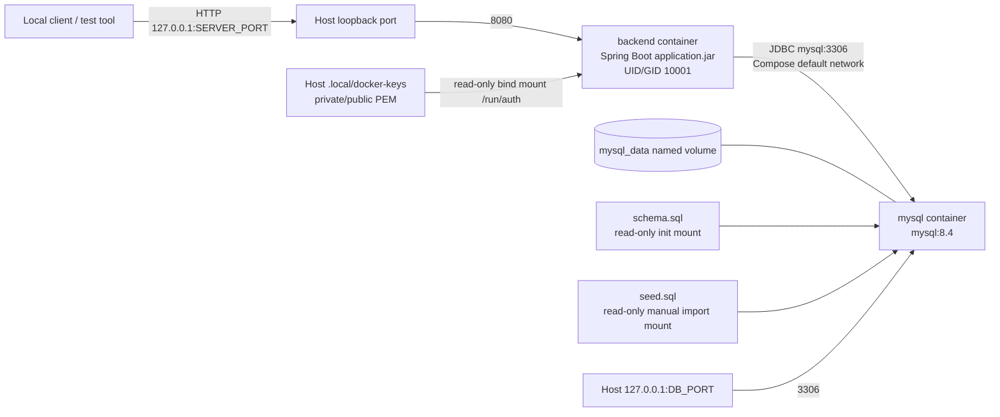

## 7. Docker & Configuration Assessment

Phạm vi phần này là khảo sát tĩnh quy trình build, container, cấu hình, vận hành và môi trường benchmark. Không build JAR/image, không chạy container/notebook và không đọc nội dung secret; vì vậy mọi hành vi runtime chưa có bằng chứng được giữ ở trạng thái **PENDING**.

### 7.1. Build & Packaging Overview

| Hạng mục | Kết quả khảo sát | Trạng thái và bằng chứng |
|---|---|---|
| Toolchain | Maven Wrapper khai báo Wrapper `3.3.4`, Maven `3.9.11`; POM dùng Java 21 và Spring Boot parent `3.5.16`. Dependency của Spring được quản lý qua parent BOM; springdoc, JJWT và ArchUnit có version tường minh. | **CONFIRMED** — `.mvn/wrapper/maven-wrapper.properties:1-4`; `pom.xml:5-20,21-98`. Wrapper JAR đang có SHA-256 `4E2FBF…5E4E1`, nhưng properties không khai báo checksum distribution. |
| Artifact | Maven tạo executable Spring Boot JAR tên `target/application.jar`; Lombok chỉ là annotation processor/optional dependency và bị loại khỏi repackaged artifact. Không có multi-module hoặc Maven build profile. | **CONFIRMED** — `pom.xml:100-129`; không có `<profiles>` trong POM. Nội dung/manifest của JAR là **PENDING** vì không build/inspect artifact. |
| Local path | README chạy ứng dụng bằng `mvnw spring-boot:run`, với MySQL từ Compose và DB/key configuration từ environment/default local path. | **CONFIRMED** — `README.md:54-70,86-99`; `application.yml:6-11,24-33`. |
| Docker path | Build stage gọi `./mvnw ... -Dmaven.test.skip=true package`; cờ này bỏ cả compile lẫn execution test. | **CONFIRMED** — `Dockerfile:1-7`. Đây không chứng minh source build được hoặc test pass. |
| Kaggle artifact path | Hướng dẫn gọi `./mvnw -DskipTests package`, rồi copy thủ công JAR/schema/seed vào dataset; `-DskipTests` không chạy test nhưng khác `maven.test.skip` ở Docker. | **CONFIRMED** — `kaggle/script/README.md:21-33`. Không có gate tự động bảo đảm ba file cùng commit. |
| CI/CD | Không tìm thấy GitHub Actions, GitLab CI, Azure Pipelines, CircleCI hoặc Jenkinsfile trong inventory repository. | **CONFIRMED** ở trạng thái repository hiện tại — build/test/package/publish chưa có pipeline được khai báo. Một pipeline ngoài repository là **PENDING**. |

Chuỗi build chưa bit-for-bit reproducible: Maven và Java major được khóa, nhưng Maven distribution chưa có checksum khai báo, dependency download cần network, base image không pin digest, và không có artifact manifest/checksum được sinh tự động. Docker và Kaggle đều cố ý bỏ chạy test; lệnh test riêng có trong `README.md:181-197` nhưng không gắn vào hai đường đóng gói này.

### 7.2. Dockerfile Assessment

- **CONFIRMED — stages:** multi-stage build dùng `eclipse-temurin:21-jdk` để compile và `eclipse-temurin:21-jre` để chạy; runtime chỉ nhận `application.jar`, không mang source/Maven (`Dockerfile:1-14`). Cách tách này giảm bề mặt và kích thước tương đối so với chạy bằng JDK, nhưng kích thước thực tế là **PENDING**.
- **CONFIRMED — identity/filesystem:** JAR được copy với owner `10001:10001`, tiến trình chạy non-root cùng UID/GID, workdir `/app` (`Dockerfile:9-12`). Image không tạo writable data directory và ứng dụng không khai báo nhu cầu ghi file trong container.
- **CONFIRMED — context:** `.dockerignore` loại Git metadata, IDE files, `target`, `.env*`, `.local`, virtualenv và log (`.dockerignore:1-9`); vì vậy local credentials/key không được gửi vào build context. Dockerfile chỉ `COPY` wrapper/POM và `src` (`Dockerfile:3-6`).
- **CONFIRMED — cache/build speed risk:** source được copy trước duy nhất một lệnh `mvn package`; không có layer `dependency:go-offline` hoặc BuildKit Maven cache mount. Mỗi thay đổi source làm invalid package layer và có thể tải lại dependencies. Đây là build-time concern, không phải runtime defect.
- **CONFIRMED — image provenance gap:** cả hai Temurin tags chỉ khóa Java major, không khóa patch/digest (`Dockerfile:1,9`). Không kết luận image có lỗ hổng khi chưa resolve digest/SBOM/vulnerability scan.
- **CONFIRMED — process contract:** image expose 8080 và có fixed exec-form entrypoint `java -jar`; không khai báo `JAVA_OPTS`, heap/GC flags, healthcheck, stop signal, init, labels hoặc graceful-shutdown setting (`Dockerfile:13-14`). JVM vẫn có thể nhận standard environment như `JAVA_TOOL_OPTIONS`, nhưng repository không định nghĩa giá trị nào.

### 7.3. Docker Compose Assessment

| Concern | As-Is | Đánh giá tĩnh |
|---|---|---|
| Services/image | Một `backend` build local và một `mysql:8.4`. | **CONFIRMED** — `compose.yaml:1-3,21-23`. MySQL pin dòng 8.4 nhưng không pin patch/digest; backend không có image tag/provenance. |
| Network/exposure | Không khai báo network riêng nên Compose dùng default project network; backend kết nối hostname `mysql`. Cả MySQL và backend chỉ publish lên `127.0.0.1`. | **CONFIRMED** — `compose.yaml:9-10,24-31`. Loopback phù hợp local; không có topology production/reverse proxy. |
| Persistence/init | MySQL dùng named volume; schema mount vào init directory read-only, seed mount riêng và README yêu cầu import thủ công. | **CONFIRMED** — `compose.yaml:11-14,37-38`; `README.md:74-84`. Init script chỉ áp dụng khi data directory mới; volume cũ không tự nâng cấp/reset. Liên hệ **DB-02/DB-08**. |
| Readiness/order | MySQL có SQL healthcheck; backend chỉ start sau `service_healthy`. | **CONFIRMED** — `compose.yaml:15-20,34-36`. Backend không có healthcheck/readiness; `depends_on` chỉ điều phối startup ban đầu, không chứng minh recovery khi DB mất sau đó. |
| Secret/key mount | DB credential đi qua environment; RSA key directory host được bind vào `/run/auth` read-only. | **CONFIRMED** — `compose.yaml:4-8,24-33`. Không dùng secret abstraction; xem 7.5. |
| Recovery/operations | Không có restart policy, resource limit/reservation, log rotation/driver, replica, profile hoặc explicit shutdown policy. | **CONFIRMED** — toàn bộ `compose.yaml:1-38`. Exact Docker-engine defaults/runtime behavior là **PENDING**. |

Topology có một instance cho mỗi service; backend và MySQL đều là single point of failure. Điều này đơn giản và phù hợp phạm vi monolith/local Pha 1, nhưng không tạo high availability. Không có bằng chứng để kết luận thời gian phục hồi hoặc khả năng chịu lỗi.

### 7.4. Application Configuration

| Nhóm cấu hình | Khai báo hiện có | Mục dựa vào default/chưa khóa |
|---|---|---|
| Database/JPA | DB URL/user/password bắt buộc từ environment; mỗi connection đặt UTC; `open-in-view=false`, `ddl-auto=none`, Hibernate JDBC timezone UTC. | **CONFIRMED** — `application.yml:6-11,18-23`. Không khai báo Hikari size, connection/acquisition/idle/lifetime timeout hoặc leak detection. |
| Security/JWT | Key paths có default local; token TTL và login limits/window có default/override environment. | **CONFIRMED** — `application.yml:24-31`. Rotation/production secret source không có; liên hệ Phần 6. |
| HTTP/API | Port mặc định 8080; Swagger UI đọc static `/openapi.yaml`. | **CONFIRMED** — `application.yml:32-38`. Không khai báo TLS, compression, forwarded headers, connector/thread limits, request timeout hoặc graceful shutdown. |
| JSON correctness | Reject numeric enum và float-to-int coercion. | **CONFIRMED** — `application.yml:12-17`; đây là behavior contract, không phải tuning. |
| Logging/management | Có Actuator dependency nhưng không có application logging/management exposure/detail configuration. | **CONFIRMED** — `pom.xml:38-41`; không có `logging:`/`management:` trong `application.yml`. Exact framework defaults/response runtime là **PENDING**. |
| Profiles | Không có Maven profile; resource có `application.yml` và `application-test.yml`, trong đó test chỉ tắt SQL logging và ghi rằng connection do Testcontainers cấp. Không có file profile local/docker/benchmark. | **CONFIRMED** — `src/main/resources/application-test.yml:1-4`; resource inventory. Local, Compose và Kaggle phân biệt bằng environment/manual procedure. |

Config drift có ảnh hưởng trực tiếp đến thí nghiệm: Compose dùng Hikari/Tomcat/JVM defaults, trong khi notebook override Hikari max pool 50, Tomcat max threads 200 và heap 2–6 GiB (`kaggle/script/byteme_kaggle_benchmark.ipynb`, cell 1:35-56). Những giá trị default còn lại phụ thuộc exact Spring Boot/Tomcat/Hikari/JVM runtime và phải được ghi nhận thay vì suy đoán.

### 7.5. Secrets & Environment

- **CONFIRMED:** `.env.example` được đánh dấu development-only và chỉ liệt kê DB/port variables; `.gitignore` loại `.env*` trừ example và toàn bộ `.local` (`.env.example:1-9`; `.gitignore:8-17`). Không ghi giá trị credential vào phần đánh giá này.
- **CONFIRMED:** script sinh RSA 2048-bit, không overwrite cặp hiện hữu, đặt private key mode `0600`; script chuẩn bị Docker copy atomically sang `.local/docker-keys`, private `0600`, public `0644` (`scripts/generate-keys.py:7-22`; `scripts/prepare-docker-keys.py:6-28`). Compose mount thư mục read-only và image chạy non-root (`compose.yaml:28-33`; `Dockerfile:11-12`).
- **POTENTIAL ISSUE:** trên Linux bind mount giữ owner/mode host, private key `0600` do user host sở hữu có thể không đọc được bởi container UID `10001`. Docker Desktop/ACL có thể khác; cần smoke test quyền trên target OS trước khi kết luận lỗi (`prepare-docker-keys.py:17-26`; `Dockerfile:11-12`; `compose.yaml:32-33`).
- **POTENTIAL ISSUE — SEC2-07:** Compose có development defaults và seed có sample accounts. Nếu target ngoài local không override/remove chúng, credential trở nên dự đoán được; repository không có production profile/secret abstraction (`.env.example:1-9`; `compose.yaml:4-8`; `seed.sql:1-17`).
- **POTENTIAL ISSUE — SEC2-06:** deployment repository chỉ có HTTP/loopback, không có TLS termination hoặc reverse-proxy/forwarded-header contract (`Dockerfile:13`; `compose.yaml:30-31`). Đây là condition của deployment ngoài trusted host, không phải bằng chứng traffic hiện đang bị expose.

### 7.6. Runtime & Resource Settings

| Setting | Local/Compose | Kaggle | Kết luận |
|---|---|---|---|
| JVM heap/GC | Không khai báo heap hoặc GC flags. | `-Xms2g -Xmx6g`; không có GC flag. | **CONFIRMED configuration**; actual heap/GC/container ergonomics **PENDING** (`Dockerfile:14`; notebook cell 1:51-56). |
| HTTP threads | Không khai báo. | Tomcat max threads 200 qua environment. | **CONFIRMED drift** — notebook cell 1:37-49. Other connector values/defaults **PENDING**. |
| DB pool | Chỉ connection init timezone. | Hikari maximum pool 50. | **CONFIRMED drift** — `application.yml:10-11`; notebook cell 1:37-49. Min/timeout/lifetime defaults chưa khóa ở cả hai. |
| CPU/RAM | Compose không có limit/reservation. | README mô tả CPU session 4 vCPU/30 GB; app heap cap 6 GiB. | **CONFIRMED declaration**, actual host/cgroup/CPU model/runtime **PENDING** (`kaggle/script/README.md:41-46`). |
| Readiness/timeouts | Compose chỉ healthcheck MySQL; app không có healthcheck. | Poll `/actuator/health` mỗi 5 giây, request timeout 2 giây, tối đa 600 giây; gọi `/api/foods` sau readiness. | **CONFIRMED** — `compose.yaml:15-20`; notebook cell 2:1-30. Health `UP` không thay thế warm-up protocol. |
| Shutdown/recovery | Không có graceful shutdown, restart hoặc retry policy tường minh. | Notebook không có cell dừng backend/MySQL hoặc cleanup process. | **CONFIRMED absence in reviewed config/notebook**; actual signal/recovery behavior **PENDING**. |

Các biến số chưa khóa — JVM patch/ergonomics, CPU scheduling, MySQL server settings, Hikari/Tomcat defaults, warm-up và background load — có thể gây nhiễu đáng kể cho before/after benchmark. Không thể suy ra capacity hoặc reliability chỉ từ các khai báo này.

### 7.7. Deployment & Operational Assessment

Quy trình local được mô tả là tạo key → copy key Docker → `docker compose up --build -d` → import seed thủ công; đường host JVM chỉ start MySQL rồi chạy Maven (`README.md:54-99`). README không mô tả stop/reset/backup/upgrade/rollback. Một clean deployment còn phụ thuộc Python + `cryptography==50.0.2`, network để tải Maven/image/dependency, Docker Compose, key directory, database volume rỗng và bước seed đúng thứ tự.

- **CONFIRMED:** MySQL readiness được gate trước backend startup; schema được init trên volume mới. Không có backend healthcheck, restart policy hay automation phục hồi nếu backend/MySQL exit sau startup (`compose.yaml:11-20,34-38`).
- **CONFIRMED:** application logs mặc định đi stdout/stderr của container; repository không khai báo structured logging, log persistence/rotation hoặc resource monitoring. Kaggle redirect server log vào file, còn Compose không có tương đương (`application.yml`; `compose.yaml`; notebook cell 1:51-56).
- **PENDING:** hành vi khi DB unavailable lúc start/sau start, thời gian stop, transaction recovery, disk-full, OOM và restart chưa được fault/smoke test.
- **POTENTIAL ISSUE:** named volume làm deployment lặp lại không đồng nghĩa clean deployment; schema change không được migration và seed không idempotent. Đây là cùng nguyên nhân với **DB-02/DB-08**, không phải finding database mới.

### 7.8. Kaggle Environment Assessment

Notebook hiện có sáu cell: tìm dataset/cài toolchain/DB/key/start app, chờ readiness, sinh và chạy k6, vẽ biểu đồ, tính percentile. Repository notebook không lưu execution output (`execution_count` rỗng, `outputs=[]`), nên chỉ chứng minh procedure, không chứng minh một run thành công.

| Aspect | Bằng chứng và đánh giá |
|---|---|
| Tool installation | **CONFIRMED:** `apt-get` cài generic `openjdk-21-jdk`, `mysql-server`; k6 lấy từ `stable` apt repository, không pin version/package snapshot và không in version/OS manifest (notebook cell 1:11-25). Internet bắt buộc (`kaggle/script/README.md:41-46`). GPG key retrieval được cho phép fail (`\|\| true`), nhưng install thành công/thất bại là **PENDING**. |
| Dataset/provenance | **CONFIRMED:** notebook chọn match `application.jar` đầu tiên dưới `/kaggle/input/**`; schema/seed được lấy từ cùng directory, nhưng upload ba file là thao tác thủ công, không có checksum/manifest validation (notebook cell 1:4-9,21-25; `kaggle/script/README.md:21-38`). Nhiều match có thể chọn input không chủ ý theo thứ tự glob — **POTENTIAL ISSUE**. |
| Database reset | **CONFIRMED:** dùng `CREATE DATABASE/USER IF NOT EXISTS`, sau đó chạy schema và seed; không drop/reset trước run (notebook cell 1:21-26). Schema/seed không idempotent, nên rerun cùng session không bảo đảm trạng thái sạch; liên hệ **DB-08/DB-10**. |
| Runtime/readiness | **CONFIRMED:** RSA key được tạo mỗi session; rate-limit nâng cao; Hikari 50, Tomcat 200; JVM heap 2–6 GiB; health poll tối đa 600 giây rồi kiểm tra menu (notebook cells 1–2). Không có warm-up traffic/steady-state criterion riêng. |
| Workload | **CONFIRMED:** k6 stages `50 → 200 → 500 → 0` trong 3 phút, think time 0,1 giây; mỗi iteration gọi menu, search, cart và token endpoint; threshold p95 < 500 ms, p99 < 1200 ms, error < 1% (notebook cell 3:1-63). Script được sinh động từ notebook nên notebook revision là workload source of truth. |
| Outputs/observability | **CONFIRMED:** notebook tạo `server.log`, raw `k6_results.csv` và PNG; chỉ tính request latency/throughput percentile, không thu CPU/RAM/GC/MySQL/query/pool metrics (notebook cells 1,3–5). Baseline repository hiện chỉ có README, PNG và summary; README nói `server.log` nhưng file không tồn tại và raw CSV không lưu (`kaggle/results/phase1-baseline/README.md:39-44`). |
| Existing baseline | **PENDING provenance:** report ghi run 2026-10-26, notebook v3/dataset v2, 4 vCPU/30 GB, JVM/pool/thread/workload; nhưng JAR được gắn với `ed8be73`, object không resolve trong clone và khác current HEAD `510f641…` (Phần 0: Mục 4). Vì thiếu raw data/log/checksum/tool versions, không thể tái tính độc lập hoặc dùng ngay làm comparison gate. |

Kaggle CPU là hướng phù hợp yêu cầu cùng phần cứng, nhưng nhãn “4 vCPU/30 GB” chưa khóa CPU model, OS image, apt snapshot, noisy-neighbor và exact toolchain. Pha này chỉ ghi điều kiện; chưa chốt benchmark protocol hoặc chọn cải tiến.

### 7.9. Reproducibility Assessment

| Điều kiện cần khóa | Hiện trạng | Trạng thái/việc cần xác minh trước benchmark chính thức |
|---|---|---|
| Source SHA/working tree | Current HEAD biết rõ; baseline cũ trỏ SHA không resolve. | **PENDING** — chọn baseline có full SHA/tag và clean-state evidence; không gộp tài liệu untracked vào source artifact ngoài ý muốn. |
| Java/Maven | Java major 21; Maven 3.9.11/Wrapper 3.3.4. | **PENDING exactness** — lưu `java -version`, Maven output, wrapper/distribution checksum. |
| Base image/MySQL/k6 | Docker tags không có digest; Kaggle packages không pin. | **PENDING** — lưu digest/package version/repository snapshot và MySQL server variables cần thiết. |
| JAR/schema/seed | Manual copy/upload, không manifest. | **PENDING** — SHA-256 của cả ba và source commit; validate trước start. |
| Environment/JVM | Variables nằm rải ở Compose/notebook; Compose không có JVM flags, Kaggle có heap/pool/thread overrides. | **PENDING** — manifest tên biến + giá trị không nhạy cảm/hash secret reference; khóa flags/defaults có ảnh hưởng. |
| Dataset/workload | Schema/seed/notebook versioned trong Git, Kaggle dataset upload riêng; generated k6 JS không lưu cùng baseline. | **PENDING** — khóa notebook/workload checksum, dataset version/cardinality và token/account setup. |
| Hardware/OS | Baseline ghi 4 vCPU/30 GB, không có CPU model/OS/Kaggle image evidence. | **PENDING** — capture system/runtime metadata cho từng run. |
| Startup/warm-up/reset | Có readiness poll; không có warm-up riêng, clean reset hoặc repeated-run procedure. | **PENDING** — nhóm quyết định procedure giống nhau cho before/after và số lần lặp. |
| Output retention | Có summary/PNG; thiếu raw CSV/server log/resource metrics/notebook output. | **PENDING** — giữ raw result, app/DB/resource logs và machine-readable manifest. |

Điều kiện so sánh công bằng kế thừa Phần 0: cùng hardware class, source/artifact provenance, data state, workload, tool versions, JVM/pool/thread/DB settings, startup/warm-up/reset và output retention. Thay đổi duy nhất giữa before/after phải được liệt kê rõ; nếu một config tuning là phần cải tiến thì phải coi chính nó là treatment, không âm thầm thay cùng lúc với code.

### 7.10. Deployment Architecture Diagram

Sơ đồ mô tả đúng topology Compose hiện hữu: không có reverse proxy, TLS terminator, load balancer, Redis, queue hay service application thứ ba.

### 7.11. Docker & Configuration Findings

| ID | Trạng thái | Impact sơ bộ | Finding / quality attribute | Bằng chứng | Điều kiện kiểm chứng |
|---|---|---|---|---|---|
| DEP-01 | **CONFIRMED** | Medium | Temurin JDK/JRE và MySQL chỉ pin tag, không pin digest; exact patch/supply-chain input có thể đổi giữa build. **Reproducibility, security.** | `Dockerfile:1,9`; `compose.yaml:3`. | Resolve/lưu digest, exact version, SBOM/authorized scan; không suy luận CVE từ tag. |
| DEP-02 | **CONFIRMED** | Medium–High | Docker bỏ compile/run test; Kaggle không chạy test; không có CI workflow trong repo. Artifact có thể được đóng gói mà không qua verification gate. **Reliability, deployability.** | `Dockerfile:7`; `kaggle/script/README.md:24-27`; CI inventory; `README.md:181-197`. | Chạy pipeline/test phù hợp ở hạng mục 8 và lưu kết quả đúng SHA; không tuyên bố test đang fail/pass. |
| DEP-03 | **CONFIRMED** | High cho so sánh hiệu năng | Compose và Kaggle lệch heap, Hikari pool và Tomcat threads; nhiều runtime defaults không khóa, có thể gây confounder. **Performance, reproducibility.** | `application.yml:10-11,32-33`; `Dockerfile:14`; notebook cell 1:35-56. | Capture resolved config/JVM flags và giữ cố định, hoặc khai báo tuning nào là treatment. |
| DEP-04 | **CONFIRMED** | Medium | Compose thiếu backend healthcheck, restart/resource/log policy; MySQL health chỉ gate startup. **Reliability, operability.** | `compose.yaml:15-38`. | Smoke/failure-recovery, shutdown/OOM/disk/log-retention tests trên target runtime. |
| DEP-05 | **CONFIRMED**, liên hệ DB-02/DB-08 | High cho clean deployment | Schema chỉ init volume mới, seed thủ công/non-idempotent, không có migration/reset automation. **Deployability, reproducibility.** | `compose.yaml:11-14`; `README.md:79-84`; `schema.sql:1-2`; `seed.sql:1-5`. | Thực hiện clean/repeat/upgrade rehearsal có backup; chốt reset procedure trước benchmark. |
| DEP-06 | **POTENTIAL ISSUE** | Medium, phụ thuộc OS | Private key host mode `0600` có thể không đọc được bởi container UID 10001 qua Linux bind mount. **Deployability, security.** | `prepare-docker-keys.py:17-26`; `Dockerfile:11-12`; `compose.yaml:32-33`. | Kiểm tra owner/ACL/readability trên Linux và Docker Desktop mà không in key. |
| DEP-07 | **POTENTIAL ISSUE**, liên hệ SEC2-07 | High nếu misdeploy | Development DB defaults/sample accounts và env-based secret injection chưa có production override/seed-removal policy. **Security, deployability.** | `.env.example:1-9`; `compose.yaml:4-8`; `seed.sql:1-17`. | Xác nhận target profile, secret source, fail-closed overrides và dữ liệu được nạp. |
| DEP-08 | **POTENTIAL ISSUE**, liên hệ SEC2-06 | High nếu expose mạng | Repo không có TLS/reverse proxy/forwarded-header contract; Compose chỉ chứng minh local loopback HTTP. **Security, deployability.** | `Dockerfile:13`; `compose.yaml:30-31`. | Xác minh topology target, TLS termination, trusted proxy, redirects/HSTS/headers runtime. |
| DEP-09 | **CONFIRMED** | High cho baseline | Kaggle cài JDK/MySQL/k6 từ moving apt repositories mà không pin/in version manifest. **Reproducibility.** | Notebook cell 1:11-25; `kaggle/script/README.md:43-45`. | Lưu exact versions, OS/package sources và notebook output mỗi run. |
| DEP-10 | **CONFIRMED** | High cho provenance | JAR/schema/seed được copy/upload thủ công, không có checksum/manifest validation; glob chọn match JAR đầu tiên. **Reproducibility, reliability.** | `kaggle/script/README.md:21-38`; notebook cell 1:4-9. | Manifest full SHA + three checksums; fail nếu thiếu/multiple/unmatched artifact. |
| DEP-11 | **CONFIRMED**, gap từ Phần 0 | High cho before/after | Baseline report trỏ commit không resolve, thiếu raw CSV và `server.log` dù README liệt kê log; không có resource metrics. **Reproducibility, performance assurance.** | `kaggle/results/phase1-baseline/README.md:3-12,39-44`; folder inventory; Phần 0 Mục 4. | Khôi phục provenance/artifact cũ hoặc rerun baseline đã khóa; chưa chọn phương án trong assessment. |
| DEP-12 | **POTENTIAL ISSUE**, liên hệ DB-08/DB-10 | High cho repeated run | Notebook không reset DB và chạy non-idempotent schema/seed; rerun cùng session có thể không bắt đầu cùng state. **Reliability, reproducibility.** | Notebook cell 1:21-26; `schema.sql:1-2`; `seed.sql:1-5`. | Chạy clean/repeat verification và so sánh checksum/cardinality trước workload. |
| DEP-13 | **CONFIRMED** | Low–Medium | Docker build không có dependency-cache layer/cache mount; source change có thể kéo lại dependencies, làm build chậm và phụ thuộc network. **Build performance, deployability.** | `Dockerfile:3-7`. | Đo cold/warm build sau này nếu build speed là requirement; không phải runtime benchmark finding. |
| DEP-14 | **PENDING** | Unknown | Exact runtime defaults, image sizes/digests, MySQL variables, JVM/container ergonomics, startup/failure recovery và capacity chưa được quan sát. **Performance, reliability, security.** | Giới hạn static assessment; config không khai báo các giá trị này. | Inspect resolved manifests/runtime metrics bằng thao tác read-only/controlled ở giai đoạn phù hợp. |

Không finding nào ở trên tự động yêu cầu Kubernetes, microservices, Redis hay cloud service. DEP-03/09/10/11/12 cùng ảnh hưởng benchmark nhưng khác nguyên nhân: config drift, toolchain drift, artifact provenance, evidence retention và database reset.

### 7.12. Conclusions & Pending Questions

#### Kết luận

- **CONFIRMED:** hệ thống đóng gói thành một Spring Boot `application.jar`; Docker dùng JDK→JRE multi-stage, runtime non-root; Compose triển khai một backend và một MySQL trên default network với loopback host ports.
- **CONFIRMED:** MySQL có startup health gate và persistent volume, key được bind read-only; nhưng backend health/restart/resource/logging, clean schema evolution/reset và production TLS/secret profile không được định nghĩa.
- **CONFIRMED:** local/Compose/Kaggle có drift đáng kể ở test-skipping flags, JVM heap, pool/thread và toolchain; notebook benchmark có workload rõ nhưng package versions, artifact checksum, reset/warm-up và resource telemetry chưa đủ khóa.
- **PENDING:** không tuyên bố Docker image/JAR build được, service khởi động được, key readable, tests pass, baseline tái lập được, recovery hoạt động hoặc image không có vulnerability vì chưa có runtime/build/scan evidence.
- **POTENTIAL ISSUE:** quyền bind-mounted private key trên Linux, dev credentials/sample data, no-TLS target, Kaggle first-glob artifact selection và non-clean rerun cần kiểm chứng theo môi trường.

#### Câu hỏi/điểm cần nhóm xác nhận

1. Baseline chính thức sẽ khôi phục run `ed8be73` hay rerun từ một full SHA hiện có; tag/manifest nào là nguồn chân lý?
2. Before/after sẽ khóa exact Kaggle image/tool versions bằng cách nào, và metadata CPU/OS nào phải lưu?
3. Heap, GC, Hikari, Tomcat/MySQL settings nào là control cố định; config nào được phép là treatment của Pha 2?
4. Quy trình clean reset, seed, readiness, warm-up, số lần lặp và thứ tự run là gì?
5. Artifact set bắt buộc có JAR/schema/seed/notebook/workload checksums, raw CSV, server/DB/resource logs và notebook output hay không; lưu ở đâu?
6. Target deployment chỉ là local/Kaggle hay có môi trường ngoài trusted host cần TLS/proxy, secret injection, restart và log-retention policy?
7. UID/ACL strategy nào bảo đảm container non-root đọc private key trên target OS mà không nới quyền không cần thiết?
8. Có pipeline ngoài repository không; nếu không, verification gate nào sẽ tạo artifact dùng cho benchmark?
9. MySQL named volume cần giữ dữ liệu qua version hay mỗi run phải disposable; ai sở hữu backup/migration/reset procedure?

**Readiness:** đủ thông tin tĩnh để chuyển sang **Hạng mục 8 – Testing Assessment**: build paths, test-skipping behavior, runtime profiles, deployment topology và các gap tái lập đã được định vị. Tuy nhiên dự án **chưa sẵn sàng dùng baseline hiện tại cho kết luận before/after** cho tới khi provenance, version/config lock, clean reset/warm-up và artifact retention được xử lý. Chưa lựa chọn giải pháp kiến trúc/cải tiến Pha 2.

